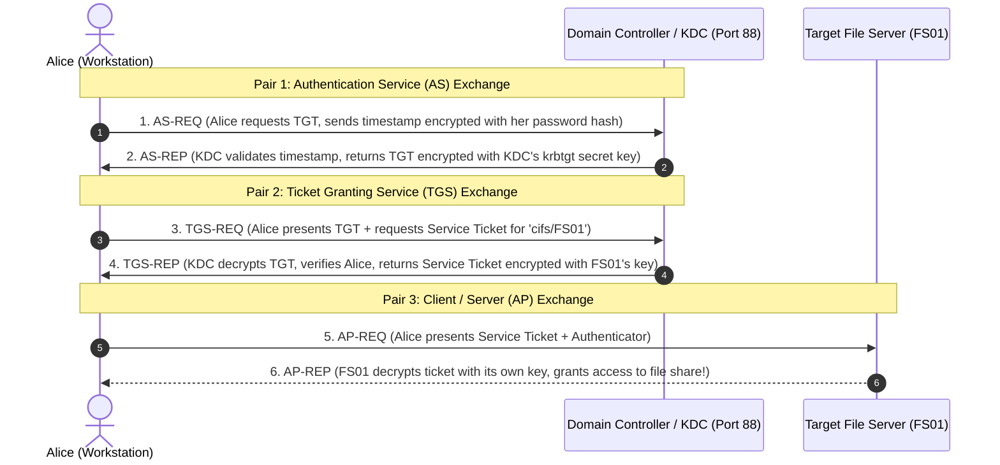

# 02. Kerberos Authentication

[⬅️ Prev: Active Directory & LDAP](./01_Active_Directory_and_LDAP.md) | [Back to Protocols](./README.md) | [Next: SAML 2.0 Deep Dive ➡️](./03_SAML_2.0_Deep_Dive.md)

---

### 🎓 Beginner's Compass: Decoded Acronyms & Terms
- **Kerberos**: The primary network authentication protocol used by Microsoft Windows domains. It is named after Cerberus, the mythical three-headed hound that guarded the gates of the underworld.
- **KDC (Key Distribution Center)**: The trusted central service running on every Domain Controller that issues Kerberos tickets (Port 88).
- **AS (Authentication Service)**: The first component of the KDC that verifies your password and hands you a master ticket.
- **TGT (Ticket Granting Ticket)**: The "Golden Wristband" you receive after logging in. It proves you are authenticated so you don't have to keep retyping your password.
- **TGS (Ticket Granting Service)**: The second component of the KDC that takes your TGT and trades it for a specific service ticket.
- **Service Ticket (ST)**: A single-use ticket that grants you access to a specific target server (e.g., a file share or SQL database).
- **SPN (Service Principal Name)**: The unique identifier assigned to a service running on a server (e.g., `MSSQLSvc/db01.contoso.com:1433`).
- **Kerberoasting**: A popular cyberattack where hackers request service tickets and crack the service account's password offline on their own computers.

---

### 1. Plain-English Walkthrough: The Amusement Park Analogy

Why does Kerberos exist? **To ensure passwords are never transmitted across the network.**

#### The Amusement Park Ticket Booth
Imagine spending a day at Disneyland:
1. **The Entrance Ticket Booth (AS - Authentication Service)**:
   - You walk up to the main gate ticket booth and show your driver's license (enter your username and password).
   - The ticket agent stamps your hand and gives you a golden wristband (**TGT - Ticket Granting Ticket**).
   - You now put your driver's license back in your pocket. You will **never take it out again all day**.
2. **The Ride Ticket Kiosk (TGS - Ticket Granting Service)**:
   - You want to ride the Space Mountain roller coaster.
   - You show your golden wristband (TGT) to the internal ride kiosk.
   - The kiosk checks your wristband and prints out a single Space Mountain ride pass (**Service Ticket**).
3. **The Roller Coaster Entrance (Target Server)**:
   - You hand the Space Mountain ride pass to the ride attendant at the door.
   - The attendant verifies the stamp on the pass and lets you onto the ride.
   - You never gave your password to the roller coaster operator!

---

### 2. The 6-Step Kerberos Exchange (The Technical Flow)

All Kerberos communication takes place over **Port 88 (TCP/UDP)** in exactly 3 pairs of requests:

---

### 3. Kerberos Security Pitfalls: What is Kerberoasting?

Beginners in SOC and IAM hear the term **Kerberoasting** constantly. Here is how it works in plain English:
1. Any authenticated user in the domain (even a temp contractor) is allowed to ask the KDC for a Service Ticket for any registered SPN (e.g., `MSSQLSvc/db01`).
2. The KDC generates the ticket and encrypts it with the **password hash of the service account** that runs that database.
3. The attacker copies that ticket file onto a USB drive, takes it home, and runs high-powered password-cracking software (like Hashcat).
4. If the service account had a weak password like `Summer2025!`, the attacker cracks it in 15 seconds!

#### How IAM & SOC Engineers Prevent Kerberoasting:
- **Group Managed Service Accounts (gMSA)**: Migrate services to gMSAs where Windows automatically generates 128-character complex passwords and rotates them every 30 days.
- **Complex Passwords**: If a standard service account is unavoidable, enforce a minimum 30-character random passphrase.
- **SOC Detection**: Monitor Event ID **4769** ("A Kerberos service ticket was requested") with RC4 encryption type (`0x17`), which indicates ticket harvesting.

---

### 4. Common Beginner Mistakes vs. Best Practices

| Common Beginner Mistake | Real-World Risk | Industry Best Practice |
| :--- | :--- | :--- |
| **Clock Skew Ignorance** | Kerberos tickets contain timestamps to prevent replay attacks. If computer clocks differ by >5 minutes, authentication fails globally. | Synchronize all workstations and Domain Controllers to a reliable corporate NTP time source. |
| **Weak krbtgt Password Rotation** | If an attacker steals the `krbtgt` account hash, they can forge "Golden Tickets" and maintain permanent domain god-mode. | Rotate the `krbtgt` account password twice annually using Microsoft's automated rotation script. |
| **Using RC4 Encryption** | Legacy Kerberos allowed weak RC4 encryption that can be cracked in minutes. | Disable DES and RC4; mandate **AES-128 and AES-256** Kerberos encryption across the entire domain. |

---

### 5. Recommended Next Steps
Kerberos was designed for local office networks. How do we log into cloud SaaS tools like Salesforce, Zoom, and AWS in a web browser?
- [03. SAML 2.0 Deep Dive ➡️](./03_SAML_2.0_Deep_Dive.md)
