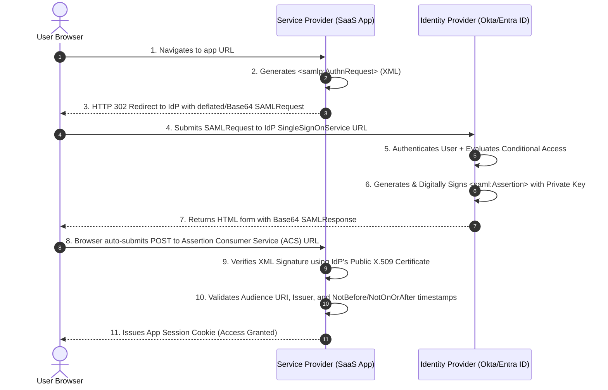

# 03. SAML 2.0 (Security Assertion Markup Language) Deep Dive

[⬅️ Prev: Kerberos Authentication](./02_Kerberos_Authentication.md) | [Back to Technologies](./README.md) | [Next: OAuth 2.0 and OIDC ➡️](./04_OAuth_2.0_and_OpenID_Connect_OIDC.md)

---

### 1. Definition and Purpose

**SAML 2.0 (Security Assertion Markup Language)** is an XML-based open standard developed by OASIS for exchanging authentication and authorization data between security domains.

It is the enterprise standard for browser-based **Single Sign-On (SSO)** into SaaS applications such as Salesforce, ServiceNow, Workday, and the AWS Management Console.

---

### 2. SP-Initiated vs IdP-Initiated SSO Flow

There are two primary SAML SSO flows:
- **SP-Initiated (Recommended)**: The user starts at the application (e.g., navigates to `https://company.slack.com`). The app redirects them to their corporate IdP for authentication.
- **IdP-Initiated (Discouraged)**: The user logs into an IdP portal (e.g., `myapps.microsoft.com`) and clicks an application chiclet. The IdP pushes an unsolicited assertion directly to the app. (Vulnerable to stolen token reuse / CSRF attacks).



---

### 3. Anatomical Breakdown of a SAML Assertion

A raw SAML Assertion contains three critical elements:

```xml
<saml:Assertion xmlns:saml="urn:oasis:names:tc:SAML:2.0:assertion" ID="_a74b..." IssueInstant="2026-11-20T06:00:00Z" Version="2.0">
  <!-- 1. ISSUER: Identity of the IdP -->
  <saml:Issuer>https://sts.windows.net/tenant-id-guid/</saml:Issuer>
  
  <!-- 2. SUBJECT: Who is being authenticated -->
  <saml:Subject>
    <saml:NameID Format="urn:oasis:names:tc:SAML:1.1:nameid-format:emailAddress">alice.smith@contoso.com</saml:NameID>
    <saml:SubjectConfirmation Method="urn:oasis:names:tc:SAML:2.0:cm:bearer">
      <saml:SubjectConfirmationData NotOnOrAfter="2026-11-20T06:10:00Z" Recipient="https://company.slack.com/sso/saml"/>
    </saml:SubjectConfirmation>
  </saml:Subject>

  <!-- 3. CONDITIONS: Time validity window and authorized audience -->
  <saml:Conditions NotBefore="2026-11-20T05:55:00Z" NotOnOrAfter="2026-11-20T06:10:00Z">
    <saml:AudienceRestriction>
      <saml:Audience>https://company.slack.com</saml:Audience>
    </saml:AudienceRestriction>
  </saml:Conditions>

  <!-- 4. ATTRIBUTES: Entitlements and profile claims -->
  <saml:AttributeStatement>
    <saml:Attribute Name="Department"><saml:AttributeValue>CyberSecurity</saml:AttributeValue></saml:Attribute>
    <saml:Attribute Name="Role"><saml:AttributeValue>SecurityAnalyst</saml:AttributeValue></saml:Attribute>
  </saml:AttributeStatement>

  <!-- 5. SIGNATURE: Cryptographic proof of authenticity -->
  <ds:Signature xmlns:ds="http://www.w3.org/2000/09/xmldsig#">...</ds:Signature>
</saml:Assertion>
```

---

### 4. SAML Troubleshooting and Common Pitfalls

- **X.509 Certificate Expiration**: SAML relies on public/private certificate pairs. When the IdP token-signing certificate expires (typically every 1–3 years), SSO breaks globally for all connected applications until the new public certificate is imported into every SP.
- **Clock Skew Mismatch**: If the SP server time is faster than the IdP server time by more than 5 minutes, assertions fail with `"Assertion is not yet valid"` or `"Assertion has expired"`. Ensure NTP synchronization across all infrastructure.
- **Audience URI Mismatch**: If the SP expects `https://sp.contoso.com` but the IdP sends `https://sp.contoso.com/`, the trailing slash mismatch causes assertion rejection.
