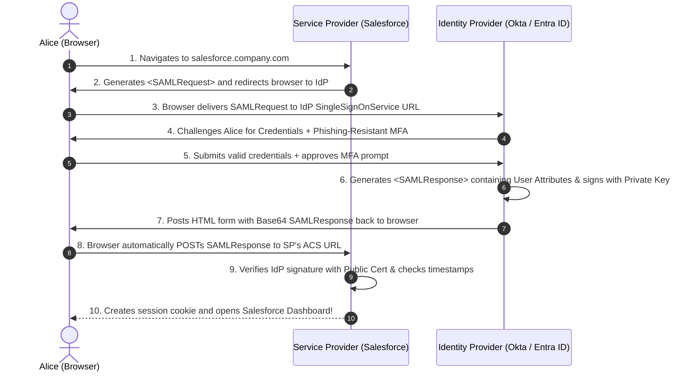

# 03. SAML 2.0 Deep Dive

[⬅️ Prev: Kerberos Authentication](./02_Kerberos_Authentication.md) | [Back to Protocols](./README.md) | [Next: OAuth 2.0 & OIDC ➡️](./04_OAuth_2.0_and_OpenID_Connect_OIDC.md)

---

### 🎓 Beginner's Compass: Decoded Acronyms & Terms
- **SAML (Security Assertion Markup Language)**: The XML-based open standard used by enterprises for cross-domain Single Sign-On (SSO).
- **IdP (Identity Provider)**: The system that authenticates the user and creates the SAML assertion (e.g., Microsoft Entra ID, Okta, Ping Identity).
- **SP (Service Provider)**: The web application the user wants to access (e.g., Salesforce, Zoom, ServiceNow).
- **SAML Assertion**: The digital document containing user information (name, email, roles) cryptographically signed with the IdP's private certificate.
- **ACS URL (Assertion Consumer Service)**: The endpoint URL on the Service Provider that receives and validates the SAML response (e.g., `https://zoom.us/saml/SSO`).
- **Entity ID**: The globally unique URI that identifies the IdP and SP to each other (e.g., `urn:mace:dir:entitlements`).
- **Metadata XML**: A configuration file exchanged between IdP and SP containing public certificates, ACS URLs, and bindings.

---

### 1. Plain-English Walkthrough: The Notarized Passport Analogy

#### Why SAML Exists
When you access Salesforce, Salesforce does not want to store your company password. Your company does not want to give Salesforce your password either!

#### The Notarized Passport Model
Think of traveling internationally:
- You land in France (the **Service Provider / SP**).
- The French border agent does not call your local hometown police department to ask if you are a good citizen.
- Instead, you hand them your government-issued Passport (**SAML Assertion**).
- The passport has a government watermark, an official holographic seal, and an embossed stamp (**Digital Signature**).
- The French agent inspects the watermark. Because France trusts the issuing government (**Identity Provider / IdP**), they stamp your entry visa and let you pass!

---

### 2. The SP-Initiated SAML 2.0 Flow (The Gold Standard)

In 95% of enterprise implementations, logins start at the Service Provider (**SP-Initiated Flow**):



---

### 3. Anatomy of a SAML Assertion

Inside that Base64 payload is a standard XML document:

```xml
<saml2:Assertion xmlns:saml2="urn:oasis:names:tc:SAML:2.0:assertion" ID="_123456" IssueInstant="2026-11-21T10:00:00Z">
  <saml2:Issuer>https://login.microsoftonline.com/tenant-id/</saml2:Issuer>
  
  <!-- Digital Signature proving authenticity -->
  <ds:Signature xmlns:ds="http://www.w3.org/2000/09/xmldsig#">
    <ds:SignedInfo>...</ds:SignedInfo>
    <ds:SignatureValue>MIIB...[Cryptographic Signature]...</ds:SignatureValue>
  </ds:Signature>
  
  <!-- Who is the user? -->
  <saml2:Subject>
    <saml2:NameID Format="urn:oasis:names:tc:SAML:1.1:nameid-format:emailAddress">
      alice.smith@contoso.com
    </saml2:NameID>
  </saml2:Subject>
  
  <!-- User Profile Attributes -->
  <saml2:AttributeStatement>
    <saml2:Attribute Name="Department"><saml2:AttributeValue>Finance</saml2:AttributeValue></saml2:Attribute>
    <saml2:Attribute Name="CostCenter"><saml2:AttributeValue>CC-9041</saml2:AttributeValue></saml2:Attribute>
    <saml2:Attribute Name="Role"><saml2:AttributeValue>Billing_Manager</saml2:AttributeValue></saml2:Attribute>
  </saml2:AttributeStatement>
</saml2:Assertion>
```

---

### 4. Common Beginner Mistakes vs. Best Practices

| Common Beginner Mistake | Real-World Risk | Industry Best Practice |
| :--- | :--- | :--- |
| **IdP-Initiated Flow Preference** | IdP-initiated SAML does not pass an InResponseTo ID, making the assertion vulnerable to **SAML Replay Attacks**. | Always mandate **SP-Initiated SAML** where the SP generates a cryptographically random Request ID to validate the response. |
| **Letting Signing Certs Expire** | SAML tokens fail verification the second an X.509 signing certificate expires, locking out thousands of employees. | Configure dual-certificate rollover in your IdP 30 days prior to expiration. |
| **Omitting Attribute Encryption** | Sending sensitive PII (Social Security numbers, employee IDs) in unencrypted SAML assertions. | Enable SAML assertion encryption using the Service Provider's public encryption certificate. |

---

### 5. Recommended Next Steps
SAML is great for enterprise web browsers, but modern mobile apps, microservices, and APIs use a lighter, JSON-based standard:
- [04. OAuth 2.0 and OpenID Connect (OIDC) Deep Dive ➡️](./04_OAuth_2.0_and_OpenID_Connect_OIDC.md)
