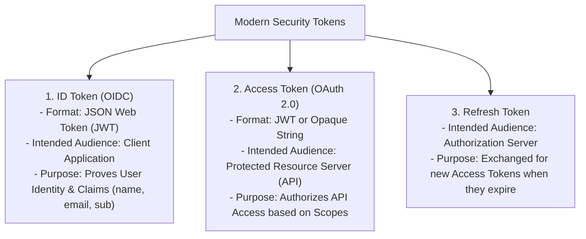
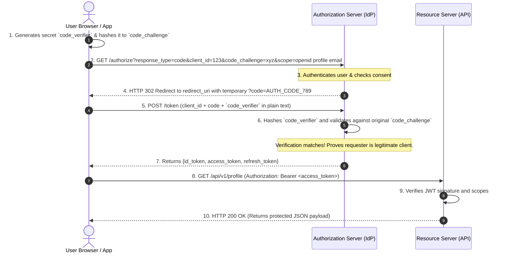

# 04. OAuth 2.0 and OpenID Connect (OIDC)

[⬅️ Prev: SAML 2.0 Deep Dive](./03_SAML_2.0_Deep_Dive.md) | [Back to Technologies](./README.md) | [Next: Entra ID & Conditional Access ➡️](./05_Microsoft_Entra_ID_and_Conditional_Access.md)

---

### 1. Conceptual Distinction: OAuth 2.0 vs OIDC

One of the most frequent points of confusion in modern identity:
- **OAuth 2.0 (RFC 6749)** is an **AUTHORIZATION framework**. It allows a third-party application to obtain limited access to a protected HTTP resource on behalf of a user without exposing their password. OAuth 2.0 does NOT tell the application *who* the user is.
- **OpenID Connect (OIDC)** is an **AUTHENTICATION identity layer** built directly on top of OAuth 2.0. It standardizes identity claims using JSON Web Tokens (JWT).

> 💡 **Analogy**:
> - **OAuth 2.0** is a Valet Key for your car: It grants the valet parking attendant permission to drive the car 50 feet and lock the doors, but it won't open the glovebox or trunk. The key proves *delegated permission*, not who owns the car.
> - **OIDC** is your Driver's License: It proves your name, date of birth, photo, and address (Identity).

---

### 2. Token Types in Modern Identity

---

### 3. The Gold Standard Flow: Authorization Code Flow with PKCE

The **Authorization Code Flow with Proof Key for Code Exchange (PKCE)** (RFC 7636) is the mandatory industry standard for securing Single-Page Applications (React/Vue), Mobile Apps, and Web Applications against authorization code interception attacks.

---

### 4. Anatomy of a JSON Web Token (JWT)

A JWT is composed of three Base64URL-encoded strings separated by dots (`.`):
`eyJhbGci... . eyJzdWIi... . TJVA95...`

1. **Header**: Metadata describing the token type and cryptographic signing algorithm (`RS256`, `EdDSA`).
2. **Payload (Claims)**: The core data payload:
   - `sub` (Subject): Unique immutable user ID (`usr_94812`).
   - `iss` (Issuer): Who generated the token (`https://login.microsoftonline.com/...`).
   - `aud` (Audience): Who the token is intended for.
   - `exp` (Expiration): Epoch timestamp when the token dies.
   - `scp` (Scopes): Granted permissions (`["read:reports", "write:orders"]`).
3. **Signature**: Cryptographic hash generated using the issuer's private key. The resource server verifies this signature using the issuer's publicly exposed `/.well-known/jwks.json` endpoint.
