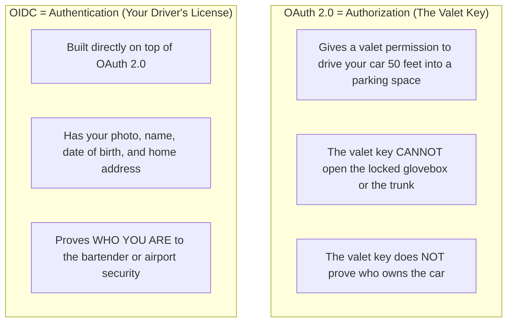
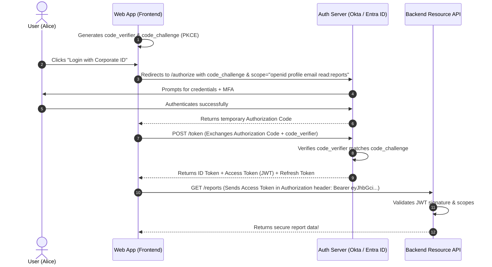

# 04. OAuth 2.0 and OpenID Connect (OIDC)

[⬅️ Prev: SAML 2.0 Deep Dive](./03_SAML_2.0_Deep_Dive.md) | [Back to Protocols](./README.md) | [Next: Entra ID & Conditional Access ➡️](./05_Microsoft_Entra_ID_and_Conditional_Access.md)

---

### 🎓 Beginner's Compass: Decoded Acronyms & Terms
- **OAuth 2.0**: An **authorization framework** that lets a third-party app access your data without ever knowing your password (e.g., letting Spotify access your Facebook friends list).
- **OIDC (OpenID Connect)**: An **authentication layer** built directly on top of OAuth 2.0 to verify a user's identity (e.g., *"Sign in with Google"*).
- **Access Token**: A digital VIP badge (usually a JWT) that an application presents to an API to prove it has permission to read or write data.
- **ID Token**: A digital security badge containing user profile information (Name, Email, Subject ID) meant exclusively for the client application.
- **Refresh Token**: A long-lived credential used to silently request a new Access Token when the short-lived (e.g., 60-minute) Access Token expires.
- **JWT (JSON Web Token)**: A compact, URL-safe format used to transfer claims between parties, made of three Base64 parts separated by dots: `Header.Payload.Signature`.
- **PKCE (Proof Key for Code Exchange)**: A security enhancement that stops hackers from intercepting authorization codes on mobile and single-page apps.

---

### 1. Plain-English Walkthrough: The Valet Key vs. The Driver's License

The single most common mistake beginners make is confusing **OAuth 2.0** with **OIDC**:



> [!TIP]
> - **OAuth 2.0 alone** answers: *"What is this application allowed to do on my behalf?"* (Authorization).
> - **OIDC (OAuth 2.0 + ID Token)** answers: *"Who is the human currently sitting at this screen?"* (Authentication).

---

### 2. The Authorization Code Flow with PKCE (The Industry Standard)

This is the flow used by modern Single Page Apps (React/Angular) and mobile apps:



---

### 3. Anatomy of a JSON Web Token (JWT)

A JWT looks like a garbled string: `eyJhbGciOi... . eyJzdWIiOi... . 4uC3D5...`  
When decoded from Base64, it reveals three distinct JSON blocks:

```json
// 1. HEADER: Algorithm & Token Type
{
  "alg": "RS256",
  "typ": "JWT",
  "kid": "k-2026-auth-cert"
}

// 2. PAYLOAD: The Claims (User & Permission Data)
{
  "sub": "usr_94820194",
  "name": "Alice Smith",
  "email": "alice.smith@contoso.com",
  "roles": ["Cloud_Engineer", "Incident_Responder"],
  "scope": "openid profile email read:reports write:logs",
  "iss": "https://login.microsoftonline.com/tenant-id/v2.0",
  "aud": "https://api.contoso.com",
  "exp": 1732194000,
  "iat": 1732190400
}

// 3. SIGNATURE: Cryptographic tamper-proof seal
RSASHA256(
  base64UrlEncode(header) + "." + base64UrlEncode(payload),
  privateKey
)
```

---

### 4. Common Beginner Mistakes vs. Best Practices

| Common Beginner Mistake | Real-World Risk | Industry Best Practice |
| :--- | :--- | :--- |
| **Using the Implicit Grant Flow** | Returning Access Tokens directly in the browser URL fragment allows browser history or malicious browser extensions to steal tokens. | Deprecate Implicit Grant. Mandate **Authorization Code Flow with PKCE** for all web and mobile apps. |
| **Storing Tokens in `localStorage`** | If your application suffers a Cross-Site Scripting (XSS) vulnerability, malicious JavaScript can steal tokens from `localStorage`. | Store tokens in **HttpOnly, Secure, SameSite cookies** or in private memory workers. |
| **Skipping Token Signature Validation** | Accepting a JWT without validating its cryptographic signature allows hackers to edit their user role to `"Admin"` in Base64! | Always validate the signature using the IdP's JSON Web Key Set (`/.well-known/jwks.json`), along with `exp`, `iss`, and `aud` claims. |

---

### 5. Recommended Next Steps
Now discover how cloud directories evaluate device health, threat intelligence, and user risk dynamically:
- [05. Microsoft Entra ID and Conditional Access Deep Dive ➡️](./05_Microsoft_Entra_ID_and_Conditional_Access.md)
