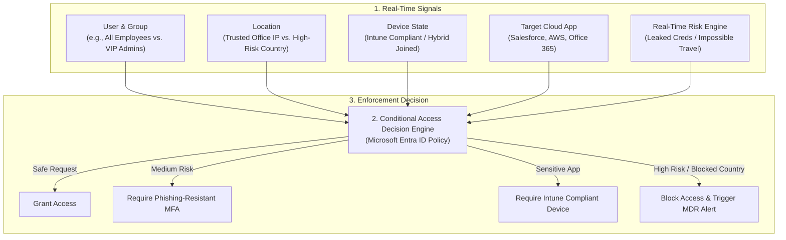
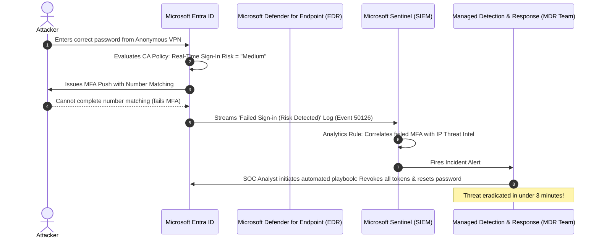

# 05. Microsoft Entra ID and Conditional Access

[⬅️ Prev: OAuth 2.0 & OIDC](./04_OAuth_2.0_and_OpenID_Connect_OIDC.md) | [Back to Protocols](./README.md) | [Next: SCIM Identity Provisioning ➡️](./06_SCIM_Identity_Provisioning.md)

---

### 🎓 Beginner's Compass: Decoded Acronyms & Terms
- **Microsoft Entra ID**: Formerly known as **Azure Active Directory (Azure AD)**. It is Microsoft's multi-tenant cloud-based identity and access management service.
- **Conditional Access (CA)**: The core policy engine in Entra ID that acts like an intelligent security guard. It evaluates real-time signals (who, where, what device) before deciding to allow, challenge with MFA, or block a login.
- **Signal**: Contextual data fed into the decision engine (e.g., user group, IP location, device compliance status, application risk).
- **Enforcement (Control)**: The action taken by the policy (e.g., Require MFA, Require Compliant Intune Device, Require Password Reset, Block Access).
- **Identity Protection**: An advanced machine-learning service in Entra ID that calculates real-time **User Risk** (compromised credentials leaked on the dark web) and **Sign-In Risk** (impossible travel, anonymous Tor IP).
- **MDR / SOC Integration**: Entra ID streams sign-in logs and risk alerts into SIEMs (Microsoft Sentinel, Splunk) so 24/7 SOC / MDR teams can quarantine infected devices in seconds.

---

### 1. Plain-English Walkthrough: The Intelligent VIP Club Bouncer

Imagine a high-end club with a very smart bouncer at the door:
- **Scenario A (Standard Routine)**: You arrive in business attire, show your club membership card, and your face matches the picture. The bouncer smiles and lets you in.
- **Scenario B (Suspicious Context)**: You show the same membership card, but you arrive at 3:30 AM wearing a ski mask, smelling of gasoline, carrying a crowbar. The bouncer does **not** let you in!
- **How Conditional Access Works**:
  - It does not just check: *"Is the password correct?"*
  - It evaluates the entire **context**: Is the employee logging in from their company-issued encrypted laptop inside the United States? -> **Allow**.
  - Is the employee logging in from an unmanaged personal phone in Russia while their laptop is active in New York? -> **Block immediately and alert the SOC/MDR team!**

---

### 2. Real-World Enterprise Policy Stack

A professional IAM engineer builds Conditional Access policies in layers:

| Priority | Policy Name | Scope | Condition | Grant / Block Control |
| :--- | :--- | :--- | :--- | :--- |
| **01** | **Emergency Break-Glass Exemption** | Exclude 2 Break-Glass Accounts | All Apps | Exempt from standard policies to avoid total lockout |
| **02** | **Block Legacy Authentication** | All Users | Protocols that don't support MFA (POP3, IMAP, SMTP) | **BLOCK ACCESS** |
| **03** | **Enforce Phishing-Resistant MFA for Admins** | All Privileged Roles | Azure Portal, AWS, M365 Admin | Require FIDO2 / YubiKey |
| **04** | **Block High-Risk Sign-Ins** | All Users | Sign-In Risk = "High" (Tor IP, Leaked Creds) | **BLOCK ACCESS** (SOC Alert) |
| **05** | **Compliant Device Requirement** | All Employees | Accessing production data | Require Microsoft Intune Compliant Device |

---

### 3. How Entra ID Connects to the SOC, EDR, and MDR

---

### 4. Common Beginner Mistakes vs. Best Practices

| Common Beginner Mistake | Real-World Risk | Industry Best Practice |
| :--- | :--- | :--- |
| **Locking Yourself Out** | Enabling a blanket *"Require Compliant Device for All Users"* policy before company laptops are registered locks out all administrators. | Always test new CA policies in **Report-Only Mode** first; inspect the Entra Sign-In Logs to see who would have been blocked. |
| **Leaving Legacy Auth Enabled** | Leaving basic authentication (IMAP/POP3) open allows hackers to bypass all MFA rules using credential stuffing tools. | Enforce a dedicated policy that blocks legacy authentication across the entire tenant. |
| **No Break-Glass Accounts** | If an admin misconfigures a CA policy or a cloud outage occurs, nobody can log in to fix it. | Maintain two dedicated cloud-only Emergency Access Accounts with complex passwords in physical tamper-evident safes, excluded from CA policies. |

---

### 5. Recommended Next Steps
Learn how user accounts are automatically created and deleted inside connected cloud SaaS applications:
- [06. SCIM Identity Provisioning Deep Dive ➡️](./06_SCIM_Identity_Provisioning.md)
