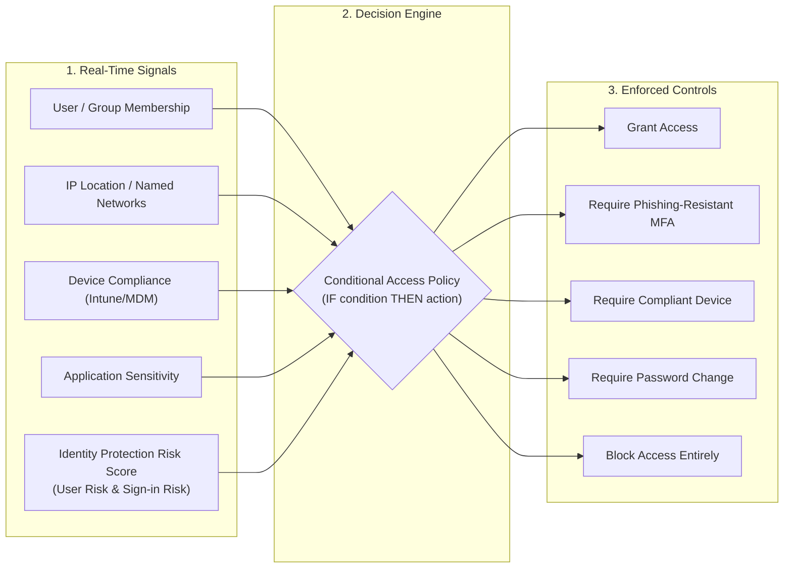

# 05. Microsoft Entra ID and Conditional Access Policies

[⬅️ Prev: OAuth 2.0 and OIDC](./04_OAuth_2.0_and_OpenID_Connect_OIDC.md) | [Back to Technologies](./README.md) | [Next: SCIM Identity Provisioning ➡️](./06_SCIM_Identity_Provisioning.md)

---

### 1. Definition and Evolution

**Microsoft Entra ID** (formerly *Azure Active Directory / Azure AD*) is Microsoft's multi-tenant, cloud-based identity and access management service. Unlike legacy Windows Server Active Directory:
- It is **NOT** a flat server running Kerberos and LDAP over an internal LAN.
- It is a cloud REST-based identity engine communicating over HTTPS via modern protocols (OIDC, OAuth 2.0, SAML 2.0, SCIM, and Microsoft Graph API).

---

### 2. Conditional Access: The Intelligent Zero Trust Brain

**Conditional Access (CA)** is Entra ID's policy engine that implements the Zero Trust principle of **"Verify Explicitly"**. 

It works on a strict **Signal ➔ Decision ➔ Enforcement** architecture:

---

### 3. User Risk vs Sign-in Risk

Entra ID Identity Protection calculates two distinct real-time threat scores:

| Risk Category | Definition | Real-World Trigger Examples | Required Remediation Control |
| :--- | :--- | :--- | :--- |
| **Sign-in Risk (Session Level)** | Probability that a specific authentication request is NOT authorized by the legitimate identity owner. | - Impossible Travel (Login from NY at 1:00 PM, login from Paris at 1:30 PM) - Anonymous IP / Tor Exit Node - Unfamiliar sign-in properties | Require immediate step-up Multi-Factor Authentication. |
| **User Risk (Identity Level)** | Probability that the user's permanent credentials have been leaked or compromised. | - Leaked Credentials (credentials discovered on Dark Web paste sites) - Atypical user activity patterns | Require mandatory self-service password reset using secure MFA to clear risk. |

---

### 4. Continuous Access Evaluation (CAE)

In standard OAuth 2.0, an access token is valid until its expiration timestamp (e.g., 60 minutes). If an employee is fired 5 minutes into the hour, they retain access for the remaining 55 minutes.

**Continuous Access Evaluation (CAE)** (RFC draft) creates a real-time event pipeline between Entra ID and Service Providers (Exchange Online, SharePoint, Teams).
If any critical event occurs:
- User account disabled or deleted,
- Password reset,
- User risk elevated,
- Admin revokes all refresh tokens,

Entra ID sends a real-time backchannel event, and the SaaS application terminates the user's session **within seconds**.
