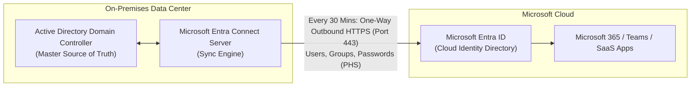
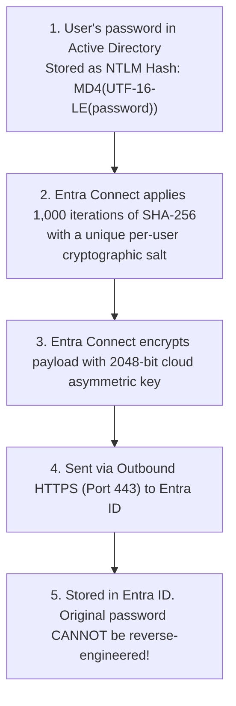

# 07. Hybrid Identity and Entra Connect Sync

[⬅️ Prev: SCIM Provisioning](./06_SCIM_Identity_Provisioning.md) | [Back to Protocols](./README.md) | [Next: Tools & Platforms Track ➡️](../04_Tools_and_Platforms/README.md)

---

### 🎓 Beginner's Compass: Decoded Acronyms & Terms
- **Hybrid Identity**: An enterprise identity model where user accounts exist in an on-premises directory (Active Directory) and are continuously synchronized to the cloud (Microsoft Entra ID).
- **Microsoft Entra Connect Sync**: The free software agent installed on an on-premises Windows Server that bridges local Active Directory with cloud Entra ID.
- **PHS (Password Hash Synchronization)**: The recommended synchronization method where a mathematical hash of the user's password hash is securely copied to the cloud.
- **PTA (Pass-Through Authentication)**: An alternative method where passwords stay on-premises, and Entra ID forwards login requests back to on-premises agents to validate.
- **ADFS (Active Directory Federation Services)**: A legacy, complex on-premises federation server farm used for SAML logins before cloud IdPs matured.
- **Soft Match vs. Hard Match**: How the sync engine pairs an on-premises user with an existing cloud user using either `UserPrincipalName` / `ProxyAddresses` (Soft Match) or the binary `ObjectGUID` converted into `ImmutableID` (Hard Match).

---

### 1. Plain-English Walkthrough: The Bridge Between Two Worlds

#### Why Hybrid Identity Exists
Most large companies (banks, hospitals, airlines, government agencies) were founded decades before cloud computing existed:
- They have 50,000 Windows workstations, internal file servers, and legacy ERP systems joined to on-premises Active Directory.
- They cannot simply turn off Active Directory overnight.
- But they also want to use modern cloud tools: Microsoft 365, Teams, Salesforce, and AWS.
- **The Solution**: **Hybrid Identity**. The on-premise Active Directory remains the "Master Source of Truth", while an automated synchronization bridge copies user identities up to Microsoft Entra ID in the cloud.

---

### 2. Comparison of Authentication Methods: PHS vs. PTA vs. ADFS

| Feature | Password Hash Sync (PHS) | Pass-Through Auth (PTA) | ADFS (Federation) |
| :--- | :--- | :--- | :--- |
| **Recommendation** | **Microsoft Recommended (Gold Standard)** | Good for strict compliance | **Legacy (Deprecate if possible)** |
| **Where is password validated?** | In the Cloud (Entra ID) | On-Premises (via PTA agents) | On-Premises (ADFS Server farm) |
| **Cloud Resiliency** | **100% Cloud-Independent**: If your office internet goes down, users can still log into Microsoft 365 from home! | **Dependent**: If on-prem internet or servers crash, cloud logins fail. | **Dependent**: If ADFS servers crash, all global cloud logins fail. |
| **Leaked Credential Detection** | **Supported**: Entra checks hashes against known dark web password dumps. | Not Supported | Not Supported |
| **Infrastructure Cost** | Lowest (zero extra servers) | Low (2-3 lightweight agents) | Very High (requires 4+ load-balanced servers + WAP proxies) |

---

### 3. How Password Hash Sync (PHS) Secures Your Password

Beginners often worry: *"Does PHS send cleartext passwords to the cloud?"*  
**Answer: Absolutely NOT!** The cryptographic process is extraordinarily secure:

---

### 4. Common Beginner Mistakes vs. Best Practices

| Common Beginner Mistake | Real-World Risk | Industry Best Practice |
| :--- | :--- | :--- |
| **Synchronizing Unfiltered OUs** | Syncing entire AD tree (including test accounts, conference rooms, service accounts) fills cloud directory with junk and inflates license costs. | Use **OU-based filtering** in Entra Connect to sync only production employee and computer OUs. |
| **Single Entra Connect Server** | If the sync server's hard drive crashes, new hires and password changes stop synchronizing to the cloud. | Deploy a secondary Entra Connect server in **Staging Mode** ready for instant failover. |
| **Syncing High-Privilege On-Prem Admins** | Syncing on-premises `Domain Admins` to the cloud allows on-premise compromises to pivot directly into the cloud tenant. | Keep cloud administrative accounts separate (cloud-only, e.g., `admin-alice@contoso.onmicrosoft.com`) with no on-premises sync link. |

---

### 5. Recommended Next Steps
Now that you have mastered the underlying protocols, explore the industry-leading enterprise tools used by IAM engineers:
- [04. Tools and Platforms: Microsoft Entra ID Deep Dive ➡️](../04_Tools_and_Platforms/01_Microsoft_Entra_ID.md)
