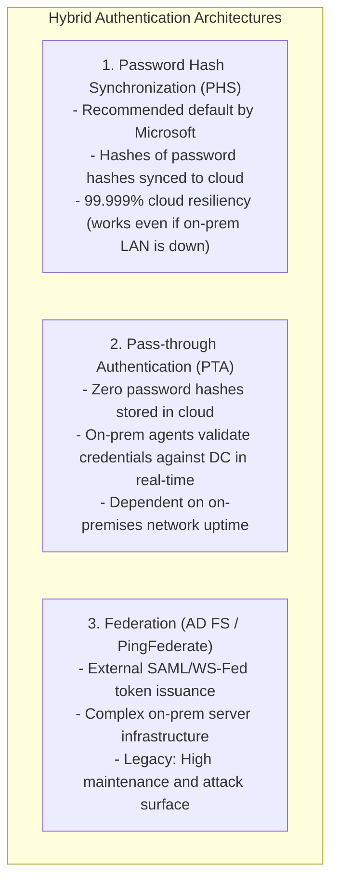
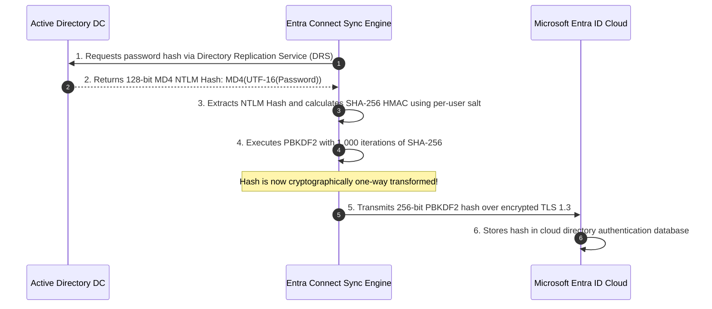

# 07. Hybrid Identity: Microsoft Entra Connect & Cloud Sync

[⬅️ Prev: SCIM Provisioning](./06_SCIM_Identity_Provisioning.md) | [Back to Technologies](./README.md) | [Next: Tools Track ➡️](../04_Tools_and_Platforms/README.md)

---

### 1. Definition and Purpose

Most large enterprises do not operate solely in the cloud or solely on-premises. They operate in a **Hybrid Identity** topology, bridging legacy Windows Server Active Directory (AD DS) with Microsoft Entra ID.

**Microsoft Entra Connect** (and its modern lightweight agent counterpart, **Microsoft Entra Cloud Sync**) is the synchronization tool that unifies user identities, groups, and password hashes between on-premises forests and the cloud tenant.

> 💡 **Analogy**: The Embassy Passport Registry:
> - Your local country's citizenship records department is **On-Premises Active Directory**.
> - The international diplomatic visa system at foreign embassies across the globe is **Microsoft Entra ID**.
> - **Entra Connect** is the secure, continuous diplomatic pouch courier service that synchronizes citizen identity records so that an embassy in Tokyo instantly recognizes your passport issued in Washington D.C.

---

### 2. The Three Hybrid Authentication Topologies

Choosing the right hybrid authentication architecture is one of the most critical decisions an IAM Architect makes:

| Dimension | Password Hash Sync (PHS) | Pass-through Authentication (PTA) | Active Directory Federation Services (AD FS) |
| :--- | :--- | :--- | :--- |
| **Cloud Resiliency** | **Maximum**: Users can authenticate even if corporate WAN/DC is severed. | **Moderate**: Requires outbound connection to on-premises agents. | **Low**: If AD FS farm or ADFS proxy fails, cloud logins fail globally. |
| **Complexity** | Minimal (Single agent or cloud sync). | Low to Medium (2–3 lightweight outbound-only agents). | High (Complex multi-tier DMZ proxies, certificates, load balancers). |
| **Leaked Credential Detection**| ✅ **Enabled**: Entra ID can check hashes against Dark Web breach databases. | ❌ Disabled. | ❌ Disabled. |
| **Password Writeback** | ✅ Supported with SSPR. | ✅ Supported with SSPR. | ✅ Supported. |
| **Recommended Stance** | **Microsoft Recommended Best Practice** | Use only if compliance strictly forbids cloud password hashes. | Deprecated in modern zero-trust migrations. |

---

### 3. How Password Hash Synchronization (PHS) Works Under the Hood

A common misunderstanding is that PHS synchronizes plain-text passwords or standard NTLM hashes. **It does not.**

---

### 4. Critical Hybrid Capabilities Every IAM Engineer Must Know

1. **Password Writeback (Self-Service Password Reset - SSPR)**:
   - When enabled, a user resetting their password from the web portal (`myprofile.microsoft.com`) has their new password encrypted with the on-prem tenant public key and written back to the on-premises Domain Controller in real time.
2. **Seamless Single Sign-On (Seamless SSO)**:
   - Automatically signs users in when they are on corporate devices connected to the internal domain network by issuing Kerberos tickets to Entra ID without retyping credentials.
3. **Staging Mode**:
   - Running a secondary Entra Connect server in read-only Staging Mode allows zero-downtime disaster recovery and safe testing of synchronization rules before pushing changes to production.
