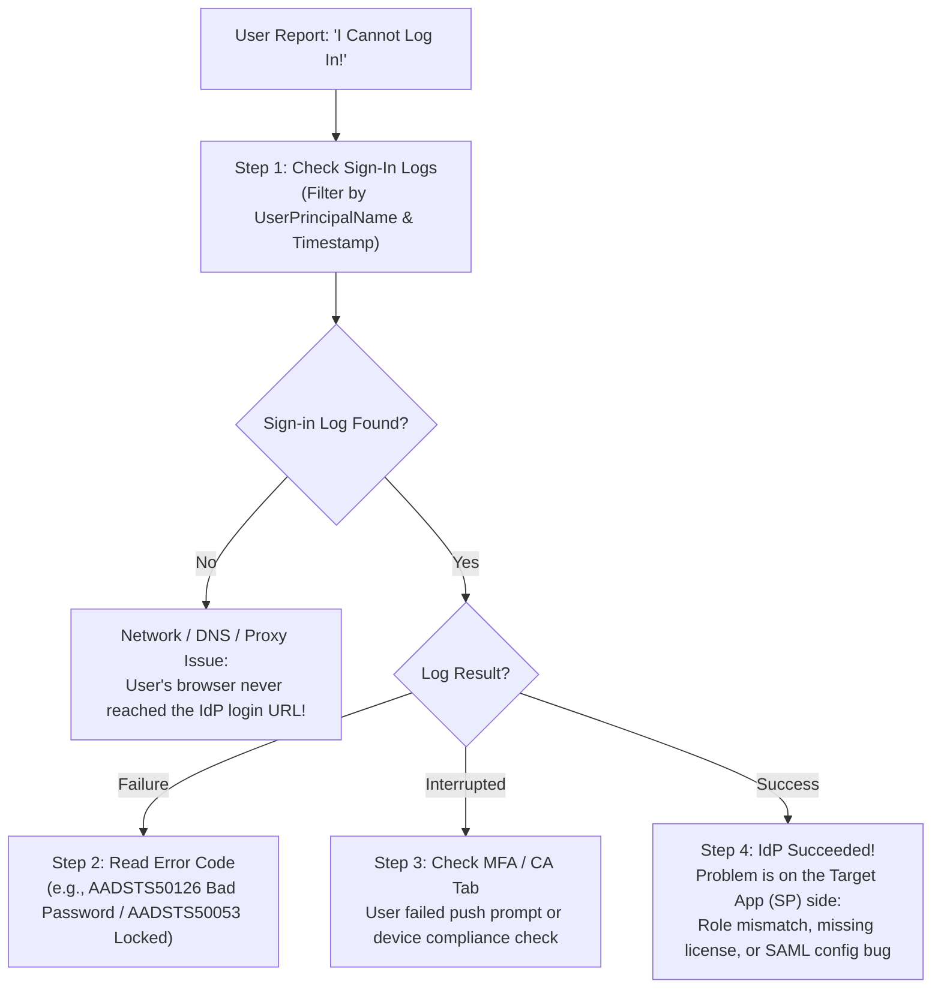
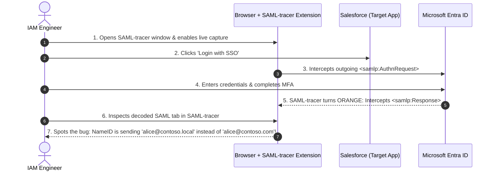

# 08. IAM Troubleshooting and Sign-In Log Analysis

[⬅️ Prev: Hybrid Identity Sync](./07_Hybrid_Identity_Entra_Connect_Sync.md) | [Back to Protocols](./README.md) | [Next: Tools and Platforms Track ➡️](../04_Tools_and_Platforms/README.md)

---

### 🎓 Beginner's Compass: Decoded Acronyms & Tools
- **Sign-In Logs**: The central activity ledger in an Identity Provider (Entra ID, Okta) recording every single login attempt, whether successful, failed, or interrupted by MFA.
- **SAML-tracer**: A free browser extension for Chrome/Firefox that intercepts and decodes SAML and OIDC requests/responses in real time as you click through web pages.
- **AADSTS Error Codes**: The standardized error code prefixes generated by Microsoft Entra ID (e.g., `AADSTS50126`).
- **"What If" Tool**: A diagnostic simulator in Microsoft Entra Conditional Access that lets an engineer simulate: *"If Alice logs in from an iPhone in Paris to Salesforce, will she be blocked or prompted for MFA?"*
- **SCIM Provisioning Quarantine**: When an automated user sync connector fails repeatedly (e.g., due to an expired API key), the IdP puts the job into "Quarantine" mode to prevent endless retries.

---

### 1. The Real-World IAM Triage Mindset

When an employee or VP submits an urgent ticket stating *"I cannot log in to work apps!"*, a junior engineer panics, while a senior IAM engineer follows a structured 4-step diagnostic flowchart:

---

### 2. Master Decoder of Common Microsoft Entra Error Codes

When investigating Sign-In Logs in Microsoft Entra ID or your SIEM (Sentinel/Splunk), memorize these frequent error codes:

| Error Code | Error Name | Plain-English Meaning | How the IAM Engineer Fixes It |
| :--- | :--- | :--- | :--- |
| **`AADSTS50126`** | `InvalidUserNameOrPassword` | The user mistyped their password or used an expired password. | Direct the user to Self-Service Password Reset (SSPR) or check for password spraying. |
| **`AADSTS50053`** | `IdsLocked` | The account is locked due to too many failed login attempts. | Unlock the account in Entra ID / AD; check IP address to see if it was an external attacker. |
| **`AADSTS50076`** | `StrongAuthRequired` | The user passed password authentication, but failed to complete the required MFA challenge. | Check user's registered MFA devices; verify if user has cellular/data service to receive push. |
| **`AADSTS50097`** | `DeviceNotCompliant` | Conditional Access requires a company-managed laptop, but the user is on an unmanaged personal device. | Check Microsoft Intune compliance status; ensure device certificate is installed. |
| **`AADSTS700016`** | `ApplicationNotFound` | The application's Client ID or Service Principal was disabled or deleted in the directory. | Verify application registration in Entra Enterprise Applications; check tenant ID. |
| **`AADSTS65001`** | `ConsentRequired` | The user or admin has not consented to the OAuth permissions requested by the application. | Perform Admin Consent for the enterprise application in the Azure portal. |

---

### 3. How to Inspect SAML Assertions Using SAML-tracer

When an application's SSO is broken (e.g., user logs into Entra ID, gets redirected to Salesforce, and sees a generic `"Single Sign-On Error"`), **SAML-tracer** is your primary diagnostic tool:

#### What to Check Inside the Decoded SAML Assertion:
1. **`NameID` format**: Does Salesforce expect `alice.smith@contoso.com`, but Entra ID is sending an internal employee ID `EMP9042`?
2. **Audience Restriction (`<Audience>` URI)**: Does the entity ID in the assertion match the SP's Entity ID exactly (case-sensitive)?
3. **Assertion Consumer Service (ACS) URL**: Is the response being sent to `https://salesforce.com/login` instead of `https://company.my.salesforce.com`?
4. **Validity Timestamps (`NotBefore` / `NotOnOrAfter`)**: If the client computer's clock differs by >5 minutes, the assertion will be rejected for clock skew.

---

### 4. The Conditional Access "What If" Diagnostic Tool

Before pushing a new security policy to 10,000 employees, you must test it to ensure you don't accidentally block the CEO or the entire sales team.

#### How to Run a Simulation:
1. In the Microsoft Entra admin center, navigate to **Protection** > **Conditional Access** > **What If**.
2. Select the target user: `Alice Smith`.
3. Select the target cloud application: `Salesforce`.
4. Define conditions:
   * **IP Location**: Select `France` (to test remote travel).
   * **Device Platform**: Select `iOS`.
   * **Client App**: Select `Browser`.
5. Click **What If**.
6. **The Result**: The tool displays two lists:
   * **Policies that will apply**: Shows which policies will challenge Alice for MFA or require a compliant device.
   * **Policies that will NOT apply**: Explains why certain policies are excluded (e.g., excluded by group membership).

---

### 5. Troubleshooting Automated SCIM Provisioning Failures

When an employee is hired or promoted, but their account fails to appear in Slack or Zoom:
1. Navigate to **Enterprise Applications** > Select Application > **Provisioning**.
2. Check the **Provisioning Status**:
   * If it says **"Quarantined"**, the IdP stopped syncing because of continuous errors (often an expired OAuth/Bearer API token).
   * **Fix**: Generate a fresh SCIM secret token inside the target app and update the connector credentials, then click **Restart Provisioning**.
3. Inspect the **Provisioning Logs**:
   * Filter by the affected user's name.
   * Check the **Skip** or **Failure** reason (e.g., *"Duplicate attribute value: A user with email alice@contoso.com already exists in Slack"*).

---

### 6. Recommended Next Steps
Now that you know how to troubleshoot identity systems in production, explore the enterprise platforms used to implement these controls:
- [04. Tools and Platforms Track ➡️](../04_Tools_and_Platforms/README.md)
