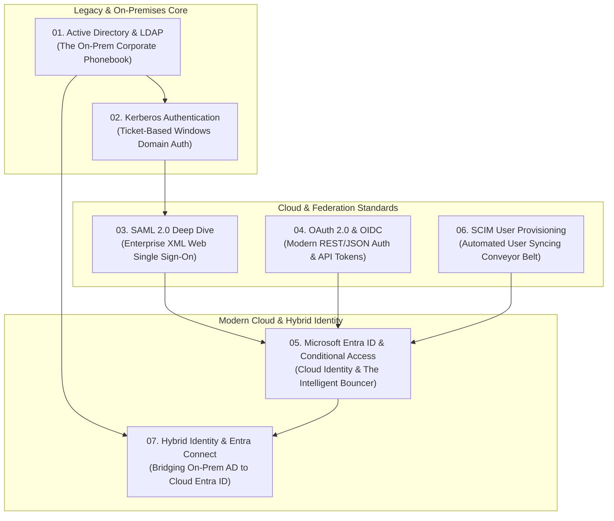

# 03. IAM Technologies and Protocols Track

In this track, we transition from theoretical concepts into the actual **protocols, directories, and data formats** that make digital enterprise security work.

---

### 🗺️ Module Learning Pathway

---

### 📚 Protocols at a Glance: The Rosetta Stone

| Protocol / Standard | Primary Purpose | Format | Real-World Analogy |
| :--- | :--- | :--- | :--- |
| **[01. Active Directory & LDAP](./01_Active_Directory_and_LDAP.md)** | Directory lookup and on-premise Windows network management | Binary / ASN.1 BER | The corporate yellow pages & master room keycard database |
| **[02. Kerberos](./02_Kerberos_Authentication.md)** | Network authentication without sending passwords over the wire | Cryptographic Tickets (Port 88) | Amusement park entry ticket and ride wristbands |
| **[03. SAML 2.0](./03_SAML_2.0_Deep_Dive.md)** | Web-based cross-domain enterprise Single Sign-On | XML Assertions (Base64) | Official notarized government paper passport |
| **[04. OAuth 2.0 & OIDC](./04_OAuth_2.0_and_OpenID_Connect_OIDC.md)** | API authorization (OAuth) and modern mobile/web login (OIDC) | JSON Web Tokens (JWT) | Hotel Valet parking key (OAuth) + Driver's License photo ID (OIDC) |
| **[05. Entra ID & Conditional Access](./05_Microsoft_Entra_ID_and_Conditional_Access.md)** | Cloud identity provider and risk-based adaptive access engine | Cloud REST APIs & JSON | The intelligent security guard analyzing risk signals in real time |
| **[06. SCIM](./06_SCIM_Identity_Provisioning.md)** | Automated cross-platform user account creation and deletion | RESTful JSON payload | The automated conveyor belt cloning employee badges into all apps |
| **[07. Hybrid Identity Sync](./07_Hybrid_Identity_Entra_Connect_Sync.md)** | Syncing on-premises Active Directory accounts to cloud Entra ID | Agent-based Hash Sync (PHS) | The secure pneumatic tube copying badge records between buildings |
