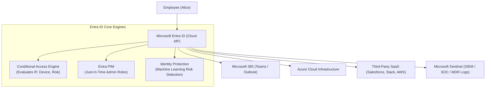
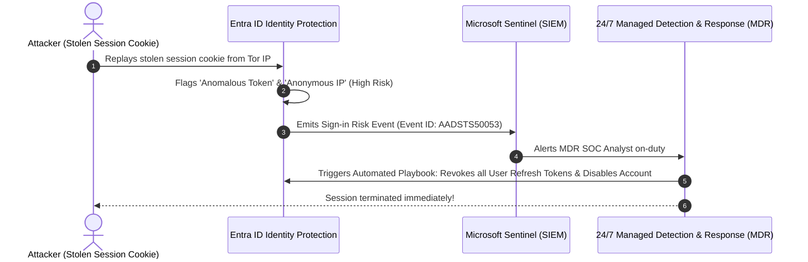

# 01. Microsoft Entra ID

[⬅️ Back to Tools Track](./README.md) | [Next: Okta Workforce Identity ➡️](./02_Okta_Workforce_Identity.md)

---

### 🎓 Beginner's Compass: Decoded Acronyms & Terms
- **Microsoft Entra ID**: Formerly named **Azure Active Directory (Azure AD)**. It is Microsoft's multi-tenant cloud identity platform.
- **Tenant**: A dedicated instance of Entra ID representing a single organization (e.g., `contoso.onmicrosoft.com`).
- **P1 vs. P2 Licensing**: 
  - **P1**: Includes Conditional Access, dynamic groups, and self-service password reset (SSPR).
  - **P2**: Adds advanced AI threat protection (Identity Protection) and Privileged Identity Management (PIM).
- **PIM (Privileged Identity Management)**: Time-bound, just-in-time activation of admin roles (e.g., Global Admin for 2 hours with manager approval).
- **Identity Protection**: An automated machine-learning system that flags **User Risk** (compromised passwords found on hacker forums) and **Sign-In Risk** (impossible travel anomalies).
- **MDR (Managed Detection and Response)**: An external 24/7 security team that monitors Entra ID sign-in alerts in real time.

---

### 1. Plain-English Walkthrough: The Grand Enterprise Cloud Hub

#### What is Microsoft Entra ID?
Think of Microsoft Entra ID as the **central digital identity hub** for modern companies.
- If your company uses Outlook, Microsoft Teams, SharePoint, or Azure, you are already using Entra ID!
- It connects human employees to Microsoft 365 services and thousands of third-party cloud applications (like Zoom, Salesforce, and Workday).

#### What Happens Without Entra ID?
- Every employee would need a separate login for email, another for file storage, and another for video meetings.
- If a laptop is lost, IT cannot remotely revoke login tokens or force a password reset.
- If an employee gets phished, the attacker can log in from anywhere in the world without any risk checks.

---

### 2. Key Capabilities & Technical Features

#### 1. Conditional Access Engine
The premier policy engine in cybersecurity. It evaluates real-time signals:
- *“IF the user is an executive AND connecting from an unmanaged laptop, THEN require FIDO2 MFA and block file downloads.”*

#### 2. Privileged Identity Management (PIM)
Eliminates permanent administrators:
- Bob is a Cloud Engineer. Normally, his account has **zero admin permissions**.
- When an incident occurs, Bob opens the PIM portal, requests the `Global Reader` or `Contributor` role for 3 hours, enters ticket number `#INC-8492`, and passes MFA.
- Once approved, Entra ID activates the role. At the end of 3 hours, the role is revoked automatically.

#### 3. Identity Protection (Risk Engine)
- **Sign-In Risk**: Detects impossible travel (e.g., logging in from Dallas, Texas and Tokyo, Japan 20 minutes apart).
- **User Risk**: Microsoft scans dark web credential dumps. If Alice's corporate email and password appear in a breach dump, Entra ID flags Alice as "High Risk" and forces an immediate password reset via Self-Service Password Reset (SSPR).

---

### 3. How Entra ID Integrates with SOC and MDR Teams

---

### 4. Common Beginner Mistakes vs. Best Practices

| Common Beginner Mistake | Real-World Risk | Industry Best Practice |
| :--- | :--- | :--- |
| **Permanent Global Admins** | Leaving 10 engineers with permanent 24/7 Global Administrator roles allows one phished admin to ruin the whole company. | Enforce **Entra PIM**: zero permanent standing admins; maximum 5 eligible Global Admins with dual approval. |
| **Ignoring Diagnostic Logging** | Keeping sign-in logs only inside Entra ID (where they expire after 30 days) prevents historical breach investigations. | Stream all Entra ID AuditLogs and SignInLogs to **Log Analytics / Microsoft Sentinel** for 365-day retention. |
| **No Emergency Break-Glass Accounts** | If MFA fails or a conditional access misconfiguration blocks all users, IT is completely locked out of the tenant. | Create two dedicated cloud-only Emergency Access Accounts with complex 30+ char passwords stored in physical tamper-evident safes. |

---

### 5. Recommended Next Steps
Compare Microsoft's ecosystem with the leading cloud-neutral identity platform:
- [02. Okta Workforce Identity Deep Dive ➡️](./02_Okta_Workforce_Identity.md)
