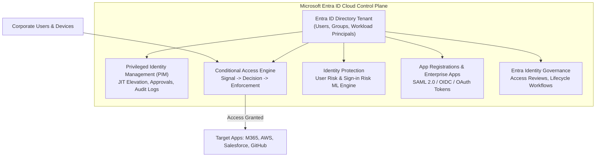

# 01. Microsoft Entra ID (formerly Azure Active Directory) Deep Dive

[⬅️ Back to Tools](./README.md) | [Next: Okta Workforce Identity ➡️](./02_Okta_Workforce_Identity.md)

---

### 1. Platform Overview & Enterprise Architecture

**Microsoft Entra ID** is Microsoft's multi-tenant, cloud-based identity and access management service that provides the core identity plane for Microsoft 365, Microsoft Azure resources, and thousands of federated enterprise SaaS and custom web applications.

Unlike on-premises Active Directory Domain Services (AD DS), Entra ID does not use LDAP queries, Kerberos ticket-granting tickets, or flat organizational units (OUs). It is an HTTP REST-based identity directory communicating via standard OAuth 2.0, OpenID Connect (OIDC), SAML 2.0, and SCIM protocols.



---

### 2. Core Modules and Architectural Pillars

#### A. App Registrations vs Enterprise Applications
Understanding the boundary between these two objects is critical:
- **App Registrations (Application Object)**: The global definition of an application, acting as the software blueprint. Created in the home developer tenant where redirect URIs, required API permissions (`Microsoft.Graph`), and client credentials (secrets/certificates) are defined.
- **Enterprise Applications (Service Principal Object)**: The local instance of an application within your specific tenant. This is where you configure SAML SSO settings, user/group assignments, Conditional Access policies, and SCIM automated user provisioning.

#### B. Privileged Identity Management (PIM)
PIM enforces Zero Standing Privileges for directory roles (Global Administrator, Security Admin, User Admin) and Azure Resource RBAC roles:
- **Eligible Assignment**: The user does not hold the role continuously. They have the right to request activation when needed.
- **Active Assignment**: The temporary elevation granted after MFA verification, business justification, and optional peer/manager approval.
- **Maximum Duration**: Typically configured between 1 and 8 hours (default enterprise standard: 2 hours).

#### C. Continuous Access Evaluation (CAE)
Historically, OAuth access tokens had a fixed 60-minute lifespan. If a user was fired or their password changed, they could still access email until the token expired.
With CAE, Entra ID and supporting resource providers (Exchange, SharePoint, Teams) maintain a real-time event channel:
- Account termination or password change sends an instant revocation signal.
- Critical IP address changes (e.g., user roams from corporate IP to an untrusted cellular hotspot) trigger immediate re-authentication challenges within seconds.

---

### 3. Production Automation: Microsoft Graph PowerShell & REST API

IAM Engineers use Microsoft Graph to manage users, groups, and audit trails programmatically.

#### A. Connecting with Least Privilege
```powershell
# Avoid using broad Global Admin rights; request specific granular Graph scopes
Connect-MgGraph -Scopes "User.ReadWrite.All", "Group.ReadWrite.All", "RoleManagement.ReadWrite.Directory"
```

#### B. Auditing Global Administrators and Privileged Role Assignments
```powershell
# Get all directory roles active in tenant
$GlobalAdminRole = Get-MgDirectoryRole | Where-Object {$_.DisplayName -eq "Global Administrator"}

# List all assigned members with their UserPrincipalName and Department
Get-MgDirectoryRoleMember -DirectoryRoleId $GlobalAdminRole.Id | ForEach-Object {
    $User = Get-MgUser -UserId $_.Id -Property DisplayName, UserPrincipalName, Department, AccountEnabled
    [PSCustomObject]@{
        Name           = $User.DisplayName
        UPN            = $User.UserPrincipalName
        Department     = $User.Department
        AccountEnabled = $User.AccountEnabled
    }
}
```

#### C. Emergency Invalidation of Active User Sessions
When a user credential leak or compromise is suspected, execute an emergency session revocation:
```powershell
# Kills all active OAuth refresh tokens and CAE sessions immediately
Revoke-MgUserSignInsSession -UserId "compromised.user@company.com"
Write-Host "[+] All active sessions revoked across Microsoft 365 and connected SaaS apps."
```

---

### 4. Enterprise Common Pitfalls & Best Practices

| Common Mistake | Root Cause | Enterprise Best Practice |
| :--- | :--- | :--- |
| **Too Many Standing Global Administrators** | Granting permanent Global Admin roles to IT Helpdesk staff for convenience. | Enforce Microsoft Entra PIM with mandatory MFA and ticket justification; maintain $\le 5$ permanent Global Admins (reserved for Break-Glass accounts). |
| **No Emergency Break-Glass Accounts** | If MFA goes down or Conditional Access misconfiguration blocks all users, admins are locked out. | Create 2 cloud-only emergency accounts (`bg-admin1@tenant.onmicrosoft.com`) excluded from all CA policies, with 40-character passwords stored in a physical safe. |
| **Permissive User Consent for Third-Party Apps** | Users clicking "Accept" on OAuth consent dialogs for random cloud tools, granting read access to corporate mailboxes. | Disable user consent for apps; enforce Admin Consent Workflow where IAM engineers inspect API scopes before approval. |
