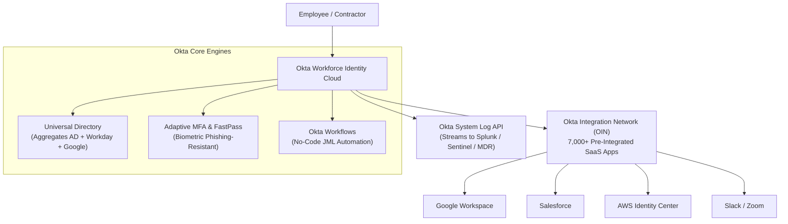

# 02. Okta Workforce Identity

[⬅️ Prev: Microsoft Entra ID](./01_Microsoft_Entra_ID.md) | [Back to Tools Track](./README.md) | [Next: SailPoint IGA ➡️](./03_SailPoint_IdentityIQ_and_IdentityNow.md)

---

### 🎓 Beginner's Compass: Decoded Acronyms & Terms
- **Okta Workforce Identity Cloud (WIC)**: A cloud-native, vendor-neutral identity platform providing SSO, MFA, directory integration, and lifecycle management for enterprise employees and contractors.
- **Universal Directory (UD)**: Okta's central cloud database that aggregates user attributes from multiple directories (Active Directory, LDAP, Workday, Google Workspace) into one unified profile.
- **OIN (Okta Integration Network)**: A pre-built catalog of over 7,000+ cloud applications with ready-to-use SAML SSO and SCIM connectors.
- **Okta Verify**: Okta's mobile authenticator app supporting Push Notifications, Number Matching, and phishing-resistant **FastPass** (biometric passwordless authentication).
- **Okta Workflows**: A no-code identity automation tool that executes custom actions (e.g., *"When an employee moves to Marketing, post a message in Slack, create a Zoom license, and grant Google Drive access"*).
- **SIEM / MDR Integration**: Okta's **System Log API** streams all authentication events to external SIEMs (Splunk, Sentinel, Datadog) and MDR providers for threat detection.

---

### 1. Plain-English Walkthrough: The Cloud-Neutral App Portal

#### What is Okta?
If a company doesn't want to be locked into Microsoft's ecosystem—using MacBooks, Google Workspace, AWS, and Slack—**Okta is the gold standard identity platform**:
- An employee opens their laptop in the morning, goes to `company.okta.com`, and sees a clean web dashboard showing icons for every software tool they need: Gmail, Zoom, Jira, Workday, and Salesforce.
- They click any icon, and **Okta logs them in instantly via SAML/OIDC** without typing a second password.

#### What Happens Without Okta?
- Employees forget passwords constantly, overwhelming the IT helpdesk with reset tickets.
- IT has no visibility into which SaaS applications employees are actually using.
- Contractors retain access to sensitive corporate apps long after their contracts expire.



---

### 2. Key Capabilities & Technical Features

#### 1. FastPass (Passwordless Phishing-Resistant Authentication)
Okta FastPass eliminates passwords completely:
- When a user clicks login, Okta communicates locally with the **Okta Verify** app installed on their MacBook or Windows PC.
- The app uses the device's secure enclave and biometric reader (Touch ID / Windows Hello) to sign a cryptographic challenge.
- **Security**: Because FastPass cryptographically validates the browser's exact domain URL, it is **100% phishing-proof** against Adversary-in-the-Middle (AiTM) reverse-proxy attacks!

#### 2. Okta Universal Directory (UD)
Enterprises often have messy identity data: some users in on-prem Active Directory, contractors in Google Workspace, and HR data in Workday.
- Universal Directory acts as an intelligent data transformer.
- It normalizes usernames, translates email formats, and maps attributes seamlessly across systems.

#### 3. ThreatInsight
Okta aggregates threat data across its thousands of global customers:
- If a specific IP address in Eastern Europe is currently executing a credential stuffing attack against an Okta customer in London, Okta's **ThreatInsight** automatically blocks that IP across all Okta customers worldwide before the attack even touches your tenant!

---

### 3. How Okta Integrates with SOC, SIEM, and MDR Teams

Every action in Okta is recorded in the **Okta System Log**:

```json
{
  "eventType": "user.authentication.verify",
  "outcome": { "result": "FAILURE", "reason": "INVALID_CREDENTIALS" },
  "actor": { "alternateId": "charlie@company.com" },
  "client": {
    "ipAddress": "198.51.100.42",
    "geographicalContext": { "country": "Russia", "city": "Moscow" }
  },
  "securityContext": { "isProxy": true }
}
```

- Okta streams these events via webhook or API into the enterprise SIEM (Splunk / Sentinel).
- If the SIEM detects 20 failed logins from a known proxy followed by a successful login, the **MDR security team** receives an automated alert and uses Okta's API to immediately suspend the compromised account.

---

### 4. Common Beginner Mistakes vs. Best Practices

| Common Beginner Mistake | Real-World Risk | Industry Best Practice |
| :--- | :--- | :--- |
| **Using SMS as Default MFA** | SMS is vulnerable to SIM-swapping attacks. | Disable SMS and voice call factors; enforce **Okta FastPass** or FIDO2 WebAuthn keys. |
| **Manual Application Assignment** | Manually assigning applications to individual users leads to privilege creep and unmanageable administration. | Assign applications exclusively through **Okta Dynamic Groups** based on attributes (e.g., `department == "Sales"`). |
| **Unmonitored Super Admins** | If an Okta Super Admin account is compromised, the attacker controls the entire company's identity plane. | Require dual-authorization for Super Admin changes and set high-priority SIEM alerts on any Super Admin assignment. |

---

### 5. Recommended Next Steps
While Okta handles SSO and basic provisioning, how do Fortune 500 enterprises manage complex compliance audits and segregation of duties?
- [03. SailPoint IdentityIQ and IdentityNow Deep Dive ➡️](./03_SailPoint_IdentityIQ_and_IdentityNow.md)
