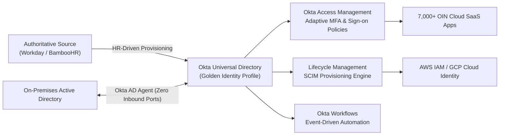

# 02. Okta Workforce Identity Cloud Deep Dive

[⬅️ Prev: Microsoft Entra ID](./01_Microsoft_Entra_ID.md) | [Back to Tools](./README.md) | [Next: SailPoint IGA ➡️](./03_SailPoint_IdentityIQ_and_IdentityNow.md)

---

### 1. Platform Overview & Architecture

**Okta Workforce Identity Cloud** is an enterprise-grade, cloud-agnostic Identity Provider (IdP) that provides central authentication, single sign-on (SSO), adaptive multi-factor authentication, lifecycle management, and directory integration across heterogeneous multi-cloud environments (AWS, GCP, Azure, Salesforce, Workday).



---

### 2. Core Modules Explained

#### A. Okta Universal Directory (UD)
Universal Directory serves as the central metadata broker. It aggregates identity attributes from multiple disparate directories (Workday HR, Active Directory, LDAP, custom SQL databases) and maps them into a unified **Golden Profile**:
- Attribute transforms using Okta Expression Language:
  ```text
  String.toLowerCase(String.substring(user.firstName, 0, 1) + user.lastName) + "@company.com"
  ```
- Bi-directional attribute mapping with conflict precedence rules.

#### B. Okta Integration Network (OIN)
A curated marketplace containing 7,000+ pre-built integrations supporting SAML 2.0, OpenID Connect, and automated SCIM provisioning. Configuring an application usually takes under 15 minutes by importing metadata rather than authoring custom assertion mappings.

#### C. Okta FastPass (Passwordless & Phishing Resistance)
Powered by the Okta Verify client and the FIDO2/WebAuthn standard:
- Registers the user's endpoint hardware TPM (Trusted Platform Module) or Apple Secure Enclave.
- Users authenticate by tapping a fingerprint or Face ID without typing a password.
- Cryptographically binds the authentication request to the client domain origin, stopping Adversary-in-the-Middle (AiTM) reverse proxy phishing.

#### D. Okta Workflows: Low-Code Identity Automation
Okta Workflows allows IAM engineers to build event-driven logic without maintaining dedicated server infrastructure:
- **Event**: User added to group `Contractors-Offboarding-Review`.
- **Logic**: Check if contractor has an active manager in Workday.
- **Action**: If no manager exists, post an alert message to `#security-iam-alerts` in Slack, generate an incident ticket in Jira Service Management, and suspend the user's Okta profile.

---

### 3. Practical Okta API Automation: Python SDK

IAM engineers frequently interact with the Okta REST API using Python:

```python
import os
import requests

OKTA_DOMAIN = "https://company.okta.com"
API_TOKEN = os.environ.get("OKTA_API_TOKEN")

headers = {
    "Accept": "application/json",
    "Content-Type": "application/json",
    "Authorization": f"SSWS {API_TOKEN}"
}

# 1. Search for active users with no recent login in the last 90 days
def get_inactive_users():
    url = f"{OKTA_DOMAIN}/api/v1/users?filter=status eq "ACTIVE""
    response = requests.get(url, headers=headers)
    users = response.json()
    
    print(f"Total active users retrieved: {len(users)}")
    for user in users:
        last_login = user.get("lastLogin")
        email = user["profile"]["email"]
        print(f"User: {email} | Last Login: {last_login}")

# 2. Suspend a user account via API
def suspend_user(user_id):
    url = f"{OKTA_DOMAIN}/api/v1/users/{user_id}/lifecycle/suspend"
    resp = requests.post(url, headers=headers)
    if resp.status_code == 200:
        print(f"User {user_id} successfully suspended.")
    else:
        print(f"Error suspending user: {resp.text}")
```

---

### 4. Okta Hardening Checklist

1. **Enforce ThreatInsight**: Set Okta ThreatInsight to `Log and block traffic from suspicious IP addresses` to automatically neutralize credential stuffing and password spraying attacks.
2. **Deprecate SMS and Voice Call Verification**: Remove SMS and phone call MFA options from all authentication enrollment policies; require Okta Verify Push with Number Matching or FIDO2 FastPass.
3. **Audit Admin Roles**: Eliminate permanent Super Admin assignments in favor of granular Custom Admin Roles (e.g., "Helpdesk Administrator" can only reset passwords for non-executive users).
