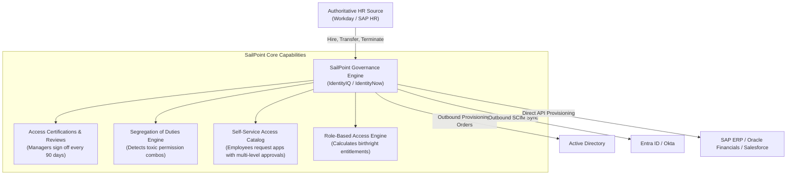

# 03. SailPoint IdentityIQ and IdentityNow

[⬅️ Prev: Okta Workforce Identity](./02_Okta_Workforce_Identity.md) | [Back to Tools Track](./README.md) | [Next: CyberArk Privileged Access ➡️](./04_CyberArk_Privileged_Access_Security.md)

---

### 🎓 Beginner's Compass: Decoded Acronyms & Terms
- **SailPoint**: The market leader in **Identity Governance and Administration (IGA)**.
- **IdentityIQ (IIQ)**: SailPoint's on-premises, highly customizable enterprise governance software.
- **IdentityNow (IDN)**: SailPoint's modern multi-tenant Software-as-a-Service (SaaS) cloud governance platform.
- **Access Certification (Attestation)**: A scheduled audit where managers inspect and approve or revoke their employees' permissions.
- **Entitlement Catalog**: A structured directory of all granular permissions across all connected company systems.
- **Role Mining**: Using AI to analyze what permissions employees actually use, and bundling them into clean, standardized job roles.
- **Segregation of Duties (SoD)**: Enforcing business policies that prevent fraud (e.g., blocking an accountant from having both billing creation and payment approval rights).

---

### 1. Plain-English Walkthrough: The Corporate Building Inspector

#### What is SailPoint?
Beginners often ask: *"We already have Okta for SSO and Active Directory for computers. Why does our company spend \$500,000 on SailPoint?"*

Here is the plain-English truth:
- **Okta and Active Directory** are like the **door locks** on the building. They let people in.
- **SailPoint** is the **Chief Building Inspector and Auditor**. 
  - SailPoint doesn't care about logging you into Zoom.
  - SailPoint cares about: *"Why does Bob have access to the financial wire-transfer database? Who approved it? When was it reviewed? Does this violate federal Sarbanes-Oxley (SOX) laws?"*

#### What Happens Without SailPoint?
- When external auditors (like PwC or Ernst & Young) inspect the company, IT has to spend 3 months manually building Excel spreadsheets of 10,000 user accounts.
- Transferred employees accumulate "access creep"—retaining permissions from their last 3 departments.
- The company fails regulatory compliance audits and receives millions of dollars in federal fines.

---

### 2. Key Capabilities & Technical Features

#### 1. Automated Access Certification Campaigns
Federal regulations require regular audits of sensitive financial and medical data.
- SailPoint launches an automated campaign: every manager receives a clean dashboard listing their direct reports and their entitlements.
- The manager clicks **[Approve]** or **[Revoke]**.
- If revoked, SailPoint **automatically connects to the target system and strips the permission**.

#### 2. Segregation of Duties (SoD) Conflict Detection
SailPoint stops fraud before it starts:
- If an employee in Procurement requests access to the "Vendor Payment Approval" group in SAP, SailPoint runs an instant policy check.
- It detects that the user already belongs to the "Vendor Invoice Creation" group.
- SailPoint displays a **Toxic Combination Conflict Alert** and blocks the request unless an executive signs an explicit risk acceptance waiver.

#### 3. Out-of-the-Box Target Connectors
SailPoint features hundreds of specialized enterprise connectors that go far beyond standard SCIM:
- Direct connectors to mainframe RACF, IBM AS/400, SAP ECC/S4HANA, Epic Healthcare, Oracle Databases, and Linux servers.

---

### 3. Day in the Life of a SailPoint IAM Engineer

| Responsibility | Operational Task |
| :--- | :--- |
| **Connector Maintenance** | Troubleshooting failed synchronization runs with Active Directory or SAP. |
| **Lifecycle State Rules** | Configuring BeanShell rules (IdentityIQ) or Transforms (IdentityNow) to map Workday job codes to access groups. |
| **Audit Campaign Operations** | Launching the Q4 Sarbanes-Oxley (SOX) Access Certification campaign for 2,500 managers. |
| **Orphan Account Remediation** | Investigating accounts discovered during target system aggregation that do not correlate to any active HR identity. |

---

### 4. Common Beginner Mistakes vs. Best Practices

| Common Beginner Mistake | Real-World Risk | Industry Best Practice |
| :--- | :--- | :--- |
| **Overly Complex Custom Coding** | Writing thousands of lines of custom Java/BeanShell rules in IdentityIQ makes upgrades nearly impossible. | Rely on out-of-the-box configuration and standard REST APIs wherever possible. |
| **Ignoring Certification Fatigue** | Sending managers 300 line-item reviews causes them to blindly approve everything without reading. | Implement **Micro-Certifications** and risk-based reviews: highlight unusual or high-risk entitlements in red. |
| **Treating IGA as an IT Project** | Implementing SailPoint without engaging HR and Business Application Owners leads to broken business workflows. | Partner with Business Data Owners to define clean role definitions before turning on automated provisioning. |

---

### 5. Recommended Next Steps
Once general employee access is governed, how do we lock down the most dangerous credentials in the company—administrative passwords?
- [04. CyberArk Privileged Access Security Deep Dive ➡️](./04_CyberArk_Privileged_Access_Security.md)
