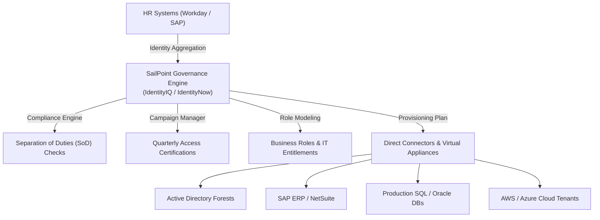

# 03. SailPoint IdentityIQ and IdentityNow Deep Dive

[⬅️ Prev: Okta](./02_Okta_Workforce_Identity.md) | [Back to Tools](./README.md) | [Next: CyberArk PAM ➡️](./04_CyberArk_Privileged_Access_Security.md)

---

### 1. Platform Overview & Identity Governance

While Access Management tools (Okta, Entra ID) operate at runtime during login, **SailPoint** is the market leader in enterprise **Identity Governance and Administration (IGA)**. It answers the critical compliance questions:
- *Who has access to what, and who authorized it?*
- *Is the access compliant with regulations (SOX, HIPAA, PCI-DSS, ISO 27001)?*
- *Are there toxic combinations of access that violate Separation of Duties (SoD)?*

SailPoint offers two enterprise architectures:
- **IdentityIQ (IIQ)**: On-premises, highly customizable Java-based enterprise engine deployed on dedicated application servers (Tomcat/WebLogic) connecting to an enterprise relational database (Oracle/SQL Server).
- **IdentityNow (Identity Security Cloud)**: Cloud-native, SaaS-delivered multi-tenant governance platform with lightweight on-premises Virtual Appliances (VAs) bridging local networks.



---

### 2. Core Governance Mechanisms

#### A. Identity Correlation & Aggregation
When SailPoint aggregates accounts from an Active Directory domain or an SAP instance, it evaluates correlation rules to match individual accounts to a single master **Identity Cube**:
```java
// SailPoint IdentityIQ Correlation Rule Example (Beanshell/Java)
String accountEmail = link.getAttribute("mail");
if (accountEmail != null) {
    QueryOptions qo = new QueryOptions();
    qo.addFilter(Filter.eq("email", accountEmail));
    Iterator it = context.search(Identity.class, qo);
    if (it.hasNext()) {
        Identity matchedUser = (Identity) it.next();
        return matchedUser.getName(); // Correlate account to master identity
    }
}
return null; // Flag as Uncorrelated / Orphaned account
```

#### B. Separation of Duties (SoD) Policy Definition
SailPoint allows compliance teams to define mathematical matrices of conflicting entitlements:
- **Toxic Pair**: `SAP_AR_INVOICE_CREATE` (Accounts Receivable: Create Invoice) AND `SAP_AP_PAYMENT_APPROVE` (Accounts Payable: Approve Payment).
- If a manager attempts to grant both to an employee, SailPoint intercepts the request, blocks fulfillment, and demands an executive risk waiver.

#### C. Access Certification Campaigns
Orchestrating quarterly audit reviews:
- Automatically groups review tasks by direct manager or application entitlement owner.
- Pre-calculates risk indicators: highlights if an employee has not used an entitlement in over 90 days.
- Automatically revokes denied entitlements across target systems upon campaign completion.

---

### 3. Best Practices for IGA Implementations

1. **Never Allow Manual Provisioning to Bypass Governance**: If system administrators manually add users directly inside Active Directory or SAP, SailPoint will flag the accounts as **Out-of-Band Modifications**. All changes should originate from SailPoint to preserve the audit trail.
2. **Prioritize Role Mining**: Do not attempt to define 1,000 distinct roles manually on Day 1. Use SailPoint's machine learning role mining algorithms to cluster employees with similar access and create parameterized baseline roles.
3. **Monitor Uncorrelated Accounts Weekly**: Every account discovered on a database or server that does not link to an active human employee record is an **Orphaned Account** and potential audit finding.
