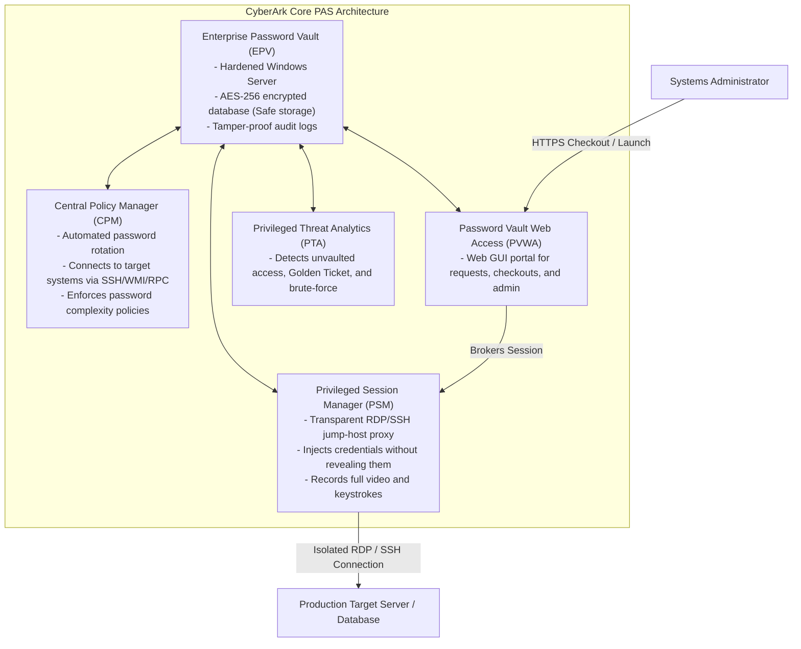

# 04. CyberArk Privileged Access Security (PAS) Deep Dive

[⬅️ Prev: SailPoint](./03_SailPoint_IdentityIQ_and_IdentityNow.md) | [Back to Tools](./README.md) | [Next: HashiCorp Vault ➡️](./05_HashiCorp_Vault_for_Secrets.md)

---

### 1. Platform Overview & Enterprise Architecture

**CyberArk** is the global benchmark for enterprise **Privileged Access Management (PAM)**. Its purpose is to secure, rotate, isolate, and audit all elevated accounts—including Windows Domain Admins, Linux root credentials, database sysadmins, network firewall credentials, and cloud root accounts.



---

### 2. Core Modules & Operational Workings

#### A. Enterprise Password Vault (EPV) & Safes
Credentials are stored inside logical containers called **Safes**:
- Access to a Safe is governed by granular permissions (e.g., `Retrieve Account`, `Store Account`, `View Audit`).
- Safes are partitioned by environment and sensitivity: `Safe_Windows_Prod_Admins`, `Safe_Network_Firewalls_Core`.

#### B. Central Policy Manager (CPM) Automated Password Rotation
The CPM connects directly to target servers to change passwords according to enterprise policy:
1. **Periodic Rotation**: Every 30, 60, or 90 days, the CPM connects to a target Windows server via RPC/WMI or a Linux server via SSH.
2. It generates a cryptographically random 64-character password, updates the password on the target machine, verifies the new credential works, and updates the encrypted record in the Vault.
3. **One-Time Passwords (Exclusive Check-Out)**: When an admin checks out a credential for an emergency change, the password is valid only for the duration of the ticket. When checked back in, the CPM **immediately rotates the password on the target host**, rendering any cached password obsolete.

#### C. Privileged Session Manager (PSM) Jump-Host Proxy
The administrator connects to PVWA and clicks **Connect**:
- CyberArk opens an RDP/SSH proxy session through the PSM jump server.
- The PSM server retrieves the administrative credential from the Vault in memory, injects it into the session protocol, and authenticates to the target machine.
- **The human administrator never sees or knows the password.**
- The PSM records video, records all keystrokes, indexes typed commands, and terminates the session if a forbidden command (`rm -rf /` or `format C:`) is typed.

---

### 3. CyberArk REST API: Automating Privileged Account Management

Enterprises automate CyberArk Safe checkouts and onboarding via REST API:

```python
import requests
import json

PVWA_URL = "https://cyberark.corp.contoso.com/PasswordVault/API"

# 1. Authenticate to CyberArk PVWA
auth_payload = {
    "username": "api_automation_user",
    "password": "SecureServicePassword123!"
}
auth_resp = requests.post(f"{PVWA_URL}/Auth/Cyberark/Logon", json=auth_payload, verify=True)
session_token = auth_resp.text.replace('"', '')

headers = {
    "Authorization": session_token,
    "Content-Type": "application/json"
}

# 2. Retrieve an account password for an automated deployment pipeline
account_id = "142_3"
pass_resp = requests.post(
    f"{PVWA_URL}/Accounts/{account_id}/Password/Retrieve",
    headers=headers,
    json={"reason": "Automated deployment task - Ticket CHG94821"}
)
retrieved_password = pass_resp.text.replace('"', '')
print("[+] Ephemeral administrative password retrieved from Vault successfully.")
```

---

### 4. Enterprise PAM Security Hardening Rules

- **Isolate the Vault Server**: The EPV must be deployed on bare-metal or dedicated virtualization with zero external internet access, zero third-party software, and physical security controls.
- **Block Direct RDP/SSH to Target Systems**: Configure network firewalls so that production database and domain controllers accept management traffic (RDP/SSH) **exclusively from CyberArk PSM jump-host IP addresses**. Any direct admin connection attempting to bypass the PSM is an immediate security alert.
