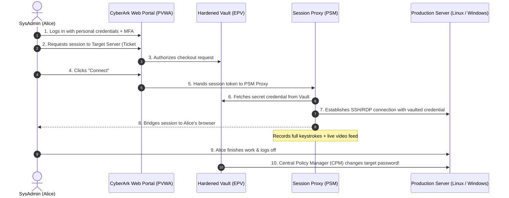
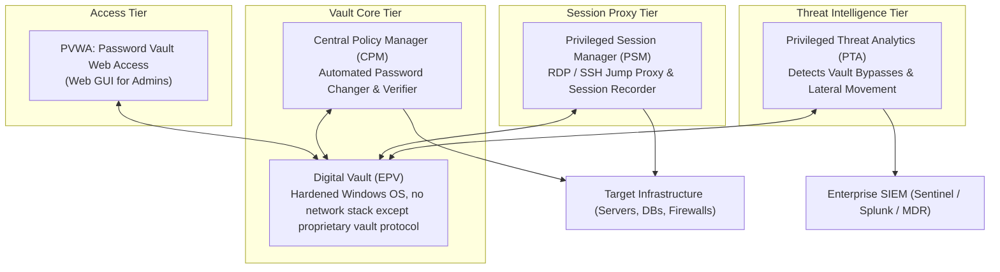

# 04. CyberArk Privileged Access Security (PAS)

[⬅️ Prev: SailPoint IGA](./03_SailPoint_IdentityIQ_and_IdentityNow.md) | [Back to Tools Track](./README.md) | [Next: HashiCorp Vault ➡️](./05_HashiCorp_Vault_for_Secrets.md)

---

### 🎓 Beginner's Compass: Decoded Acronyms & Terms
- **CyberArk Privileged Access Security (PAS)**: The enterprise gold standard platform for securing, managing, and auditing privileged accounts (passwords, SSH keys, admin accounts).
- **EPV (Enterprise Password Vault)**: The cryptographically hardened vault server where administrative credentials are encrypted and stored.
- **CPM (Central Policy Manager)**: The automated daemon engine that connects to target servers to change and verify passwords on a schedule (e.g., every 30 days or immediately upon check-in).
- **PSM (Privileged Session Manager)**: The jump-server proxy that isolates user desktops from target servers, recording live video and keystrokes of all admin sessions.
- **PVWA (Password Vault Web Access)**: The web portal where engineers log in to check out accounts or launch secure sessions.
- **PTA (Privileged Threat Analytics)**: Machine-learning security engine that alerts the SOC if an admin account is used from an unauthorized IP or bypasses the CyberArk vault.

---

### 1. Plain-English Walkthrough: The Bank Vault & Armored Escort

#### What Problem Does CyberArk Solve?
Imagine a company with 5,000 servers (Windows, Linux, databases, firewalls):
- Every server has a superuser account: `root` or `Administrator`.
- If an IT engineer knows the `root` password, they could log in at 2:00 AM, wipe customer records, and walk away.
- Or worse: if a hacker phishes one sysadmin, they discover the root password stored in a spreadsheet and compromise the entire company!

#### The CyberArk Solution:
- **No human being knows the root password!**
- Passwords are 100-character random strings generated and stored inside the **CyberArk Vault (EPV)**.
- When Engineer Alice needs to fix Database #1:
  1. She logs into the CyberArk web portal with her personal credentials and MFA.
  2. She enters her maintenance ticket number.
  3. She clicks **[Connect]**.
  4. CyberArk opens a remote session through a secure proxy (**PSM**). CyberArk injects the password into the database behind the scenes.
  5. Alice does her work. Her entire session is recorded on video.
  6. When Alice disconnects, the **CPM** automatically rotates the database password to a brand-new random string.

---

### 2. Architecture: The Core CyberArk Components

---

### 3. How CyberArk Integrates with SOC and MDR Teams

One of CyberArk's most critical functions is **detecting Vault Bypasses**:
- A target server's `root` password should **only** ever be used through CyberArk.
- If an attacker compromises a server directly and types the `root` password on the physical console without checking it out through CyberArk, **CyberArk PTA instantly fires a Critical Alert**:
  - *"UNAUTHORIZED PRIVILEGED ACCESS: root logged in directly to DB-PROD-01 bypassing the CyberArk Vault!"*
- The alert routes immediately to the **MDR / SOC team**, who isolates the server from the network within seconds!

---

### 4. Common Beginner Mistakes vs. Best Practices

| Common Beginner Mistake | Real-World Risk | Industry Best Practice |
| :--- | :--- | :--- |
| **Allowing "Show Password" Button** | Letting admins click "Show Password" and copy credentials onto their local laptops defeats session recording and credential isolation. | Disable "Show Password" permissions. Enforce connection exclusively through **PSM Jump Proxies**. |
| **No Dual-Custody for Domain Admins** | Allowing any engineer to check out the Domain Admin password without a second person approving. | Enforce **Dual-Custody Approvals**: a team lead or manager must approve Domain Admin checkouts before the vault releases credentials. |
| **Neglecting Unmanaged Accounts** | Vaulting known servers while rogue servers remain unmanaged in the network. | Run automated **CyberArk Discovery Scans** weekly to find unvaulted local admin accounts and automatically onboard them. |

---

### 5. Recommended Next Steps
CyberArk excels at managing human administrative passwords. But how do we secure machine-to-machine secrets, cloud API keys, and microservices?
- [05. HashiCorp Vault for Secrets Management Deep Dive ➡️](./05_HashiCorp_Vault_for_Secrets.md)
