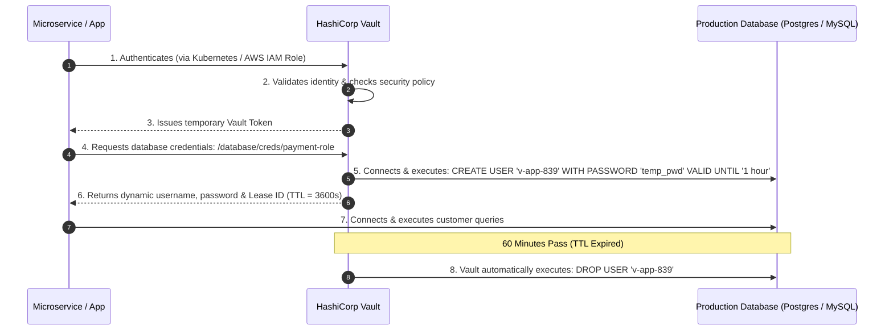

# 05. HashiCorp Vault for Secrets Management

[⬅️ Prev: CyberArk PAS](./04_CyberArk_Privileged_Access_Security.md) | [Back to Tools Track](./README.md) | [Next: Operational Workflows Track ➡️](../05_Workflows_and_Processes/README.md)

---

### 🎓 Beginner's Compass: Decoded Acronyms & Terms
- **HashiCorp Vault**: An identity-based secrets and encryption management system designed primarily for applications, APIs, microservices, and modern cloud workloads.
- **Secret**: Any sensitive piece of data you want to tightly control: database passwords, API keys, TLS certificates, SSH private keys.
- **Dynamic Secret**: A credential that **does not exist** until an application asks for it, is generated on-the-fly with an expiration timer (TTL), and is automatically destroyed when done!
- **Lease & TTL (Time-To-Live)**: The lifespan of a secret (e.g., valid for 30 minutes). When the TTL expires, Vault destroys the credential.
- **Transit Secrets Engine**: Using Vault as "Encryption-as-a-Service" so applications can encrypt credit cards or Social Security numbers without ever holding the encryption keys themselves.
- **Unsealing**: The security process required when Vault boots up, requiring multiple cryptographic key shards (Shamir's Secret Sharing) to unlock the master encryption key.

---

### 1. Plain-English Walkthrough: The Vending Machine for Temporary Passwords

#### The Problem: Hardcoded Static Passwords
Imagine a web application with 20 microservices (containers) running in Kubernetes:
- The payment service needs to connect to the PostgreSQL database.
- Traditionally, developers wrote `db_password = "SuperSecret123!"` inside an environment file.
- That password stays the same for 3 years.
- 50 developers have read access to the file. If one developer quits or copies it, the database is exposed.

#### The Vault Solution: Dynamic On-Demand Passwords
- When the payment container boots up, it contacts HashiCorp Vault using its Kubernetes Service Account identity.
- It asks: *"Please give me temporary database credentials."*
- Vault connects to PostgreSQL and creates a brand-new, unique user:
  - Username: `v-token-pay-a89f712`
  - Password: `K9#m$L2!zQ9...`
  - Expiration: **60 minutes**.
- The app uses this temporary account.
- In 60 minutes, Vault sends a drop command to PostgreSQL, erasing the user from existence.
- **The Result**: Even if an attacker steals the password from server memory, it expires before they can use it!

---

### 2. Key Capabilities & Technical Features

#### 1. Dynamic Secrets Engines
Vault integrates natively with databases (PostgreSQL, MySQL, Oracle, MongoDB), cloud providers (AWS, Azure, GCP), and messaging platforms to generate short-lived credentials programmatically.

#### 2. Transit Engine (Encryption as a Service)
- Many compliance frameworks (PCI-DSS for credit cards, HIPAA for healthcare) legally mandate encrypting sensitive data at rest.
- Instead of developers trying to write their own encryption algorithms (which often leads to severe security bugs), the application sends raw data to Vault:
  - App sends: `"4111-2222-3333-4444"`
  - Vault returns: `"vault:v1:8BfA9...encrypted_ciphertext..."`
- The application stores the ciphertext in its database. The master encryption keys **never leave Vault**.

#### 3. Auto-Unseal & Shamir's Secret Sharing
When Vault starts, its storage is completely encrypted.
- By default, Vault uses **Shamir's Secret Sharing Algorithm** to divide the master unseal key into 5 pieces (shards).
- Any 3 of the 5 keyholders must submit their key shards to unlock the vault.
- In modern cloud environments, **Cloud KMS Auto-Unseal** (AWS KMS, Azure Key Vault) automatically unseals Vault nodes securely on boot.

---

### 3. Common Beginner Mistakes vs. Best Practices

| Common Beginner Mistake | Real-World Risk | Industry Best Practice |
| :--- | :--- | :--- |
| **Storing Root Tokens** | Using the initial Vault `root` token for regular application administration leaves a permanent god-mode key active. | Revoke the root token immediately after initial setup; configure identity-based admin policies. |
| **Infinite Leases** | Setting lease TTLs to 30 days defeats the entire purpose of dynamic secrets. | Keep TTLs short (e.g., 1 hour to 24 hours max); require applications to renew leases actively. |
| **Hardcoding Vault Tokens** | Storing Vault authentication tokens in git repos or local text files recreates the exact secret sprawl problem. | Use platform-native authentication: **Kubernetes Service Accounts**, **AWS IAM Roles**, or **Azure Managed Identities** to log into Vault without static credentials. |

---

### 4. Recommended Next Steps
Now that you have mastered the Tools and Platforms of enterprise identity, dive into the operational standard operating procedures executed by IAM engineers:
- [05. Workflows and Processes: Joiner Process SOP ➡️](../05_Workflows_and_Processes/01_Joiner_Process_Employee_Onboarding.md)
