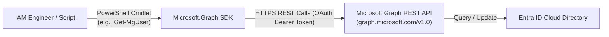

# 06. IAM Automation with PowerShell and Microsoft Graph API

[⬅️ Prev: HashiCorp Vault](./05_HashiCorp_Vault_for_Secrets.md) | [Back to Tools Track](./README.md) | [Next: Operational Workflows Track ➡️](../05_Workflows_and_Processes/README.md)

---

### 🎓 Beginner's Compass: Decoded Acronyms & Tools
- **Microsoft Graph API**: The unified REST API gateway connecting you to all data across Microsoft Cloud (Entra ID, Microsoft 365, Teams, Intune).
- **Microsoft Graph PowerShell SDK**: The official modern PowerShell module (`Microsoft.Graph`) used by cloud engineers to manage Entra ID users, groups, and licenses via command line.
- **`Connect-MgGraph`**: The command used to authenticate your PowerShell session to Microsoft Entra ID.
- **Scopes (Permissions)**: The specific delegated or application rights requested by your script (e.g., `User.ReadWrite.All`, `Directory.Read.All`).
- **Active Directory Module (`ActiveDirectory`)**: The traditional on-premises PowerShell module used to manage Windows Server Domain Controllers and users (`Get-ADUser`, `Set-ADUser`).
- **`Revoke-MgUserSignInSession`**: The emergency command that revokes all active refresh tokens and browser sessions for a compromised user immediately.

---

### 1. Why IAM Engineers Must Know PowerShell

Beginners often think: *"Why can't I just click buttons in the web portal?"*

In a small office with 15 people, clicking buttons in the portal works.  
**In an enterprise with 20,000 employees across 40 countries**:
- You cannot click through 20,000 users one by one to find who hasn't logged in for 90 days.
- You cannot manually click 500 times to assign licenses to an entire newly acquired subsidiary.
- When an executive's laptop is stolen at 2:00 AM, you need an instant 1-second script to terminate all active sessions, rather than clicking through 10 menus!



---

### 2. The Essential Cmdlets Every IAM Engineer Must Memorize

#### A. Microsoft Graph Cloud Cmdlets (Entra ID)
| Cmdlet | What It Does | Common Real-World Use Case |
| :--- | :--- | :--- |
| `Connect-MgGraph` | Authenticates to Entra ID | `Connect-MgGraph -Scopes "User.ReadWrite.All", "Group.ReadWrite.All"` |
| `Get-MgUser` | Retrieves cloud user profiles | `Get-MgUser -Filter "Department eq 'Finance'" -Property DisplayName, UserPrincipalName` |
| `New-MgUser` | Provisions a new cloud user | Automating new employee onboarding via script |
| `Update-MgUser` | Modifies user attributes | Changing job title, department, or office location |
| `Revoke-MgUserSignInSession` | Emergency token revocation | Instant session kill-switch during an active account breach |
| `Get-MgAuditLogSignIn` | Pulls sign-in activity logs | Searching for failed logins from specific foreign IP addresses |

#### B. On-Premises Active Directory Cmdlets
| Cmdlet | What It Does | Common Real-World Use Case |
| :--- | :--- | :--- |
| `Get-ADUser` | Queries on-prem AD accounts | `Get-ADUser -Identity "asmith" -Properties *` |
| `Set-ADUser` | Updates on-prem user attributes | Disabling accounts, updating manager attributes |
| `Unlock-ADAccount` | Unlocks a locked domain account | Resolving employee password lockout tickets in seconds |
| `Search-ADAccount` | Searches accounts by condition | `Search-ADAccount -AccountInactive -TimeSpan 90.00:00:00` |

---

### 3. Production-Ready IAM Automation Scripts

#### Script 1: Emergency Session Kill-Switch (Account Lockdown)
When a SOC analyst or MDR team confirms a user's session token has been hijacked by an adversary:

```powershell
# Authenticate with User and Security Admin scopes
Connect-MgGraph -Scopes "User.ReadWrite.All"

$TargetUser = "compromised.user@contoso.com"

Write-Host "[!] INITIATING EMERGENCY LOCKDOWN FOR: $TargetUser" -ForegroundColor Yellow

# 1. Disable account login
Update-MgUser -UserId $TargetUser -AccountEnabled $false
Write-Host "[+] User account login disabled." -ForegroundColor Green

# 2. Revoke all active browser sessions, OAuth refresh tokens, and cookies
Revoke-MgUserSignInSession -UserId $TargetUser
Write-Host "[+] All active sessions and refresh tokens REVOKED immediately!" -ForegroundColor Green

# 3. Verify user status
Get-MgUser -UserId $TargetUser | Select-Object DisplayName, UserPrincipalName, AccountEnabled
```

#### Script 2: Identify Stale / Inactive Accounts (Audit Compliance)
To prevent **orphaned accounts** (ex-employees or forgotten contractors), run this audit script:

```powershell
Connect-MgGraph -Scopes "AuditLog.Read.All", "User.Read.All"

# Define threshold (90 days ago)
$InactiveDays = 90
$CutoffDate = (Get-Date).AddDays(-$InactiveDays)

Write-Host "Scanning for accounts inactive since: $($CutoffDate.ToString('yyyy-MM-dd'))..."

# Fetch all enabled users with their last sign-in telemetry
$Users = Get-MgUser -All -Property DisplayName, UserPrincipalName, SignInActivity, AccountEnabled |
    Where-Object { $_.AccountEnabled -eq $true }

$StaleUsers = foreach ($user in $Users) {
    $LastSignIn = $user.SignInActivity.LastSignInDateTime
    if ($LastSignIn -and ($LastSignIn -lt $CutoffDate)) {
        [PSCustomObject]@{
            DisplayName       = $user.DisplayName
            UserPrincipalName = $user.UserPrincipalName
            LastSignInDate    = $LastSignIn
            DaysInactive      = (New-TimeSpan -Start $LastSignIn -End (Get-Date)).Days
        }
    }
}

# Export findings to CSV for compliance auditors
$StaleUsers | Export-Csv -Path "./Stale_Accounts_Report.csv" -NoTypeInformation
Write-Host "Found $($StaleUsers.Count) stale accounts. Report exported to Stale_Accounts_Report.csv" -ForegroundColor Cyan
```

---

### 4. Common Beginner Mistakes vs. Best Practices

| Common Beginner Mistake | Real-World Risk | Industry Best Practice |
| :--- | :--- | :--- |
| **Hardcoding Passwords in Scripts** | Writing `$password = "P@ssword123!"` inside `.ps1` files and saving them to shared drives allows anyone to read admin credentials. | Use **Managed Identities** in Azure automation, or store secrets in **Azure Key Vault** / HashiCorp Vault. |
| **Using Global Admin for Scripts** | Running PowerShell scripts with permanent Global Administrator credentials creates a catastrophic blast radius if intercepted. | Grant scripts only the **least privileged Microsoft Graph application scopes** (e.g., `User.Read.All` instead of `Directory.AccessAsUser.All`). |
| **Using Deprecated AzureAD Module** | Writing scripts using legacy `AzureAD` or `MSOnline` modules that Microsoft has deprecated and retired. | Use exclusively the modern **Microsoft Graph PowerShell SDK (`Microsoft.Graph`)**. |

---

### 5. Recommended Next Steps
Now that you have mastered the tools, directories, and automation scripts, discover how IAM engineers execute real-world enterprise standard operating procedures:
- [05. Workflows and Processes: Joiner Process SOP ➡️](../05_Workflows_and_Processes/01_Joiner_Process_Employee_Onboarding.md)
