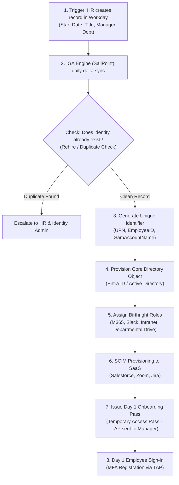

# 01. Joiner Process: Employee Onboarding SOP

[⬅️ Back to Workflows](./README.md) | [Next: Mover Process ➡️](./02_Mover_Process_Role_Transfer.md)

---

### 1. Workflow Architecture Diagram

---

### 2. Standard 8-Point Operational Breakdown

#### 1. Trigger
- An HR Business Partner marks a new candidate record as "Ready for Hire" or "Hired" in the authoritative HRIS (e.g., Workday, SAP SuccessFactors) with an effective start date $\le 7$ days in the future.

#### 2. Responsible Parties (RACI Matrix)
- **Accountable**: IAM Operations Lead.
- **Responsible**: Automated IGA Engine (SailPoint) / IAM Operations Analyst.
- **Consulted**: Hiring Manager, HR Operations.
- **Informed**: IT Asset Management (Hardware Provisioning), Facilities.

#### 3. Required Tools & Information
- **Tools**: Workday (HRIS), SailPoint IdentityIQ/IdentityNow, Microsoft Entra ID / Active Directory, ServiceNow.
- **Input Attributes**: Full Legal Name, Preferred Name, National ID / SSN Hash, Personal Email, Mobile Phone, Job Title, Cost Center, Manager ID, Physical Office Location.

#### 4. Step-by-Step Execution Procedure
1. **Identity Extraction**: The IGA platform runs an automated synchronization job against the HRIS API every 2 hours.
2. **Correlation & Disambiguation**: The engine evaluates if the incoming record matches a former employee (Rehire) based on National ID Hash or unique tax identifier.
3. **Identifier Generation**: Algorithmic generation of the username (`firstname.lastname@company.com`). If collisions occur, append sequential integers (`firstname.lastname2@company.com`).
4. **Directory Account Creation**:
   - Creates user object in Active Directory `OU=Onboarding,OU=Users,DC=corp,DC=contoso,DC=com`.
   - Replicates object to Microsoft Entra ID via Entra Connect Sync.
5. **Birthright Entitlement Assignment**:
   - Enrolls user into baseline dynamic security groups (`All-Employees-Security-Group`, `Dept-Marketing-General`).
   - Assigns Microsoft 365 E5 license.
6. **Downstream SCIM Sync**: Pushes provisioning commands to federated applications (Slack, Zoom).
7. **Credential Provisioning**:
   - Generates an Entra ID Temporary Access Pass (TAP) with a 72-hour validity window.
   - Dispatches encrypted onboarding packet with TAP to the hiring manager's corporate email.
8. **Day 1 First-Time Login**:
   - Employee boots corporate laptop, enters UPN and TAP.
   - System prompts mandatory FIDO2 Security Key or Microsoft Authenticator number-matching enrollment.
   - TAP is automatically invalidated once permanent MFA is established.

#### 5. Decision Points & Logic Gates
- **IF** the start date is more than 14 days away, **THEN** stage account in disabled status; enable 24 hours prior to Day 1.
- **IF** identity is flagged as an external contractor, **THEN** require an explicit contract end-date attribute; route to Contractor OU.
- **IF** duplicate national identifier is discovered, **THEN** pause automation immediately to prevent duplicate account creation.

#### 6. Escalation Matrix
- **Data Mismatch in HR Record**: Escalate to HR Operations (SLA: 4 hours).
- **SCIM Provisioning API Failure**: Escalate to IAM L2 Operations (SLA: 2 hours).
- **Hiring Manager Missing / Inactive**: Escalate to Department Director.

#### 7. Expected Outcome
- The new employee arrives on Day 1, authenticates using a secure Temporary Access Pass, registers hardware-backed MFA, and immediately has access to all baseline communication and departmental applications with zero manual IT tickets.

#### 8. Documentation & Audit Evidence
- SailPoint LCM Provisioning Task ID and execution logs.
- Entra ID Audit Logs: Event `Add user` and `Add member to role`.
- ServiceNow automated fulfillment ticket closed with timestamp and correlation IDs.
