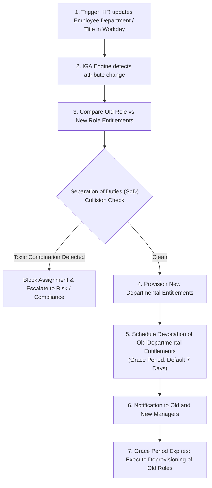

# 02. Mover Process: Internal Role Transfer SOP

[⬅️ Prev: Joiner Process](./01_Joiner_Process_Employee_Onboarding.md) | [Back to Workflows](./README.md) | [Next: Leaver Process ➡️](./03_Leaver_Process_Employee_Termination.md)

---

### 🎓 Beginner's Compass: Decoded Tools in This Workflow
- **Privilege Creep**: When Bob transfers from Customer Service to Software Engineering, but IT forgets to delete his Customer Service access. Over 5 years, Bob accumulates 50 permissions he doesn't need!
- **SoD (Separation of Duties)**: The accounting rule stating that the person who enters an invoice cannot be the person who wires the money to pay it.
- **Toxic Combination**: Two permissions that, when held by the same person, allow them to steal money or sabotage systems without anyone noticing.
- **Grace Period**: A temporary window (usually 7 days) where an employee keeps their old access while training their replacement.

---

### 1. Plain-English Walkthrough: What Actually Happens
1. Bob works in Customer Support. He applies for an internal job and gets promoted to Junior Software Developer.
2. HR updates Bob's department in Workday from "Customer Support" to "Software Engineering".
3. SailPoint (the IGA brain) detects the change and compares:
   - *What does a Developer need?* GitHub, AWS Dev Console, Docker repos.
   - *What does Customer Support need?* Zendesk, Customer Call Records.
4. SailPoint automatically checks for **Toxic Combinations**: Does Bob have permissions that violate compliance rules?
5. SailPoint grants Bob his new Developer access, and sets a 7-day timer.
6. When the 7-day timer hits zero, SailPoint automatically strips Bob's Zendesk access, preventing privilege creep!

---

### 2. Workflow Architecture Diagram

---

### 3. Standard 8-Point Operational Breakdown

#### 1. Trigger
- An internal transfer event in Workday (e.g., employee moves from "Customer Support" to "Software Development", or is promoted to a people manager).

#### 2. Responsible Parties (RACI Matrix)
- **Accountable**: Enterprise Information Security & Compliance Officer.
- **Responsible**: IGA System Automation / IAM Operations Analyst.
- **Consulted**: Previous Manager (relinquishing access), New Manager (authorizing access).
- **Informed**: The Employee, Service Desk.

#### 3. Required Tools & Information
- **Tools**: Workday, SailPoint IdentityIQ, Entra ID, ServiceNow.
- **Inputs**: Current Active Entitlements, New Department Code, New Manager ID, New Cost Center, Effective Transfer Date.

#### 4. Step-by-Step Execution Procedure
1. **Delta Detection**: IGA sync identifies that `Department` changed from `Support` to `Engineering`.
2. **Role Mining & Differential Analysis**:
   - Target Roles to Add: `Engineering-Base-Role`, `GitHub-Developer-Access`, `AWS-Dev-Role`.
   - Target Roles to Remove: `Support-Rep-Role`, `Zendesk-Agent-Access`, `Call-Recording-Viewer`.
3. **Toxic Combination / SoD Evaluation**:
   - Check against organizational compliance rules (e.g., User cannot have both "Code Deployment" and "Production Financial Ledger" permissions).
4. **Manager Notification & Grace Period Setting**:
   - An automated ticket is created in ServiceNow detailing the transition.
   - A **7-day transition grace period** is scheduled for operational handover unless immediate removal is flagged.
5. **Provisioning of New Roles**: New group memberships are provisioned in Active Directory and Entra ID.
6. **Grace Period Expiry**:
   - At day 7, 23:59:59 UTC, the IGA engine triggers automated deprovisioning jobs.
   - Old Active Directory groups are stripped; SaaS accounts associated exclusively with the old role are deleted or unassigned.
7. **Sign-off**: New manager receives an automated prompt to review and confirm final retained permissions.

#### 5. Decision Points & Logic Gates
- **IF** the transfer involves a high-risk role transition (e.g., leaving Internal Audit or Finance), **THEN** grace period is **0 days** (immediate revocation of old access prior to granting new access).
- **IF** old manager requests an extension past 14 days, **THEN** require written approval from the Chief Information Security Officer (CISO).

#### 6. Escalation Matrix
- **SoD Policy Collision**: Escalate to Governance, Risk & Compliance (GRC) team (SLA: 24 hours).
- **Transfer Conflict / Unresponsive Manager**: Escalate to HR Business Partner.

#### 7. Expected Outcome
- The employee smoothly transitions to their new team with full operational access on Day 1, while 100% of conflicting or unnecessary historical permissions are systematically eradicated, eliminating privilege creep.

#### 8. Documentation & Audit Evidence
- SailPoint LCM Mover Execution Audit Trail.
- Delta group modification events in Entra ID Audit Logs (Event: `Remove member from group`).
- Manager approval sign-offs stored in compliance repository for external auditors.
