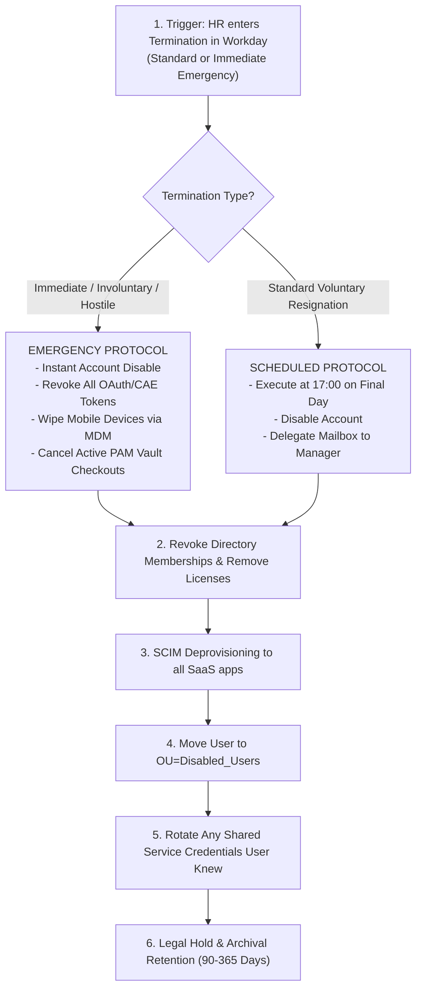

# 03. Leaver Process: Employee Deprovisioning SOP

[⬅️ Prev: Mover Process](./02_Mover_Process_Role_Transfer.md) | [Back to Workflows](./README.md) | [Next: Access Request Workflow ➡️](./04_Access_Request_and_Approval_Workflow.md)

---

### 1. Workflow Architecture Diagram



---

### 2. Standard 8-Point Operational Breakdown

#### 1. Trigger
- An HR Business Partner marks an employee as terminated in Workday.
- Can be classified as **Standard Voluntary** (resignation with notice) or **Involuntary / Immediate / Emergency** (layoff, disciplinary firing, security threat).

#### 2. Responsible Parties (RACI Matrix)
- **Accountable**: CISO & Head of HR.
- **Responsible**: IAM Operations Team / Automated IGA Engine.
- **Consulted**: Legal Counsel, Corporate Security (Physical Badging).
- **Informed**: Direct Manager, Helpdesk, Network Operations.

#### 3. Required Tools & Information
- **Tools**: Workday, SailPoint, Microsoft Entra ID, Microsoft 365 Admin Center, Intune MDM, CyberArk, Physical Badging System (Lenel/CCure).
- **Inputs**: User UPN, Employee ID, Effective Termination Timestamp, Involuntary Flag (Yes/No), Mailbox Delegation Target (Manager UPN).

#### 4. Step-by-Step Execution Procedure
1. **Immediate Session Termination (0-5 minutes)**:
   - Run PowerShell / Graph API to revoke all active refresh tokens:
     ```powershell
     Revoke-MgUserSignInsSession -UserId "user@company.com"
     ```
   - Continuous Access Evaluation (CAE) immediately severs active Outlook, Teams, and browser sessions.
2. **Directory Account Disablement**:
   - Set account status to `Disabled` (`AccountDisabled: True`).
   - Scramble password to a random 64-character unrecorded value.
   - Remove from all dynamic and static security groups.
3. **Physical & Device Isolation**:
   - Push Intune command to initiate remote retirement / corporate wipe of mobile devices.
   - Deactivate physical RFID building badge in facilities system.
4. **PAM & Privileged Account Revocation**:
   - Immediately terminate any active CyberArk PSM jump-host sessions.
   - Check for any local administrator or service account passwords checked out by the user; force an immediate CPM password rotation.
5. **Downstream SaaS Deprovisioning**:
   - IGA fires SCIM `PATCH /Users/{id} {"active": false}` to all integrated applications.
6. **Data Archival & Delegation**:
   - Grant manager Read access to user's OneDrive for Business and delegate Exchange Online mailbox for 30 days.
   - Convert user mailbox to a Shared Mailbox and unassign Microsoft 365 E5 license to recover cost.
7. **Directory Move**:
   - Move AD object to `OU=Disabled_Users,DC=corp,DC=contoso,DC=com`.
   - Set expiration timestamp on Active Directory object.

#### 5. Decision Points & Logic Gates
- **IF** Legal flags the employee for "Legal Hold", **THEN** do NOT delete mailbox or OneDrive; apply Microsoft Purview eDiscovery Preservation Hold indefinitely.
- **IF** the termination is hostile/involuntary, **THEN** execution must be triggered *simultaneously* with the HR exit meeting, not hours later.

#### 6. Escalation Matrix
- **Token Revocation API Failure**: Escalate immediately to IAM L3 on-call engineer (SLA: 15 minutes).
- **User Detected Logging In Post-Termination**: Escalate immediately to SOC as a P1 Security Incident.

#### 7. Expected Outcome
- The departing employee loses 100% of physical, network, cloud, SaaS, and privileged access within minutes of termination, zero data is exfiltrated, and expensive licenses are reclaimed.

#### 8. Documentation & Audit Evidence
- Timestamped Entra ID Sign-in and Audit Logs showing session revocation and account disablement.
- ServiceNow offboarding ticket signed off by IAM Operations and HR.
- SailPoint audit report demonstrating downstream SaaS deprovisioning completion.
