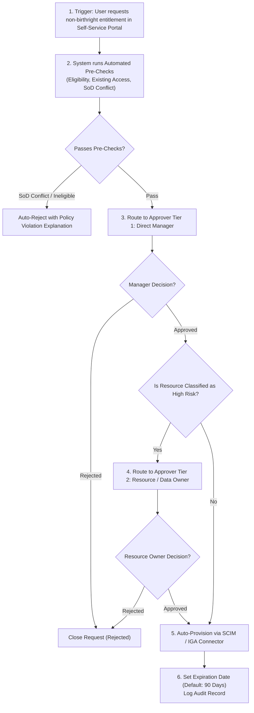

# 04. Access Request and Approval Workflow SOP

[⬅️ Prev: Leaver Process](./03_Leaver_Process_Employee_Termination.md) | [Back to Workflows](./README.md) | [Next: Access Review Campaign ➡️](./05_Access_Review_and_Certification_Campaign.md)

---

### 🎓 Beginner's Compass: Decoded Tools in This Workflow
- **Self-Service Access Portal**: An internal web catalog (like an Amazon shopping cart for software) where employees can search for software or database roles they need.
- **Entitlement**: The specific permission or group inside an application (e.g., "Salesforce Billing Manager", "AWS ReadOnlyAccess", "Marketing Shared Drive Write").
- **Multi-Tier Approval**: Requiring more than one person to approve access (e.g., your Direct Manager approves your need, AND the Financial Data Owner approves that you can see sensitive accounting numbers).
- **Time-Bound Access**: Granting permission with an automatic expiration timer (e.g., access automatically vanishes after 90 days unless renewed).

---

### 1. Plain-English Walkthrough: What Actually Happens
1. Charlie is an engineer who needs temporary access to the production customer database to fix a bug.
2. Charlie opens the company's ServiceNow or SailPoint web portal, finds "Production Database Read-Only", types his justification (*"Troubleshooting Ticket #9482"*), and clicks **Submit**.
3. The system checks if Charlie already has this access, or if this violates company policies.
4. Charlie's manager gets a prompt on Microsoft Teams and taps **Approve**.
5. The Database Owner gets an email and taps **Approve**.
6. The identity engine automatically adds Charlie to the database group and starts a **90-day countdown timer**.
7. In 90 days, Charlie's access automatically expires without anyone having to remember to delete it!

---

### 2. Workflow Architecture Diagram

---

### 3. Standard 8-Point Operational Breakdown

#### 1. Trigger
- An employee requires access to a specialized software application, network share, or database entitlement beyond their automatic birthright permissions.

#### 2. Responsible Parties (RACI Matrix)
- **Accountable**: Application Business Owner.
- **Responsible**: Requesting User, Approving Managers, Automated IGA Provisioning Engine.
- **Consulted**: Information Security & Compliance (for high-risk applications).
- **Informed**: Direct Manager.

#### 3. Required Tools & Information
- **Tools**: SailPoint IdentityNow / ServiceNow Service Catalog, Microsoft Entra ID.
- **Inputs**: Entitlement Name, Business Justification, Duration Required, Project/Billing Code.

#### 4. Step-by-Step Execution Procedure
1. **Self-Service Submission**: User navigates to company Access Portal, selects the entitlement (e.g., `Salesforce-Billing-Write`), enters a clear business justification, and submits.
2. **Automated Risk Pre-Screening**:
   - Engine evaluates if user already has this entitlement.
   - Engine evaluates if granting this creates an SoD violation with the user's existing roles.
3. **Tier 1 Approval (Direct Manager)**:
   - Manager receives notification. Manager verifies: *Does this employee need this for their job duties?*
4. **Tier 2 Approval (Resource Owner)**:
   - If the data is classified as Confidential or Financial, request routes to the designated Resource Owner.
   - Resource Owner verifies: *Does the employee meet compliance training requirements?*
5. **Automated Fulfillment**:
   - Upon dual approval, the IGA platform executes an API call adding the user to the underlying Entra ID Security Group.
6. **Time-Bound Expiration**:
   - A maximum validity window (e.g., 90 or 180 days) is assigned to the entitlement. When the window closes, the access automatically lapses unless re-certified.

#### 5. Decision Points & Logic Gates
- **IF** business justification is blank or says "need access", **THEN** system automatically rejects request.
- **IF** the approver does not respond within 5 business days, **THEN** system sends reminder; at 10 days, request is auto-cancelled.

#### 6. Escalation Matrix
- **Emergency Production Blockers**: Route to On-Call IAM Incident Manager for expedited out-of-band approval.
- **Approver Out of Office**: Auto-delegate approval to designated secondary deputy.

#### 7. Expected Outcome
- Access is granted transparently with documented multi-party approvals, zero manual IT intervention, and an enforced expiration date.

#### 8. Documentation & Audit Evidence
- Complete audit trail in ServiceNow / SailPoint: Request timestamp, requestor UPN, justification string, approving manager UPN, approval timestamp, and target group ID.
