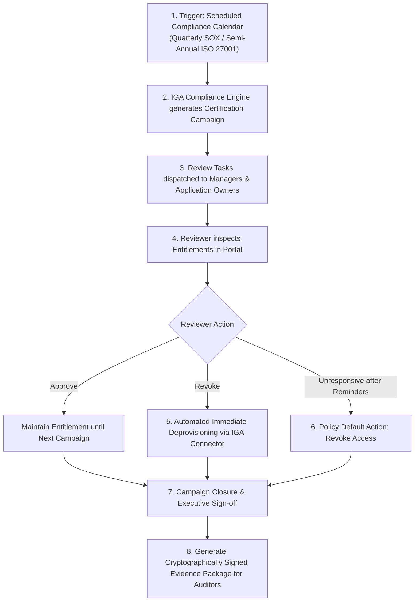

# 05. Access Review and Certification Campaign SOP

[⬅️ Prev: Access Request Workflow](./04_Access_Request_and_Approval_Workflow.md) | [Back to Workflows](./README.md) | [Next: Privileged Access JIT ➡️](./06_Privileged_Access_Just_In_Time_JIT_Request.md)

---

### 🎓 Beginner's Compass: Decoded Tools in This Workflow
- **Access Certification / Access Review**: A periodic compliance audit where managers must inspect every permission their direct reports hold and click "Approve" or "Revoke".
- **SOX (Sarbanes-Oxley Act)**: A federal US law passed after the Enron scandal requiring public corporations to prove to independent auditors that their financial computer systems cannot be tampered with.
- **Audit Finding**: When an external auditor discovers an ex-employee or unapproved person has access to company data, resulting in compliance penalties.
- **Certification Campaign**: The automated project launched in SailPoint that generates review checklists for 500 managers across the company simultaneously.

---

### 1. Plain-English Walkthrough: What Actually Happens
1. Every 90 days, the compliance calendar triggers an automated audit campaign.
2. SailPoint sends an email to every manager: *"Please review the permissions of your 8 direct reports"*.
3. The manager logs into the portal and sees a checklist:
   - *"Alice Smith has SAP Accounting Access. Has not logged in for 120 days. Keep or Revoke?"*
4. The manager clicks **Revoke**.
5. SailPoint immediately executes automated API scripts that delete Alice from the SAP security group.
6. The system stamps a cryptographic digital signature on the audit log so when external auditors (like PwC or EY) arrive, the company passes with zero manual paperwork!

---

### 2. Workflow Architecture Diagram

---

### 3. Standard 8-Point Operational Breakdown

#### 1. Trigger
- A scheduled compliance trigger established by the Governance, Risk, and Compliance (GRC) team (typically every 90 days for SOX in-scope systems, and annually for all general systems).

#### 2. Responsible Parties (RACI Matrix)
- **Accountable**: Chief Compliance Officer & Head of Identity Governance.
- **Responsible**: Reviewers (People Managers, System Owners).
- **Consulted**: External Auditors (PwC, EY).
- **Informed**: All Corporate Users.

#### 3. Required Tools & Information
- **Tools**: SailPoint IdentityIQ / IdentityNow Access Certifications module, Microsoft Entra ID Access Reviews.
- **Inputs**: Snapshot of all active accounts, group memberships, and role assignments as of the campaign start date.

#### 4. Step-by-Step Execution Procedure
1. **Campaign Scoping**: IAM Governance Lead defines campaign parameters: target applications (e.g., SAP, AWS, Workday), reviewer assignments, and 21-day completion window.
2. **Notification Dispatch**: Reviewers receive email alerts and dashboard tasks listing each direct report and their assigned entitlements.
3. **Reviewer Evaluation**: Reviewer assesses each entitlement using recent activity data provided in the console (e.g., *"Alice has not logged into SAP in 140 days"*).
4. **Action Execution**:
   - For legitimate access: Click **Certify / Approve**.
   - For unneeded access: Click **Revoke**.
5. **Automated Reminders**: Automated reminders dispatched at Day 7, Day 14, and Day 18.
6. **Automated Revocation**: When a reviewer clicks **Revoke**, the IGA platform automatically executes deprovisioning scripts to strip the role immediately.
7. **Campaign Finalization**: Campaign reaches 100% completion; remaining unreviewed items are acted upon based on enterprise default policy (e.g., auto-revoke).

#### 5. Decision Points & Logic Gates
- **IF** an entitlement is designated "Privileged / High Risk", **THEN** require sign-off from both the Manager AND the Resource Owner (Dual Certification).
- **IF** a manager leaves the company during an active campaign, **THEN** reassign review tasks to the manager's manager automatically.

#### 6. Escalation Matrix
- **Reviewer Non-Compliance (> 21 Days Overdue)**: Escalate to Department Vice President and Internal Audit.

#### 7. Expected Outcome
- Unused, excessive, and obsolete entitlements are purged across the enterprise, maintaining a clean least-privilege security baseline and passing external regulatory audits.

#### 8. Documentation & Audit Evidence
- Final Certification Summary Report with SHA-256 digital signature, reviewer IDs, timestamps, and line-item approval/revocation logs.
