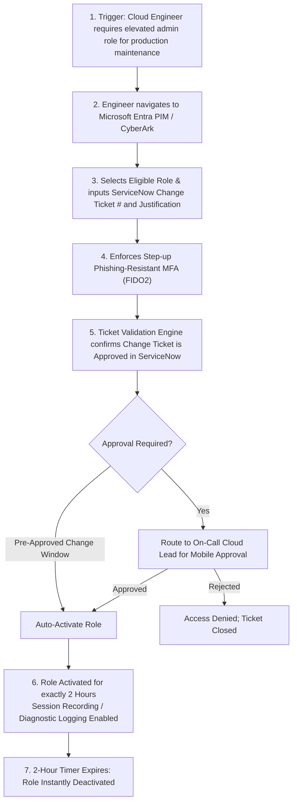

# 06. Privileged Access Just-In-Time (JIT) Request SOP

[⬅️ Prev: Access Review Campaign](./05_Access_Review_and_Certification_Campaign.md) | [Back to Workflows](./README.md) | [Next: Identity Incident Investigation ➡️](./07_Identity_Security_Incident_Investigation.md)

---

### 1. Workflow Architecture Diagram

---

### 2. Standard 8-Point Operational Breakdown

#### 1. Trigger
- An engineer needs to perform an administrative action requiring elevated privileges (e.g., restarting a production database, modifying cloud routing tables, or rotating root certificates).

#### 2. Responsible Parties (RACI Matrix)
- **Accountable**: Cloud Infrastructure & Security Operations Lead.
- **Responsible**: Requesting Engineer, Approving Lead.
- **Consulted**: Change Advisory Board (CAB).
- **Informed**: SOC Monitoring Team.

#### 3. Required Tools & Information
- **Tools**: Microsoft Entra Privileged Identity Management (PIM) / CyberArk Privileged Access Manager, ServiceNow Change Management.
- **Inputs**: Target Role Name (e.g., `Global Administrator`, `Contributor`), ServiceNow Change Request ID (`CHG0098412`), Activation Duration (max 4 hours).

#### 4. Step-by-Step Execution Procedure
1. **Accessing Portal**: Engineer opens Entra PIM or CyberArk portal using their standard user account.
2. **Initiating Activation**: Selects their pre-assigned **Eligible Role**.
3. **Step-Up Authentication**: System enforces immediate re-authentication with a hardware FIDO2 security key to guarantee session integrity.
4. **Ticket Verification**: Engineer pastes the approved ServiceNow Change Ticket number. The API validates that the ticket is in `Scheduled` or `In Progress` state.
5. **Secondary Approval**: Request alerts the on-call Lead via Teams / Push Notification. Lead inspects the change scope and clicks **Approve**.
6. **Role Activation**:
   - Entra PIM injects the user into the privileged role for the specified window (e.g., 2 hours).
   - An alert email is dispatched to the entire security operations team.
7. **Session Logging**: All actions taken during the elevated window are tagged in cloud audit trails with the PIM activation correlation ID.
8. **Automated Expiration**: At 120 minutes, the PIM engine strips the role. No standing privileges remain.

#### 5. Decision Points & Logic Gates
- **IF** the ServiceNow Change Ticket is in `Draft` or `Cancelled` state, **THEN** PIM blocks activation immediately.
- **IF** requested duration exceeds the standard policy limit (4 hours), **THEN** require Director-level authorization.

#### 6. Escalation Matrix
- **Emergency Outage (P1 Incident)**: Enable Emergency "Break-Glass" activation path requiring retrospective post-incident audit within 24 hours.

#### 7. Expected Outcome
- The engineer performs necessary maintenance with zero permanent standing administrative rights, minimizing the blast radius of any credential compromise.

#### 8. Documentation & Audit Evidence
- Entra PIM Activation Audit Log: Requester, Approver, Justification, Ticket ID, Start Time, and Deactivation Time.
