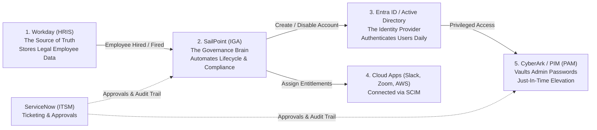

# 05. IAM Operational Workflows and Standard Operating Procedures (SOPs)

In enterprise cybersecurity, understanding abstract concepts is useless without knowing how to execute operational workflows from start to finish.

Every standard operating procedure in this module strictly complies with the **Enterprise 8-Point Operational Framework**:
1. **Trigger**: What event initiates this workflow?
2. **Responsible Parties (RACI)**: Who executes, approves, and oversees the process?
3. **Required Tools & Inputs**: What software, consoles, and credentials are required?
4. **Step-by-Step Procedure**: Sequential operational actions executed by the engineer.
5. **Decisions & Logic Gates**: Explicit IF/THEN conditional logic during execution.
6. **Escalation Matrix**: Clear escalation paths, SLAs, and emergency call trees.
7. **Expected Outcome**: Definitive success criteria.
8. **Documentation & Evidence**: Audit logs, ticket references, and compliance artifacts.

---

## 🧭 The Beginner's Guide: The 5 Core Tools Used in IAM Workflows

If you are new to IAM, you will see five specific enterprise tools repeatedly in these workflows. Here is why each one exists:

1. **Workday (HRIS - Human Resources Information System)**:
   - *Why it exists*: The legal record of who works at the company. IT does NOT decide who gets hired or fired; HR does. Workday is the "Authoritative Source of Truth".
2. **SailPoint (IGA - Identity Governance and Administration)**:
   - *Why it exists*: Reads data from Workday and translates it into technical accounts across 100+ systems. Checks for audit compliance and manages quarterly manager reviews.
3. **Microsoft Entra ID / Active Directory (IdP & Directory)**:
   - *Why it exists*: The actual login directory. When you turn on your laptop and type your username and password, Entra ID / AD checks your credentials.
4. **ServiceNow (ITSM - IT Service Management)**:
   - *Why it exists*: The ticketing and request portal. If an employee needs special access to a database, they submit a ServiceNow ticket so managers can sign off on it.
5. **CyberArk / Entra PIM (PAM - Privileged Access Management)**:
   - *Why it exists*: Holds the "super-admin" keys in an armored vault so nobody has permanent administrative rights.

---

## 📖 Module Contents

1. **[01_Joiner_Process_Employee_Onboarding.md](./01_Joiner_Process_Employee_Onboarding.md)** - From HR offer acceptance to Day 1 birthright access provisioning.
2. **[02_Mover_Process_Role_Transfer.md](./02_Mover_Process_Role_Transfer.md)** - Role transitions, privilege creep prevention, and SoD validation.
3. **[03_Leaver_Process_Employee_Termination.md](./03_Leaver_Process_Employee_Termination.md)** - Standard and emergency deprovisioning, session revocation, and data preservation.
4. **[04_Access_Request_and_Approval_Workflow.md](./04_Access_Request_and_Approval_Workflow.md)** - Self-service access requests, multi-tier approvals, and entitlement provisioning.
5. **[05_Access_Review_and_Certification_Campaign.md](./05_Access_Review_and_Certification_Campaign.md)** - Periodic compliance campaigns, manager certifications, and automatic revocation.
6. **[06_Privileged_Access_Just_In_Time_JIT_Request.md](./06_Privileged_Access_Just_In_Time_JIT_Request.md)** - Elevating to administrative roles (PIM/CyberArk) for change tickets.
7. **[07_Identity_Security_Incident_Investigation.md](./07_Identity_Security_Incident_Investigation.md)** - Investigating compromised accounts, impossible travel, and credential stuffing.
