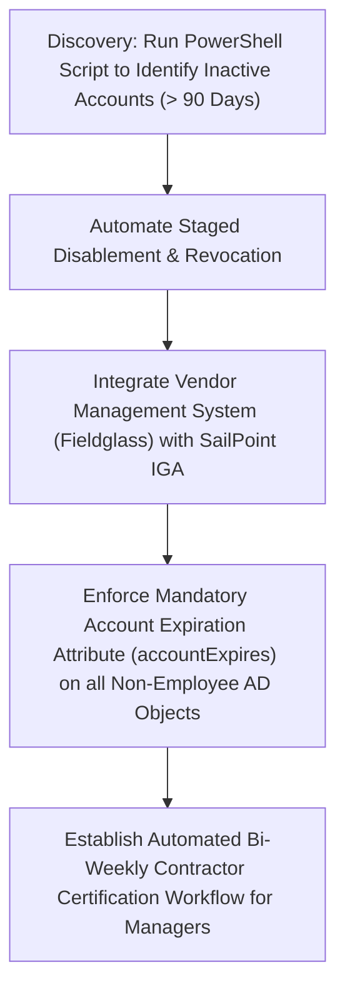

# Case Study 01: Orphaned Accounts SOX Audit Finding

[⬅️ Back to Scenarios](./README.md) | [Next: MFA Fatigue Scenario ➡️](./02_Scenario_MFA_Fatigue_and_Session_Hijacking.md)

---

### 1. The Incident Context
During a Sarbanes-Oxley (SOX) Section 404 audit, external auditors discovered that 42 external contractor accounts remained active in the corporate Active Directory and AWS environments months after their contracts ended. One dormant account belonged to a database engineer terminated 9 months prior, who still had Read/Write permissions to production financial databases.

### 2. Root Cause Analysis (RCA)
- Contractors were onboarded manually via ad-hoc IT Helpdesk tickets rather than through the centralized HR Workday system.
- No automated lifecycle link existed between the Vendor Management System (Fieldglass) and the enterprise directory.
- Department managers failed to notify IT when vendor contracts concluded.

### 3. Engineering Remediation Plan



#### Step 1: PowerShell Script to Identify and Disable Dormant Accounts
```powershell
# Import ActiveDirectory Module
Import-Module ActiveDirectory

$CutoffDate = (Get-Date).AddDays(-90)
$TargetOU = "OU=Contractors,DC=corp,DC=contoso,DC=com"

# Find accounts that have not logged in for 90 days or have never logged in
$DormantAccounts = Get-ADUser -SearchBase $TargetOU -Filter {
    (LastLogonDate -lt $CutoffDate -or LastLogonDate -notlike "*") -and (Enabled -eq $true)
} -Properties LastLogonDate, Description, Manager

Write-Output "Discovered $($DormantAccounts.Count) dormant contractor accounts. Proceeding with safe disablement."

foreach ($User in $DormantAccounts) {
    Set-ADUser -Identity $User.SamAccountName -Enabled $false -Description "$($User.Description) | Auto-disabled by IAM Audit Script $(Get-Date -Format 'yyyy-MM-dd')"
    Move-ADObject -Identity $User.DistinguishedName -TargetPath "OU=Disabled_Contractors,DC=corp,DC=contoso,DC=com"
}
```

### 4. Key Takeaways and Best Practices
- Every non-human or non-permanent account must have a strictly enforced `accountExpires` timestamp configured upon creation.
- Disallow manual account creation tickets; all identities must be driven by an authoritative source.
