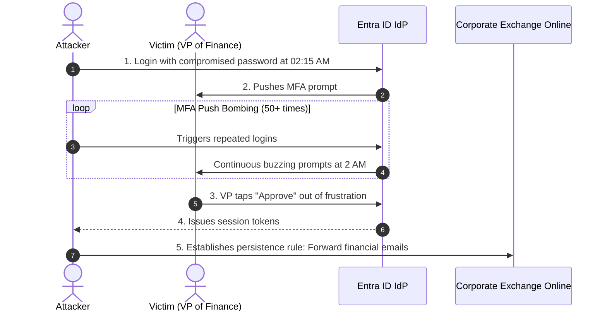

# Case Study 02: MFA Fatigue and Adversary-in-the-Middle (AiTM) Attack

[⬅️ Prev: Orphaned Accounts](./01_Scenario_Orphaned_Accounts_Audit_Finding.md) | [Back to Scenarios](./README.md) | [Next: Rogue Admin Offboarding ➡️](./03_Scenario_Emergency_Offboarding_Rogue_Admin.md)

---

### 1. Incident Timeline
- **02:15 AM**: Attacker obtains valid username and password for a VP of Finance from a dark web credential dump.
- **02:16 AM**: Attacker attempts login to Microsoft 365. Microsoft Entra ID triggers a mobile push notification.
- **02:16–02:24 AM**: Attacker unleashes **MFA Fatigue** (Push Bombing), sending 54 consecutive push notifications to the VP's phone.
- **02:25 AM**: Groggy and irritated, the VP taps **"Approve"** on their phone to silence the buzzing.
- **02:26 AM**: Attacker accesses the VP's mailbox, downloads internal acquisition documents, and creates a stealthy inbox rule forwarding all emails containing "invoice" or "wire" to an external ProtonMail address.

### 2. Engineering Remediation & Hardening

1. **Implement Number Matching**:
   - Instead of a simple "Approve/Deny" prompt, the user must view a random 2-digit number on the sign-in screen and type it into the Authenticator app. This stops 100% of blind approvals.
2. **Mandate Phishing-Resistant FIDO2 / Passkeys**:
   - For all high-risk and privileged executives, eliminate mobile push entirely in favor of YubiKeys or Windows Hello for Business.
3. **Configure Risk-Based Step-Up in Conditional Access**:
   - If Entra ID flags sign-in risk as "Medium" or "High" (unusual location or impossible travel), automatically block simple push and require FIDO2 verification.
