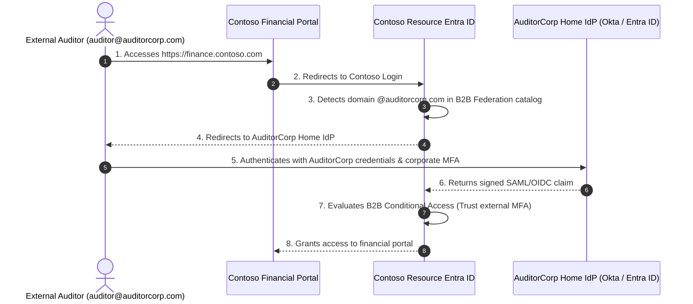

# Case Study 04: Third-Party Vendor B2B Federation

[⬅️ Prev: Rogue Admin Offboarding](./03_Scenario_Emergency_Offboarding_Rogue_Admin.md) | [Back to Scenarios](./README.md) | [Next: Hands-On Labs Track ➡️](../07_Hands_On_Labs/README.md)

---

### 1. Architectural Challenge
Contoso Corporation partners with an external auditing firm ("AuditorCorp"). 50 external auditors require temporary access to internal financial PowerBI dashboards and SharePoint documents.
- **The Bad Way**: Creating 50 internal Contoso accounts (`auditor1@contoso.com`), managing their passwords, and dealing with onboarding/offboarding tickets.
- **The Enterprise Way**: Utilizing **Microsoft Entra B2B Direct Federation / Cross-Tenant Access Policies**.

### 2. Security Benefits
- When an auditor is fired from AuditorCorp, their access to Contoso terminates **instantly**, because their home directory account is disabled. Contoso bears zero administrative overhead for password resets or lifecycle tracking.
