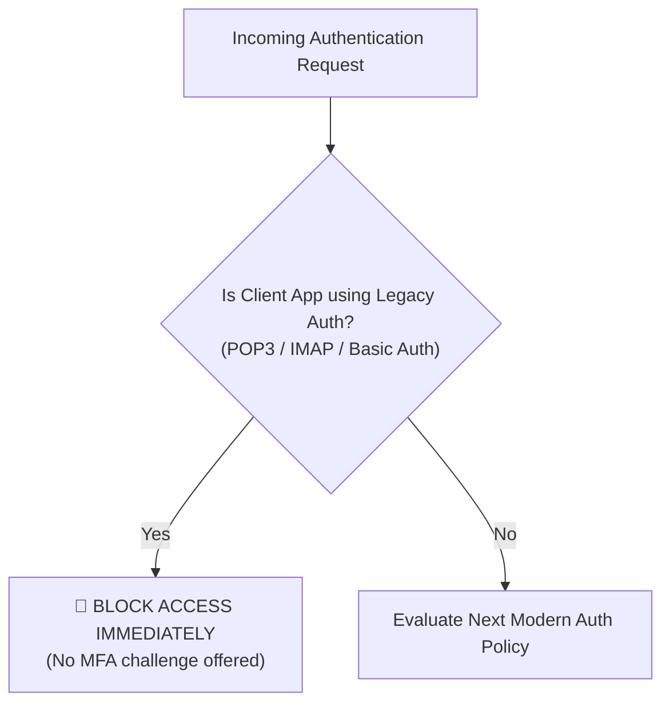

# Lab 02: Configuring Zero-Trust Conditional Access Policies

[⬅️ Prev: Entra ID Setup](./01_Lab_Setting_Up_Entra_ID_Tenant_and_Users.md) | [Back to Labs](./README.md) | [Next: SAML SSO Lab ➡️](./03_Lab_Configuring_SAML_SSO_with_Mock_App.md)

---

### Objective
In this lab, you will configure, test, and troubleshoot two production-grade Zero Trust Conditional Access (CA) policies in your Microsoft Entra ID tenant:
1. **Policy 1 (Baseline Defense)**: Block all Legacy Authentication protocols globally.
2. **Policy 2 (Privilege Defense)**: Enforce Phishing-Resistant MFA and Compliant Device status for all administrative directory roles.

---

### Prerequisites
- Access to an Entra ID tenant with Microsoft Entra ID P1 or P2 trial license.
- At least two user accounts created:
  - `admin.alice@yourtenant.onmicrosoft.com` (assigned Security Administrator role).
  - `breakglass.admin@yourtenant.onmicrosoft.com` (Emergency Cloud Account).

---

### Step-by-Step Lab Execution

#### Phase 1: Build Emergency Exclusion Group (Safety Protocol)
Before authoring blocking policies, you must ensure you do not accidentally lock yourself out of the tenant:
1. Navigate to **Microsoft Entra admin center** ➔ **Groups** ➔ **All groups** ➔ **New group**.
2. Group type: **Security**. Name: `CA-Emergency-BreakGlass-Exclusion`.
3. Add your `breakglass.admin` account to this group.

#### Phase 2: Configure Policy 1 - Block Legacy Authentication
Legacy protocols (POP3, IMAP, SMTP, MAPI) do not support modern Multi-Factor Authentication prompts. Over 98% of credential stuffing attacks target these legacy protocols.



1. Navigate to **Protection** ➔ **Conditional Access** ➔ **Create new policy**.
2. **Name**: `CA001-Global-Block-LegacyAuth`.
3. **Users**:
   - Include: **All users**.
   - Exclude: Select `CA-Emergency-BreakGlass-Exclusion` group.
4. **Target resources**: Select **All cloud apps**.
5. **Conditions**:
   - Select **Client apps**.
   - Set Configure to **Yes**.
   - Under Modern authentication clients, **uncheck** Browser and Mobile apps.
   - Under Legacy authentication clients, **check** both **Exchange ActiveSync clients** and **Other clients**.
6. **Access controls**:
   - Under Grant, select **Block access**.
7. **Enable policy**: Select **Report-only** (Verify for 24 hours), then switch to **On**.

#### Phase 3: Configure Policy 2 - Enforce MFA for Administrative Roles
1. Create new policy: `CA002-Admins-Require-PhishingResistantMFA`.
2. **Users**:
   - Under Include, select **Directory roles**.
   - Check: `Global Administrator`, `Security Administrator`, `Privileged Role Administrator`, `User Administrator`.
   - Exclude: `CA-Emergency-BreakGlass-Exclusion`.
3. **Target resources**: Select **All cloud apps**.
4. **Grant Access Controls**:
   - Select **Grant access**.
   - Check **Require authentication strength** ➔ Select **Phishing-resistant MFA** (FIDO2 or Windows Hello).
   - Check **Require device to be marked as compliant**.
   - Select **Require all the selected controls**.
5. Set policy to **On** and click **Create**.

---

### Testing and Verification

#### Test 1: Testing Legacy Authentication Block with PowerShell
Open a terminal and attempt an unauthenticated basic connection:
```powershell
# Attempting legacy POP connection against Office 365
$credential = Get-Credential -UserName "admin.alice@yourtenant.onmicrosoft.com" -Message "Enter credentials"
# Execute basic auth command - System will immediately reject with HTTP 50126 (Blocked by Conditional Access)
```

#### Test 2: Inspecting Sign-in Logs
1. Navigate to **Entra ID** ➔ **Monitoring: Sign-in logs**.
2. Select the failed sign-in attempt.
3. Click the **Conditional Access** tab.
4. Verify that `CA001-Global-Block-LegacyAuth` shows status **Failure (Access Blocked)**.
