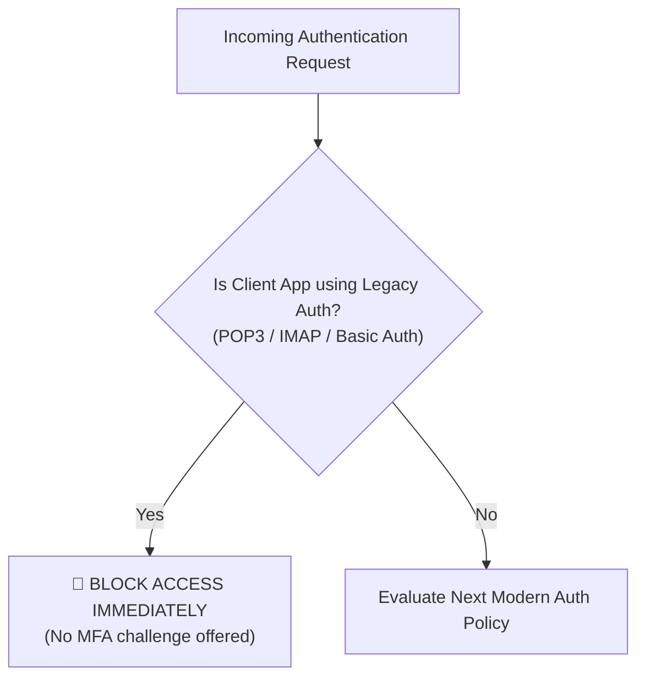

# Lab 02: Configuring Zero-Trust Conditional Access Policies

[⬅️ Prev: Entra ID Setup](./01_Lab_Setting_Up_Entra_ID_Tenant_and_Users.md) | [Back to Labs](./README.md) | [Next: SAML SSO Lab ➡️](./03_Lab_Configuring_SAML_SSO_with_Mock_App.md)

---

### Objective
Build and test two essential enterprise Conditional Access policies:
1. **Policy 1**: Block all Legacy Authentication protocols (POP3, IMAP, SMTP, Basic Auth).
2. **Policy 2**: Enforce Multi-Factor Authentication (MFA) for all cloud administration portals.

### Step-by-Step Configuration in Entra ID Portal

#### Policy 1: Block Legacy Authentication
1. Navigate to **Microsoft Entra admin center** ➔ **Protection** ➔ **Conditional Access**.
2. Click **New policy**. Name: `CA001-Block-Legacy-Authentication`.
3. **Users**: Under Include, select **All users**.
   - *CRITICAL*: Under Exclude, exclude at least one Emergency Access ("Break-Glass") account.
4. **Target resources**: Select **All cloud apps**.
5. **Conditions**: Select **Client apps**.
   - Set Configure to **Yes**.
   - Check **Exchange ActiveSync clients** and **Other clients** (legacy basic auth).
6. **Access controls**: Select **Block access**.
7. **Enable policy**: Select **Report-only** first to verify telemetry, then switch to **On**.

