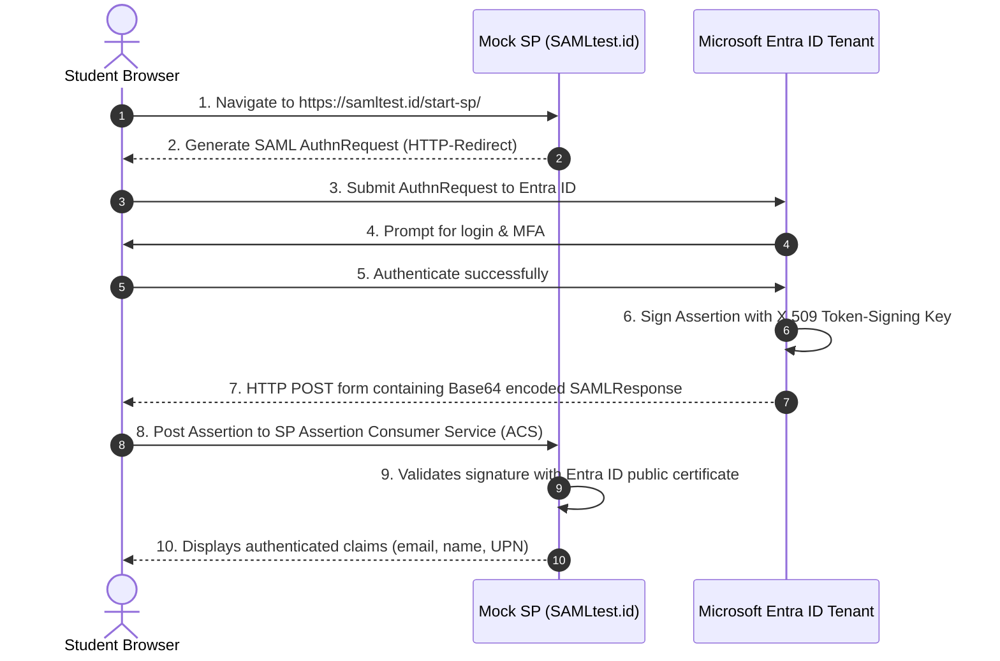

# Lab 03: Configuring SAML 2.0 Single Sign-On with a Mock Application

[⬅️ Prev: Conditional Access Lab](./02_Lab_Configuring_Conditional_Access_Policies.md) | [Back to Labs](./README.md) | [Next: RBAC & PIM Lab ➡️](./04_Lab_RBAC_Role_Definition_and_PIM_Activation.md)

---

### Objective
Integrate Microsoft Entra ID (as Identity Provider - IdP) with a mock Service Provider (`https://samltest.id/`), capture raw SAML XML assertions using browser DevTools, and validate digital signature integrity.

---

### Architecture Overview

---

### Step-by-Step Lab Instructions

#### Step 1: Install SAML-tracer Browser Extension
Install the free **SAML-tracer** extension on Google Chrome or Mozilla Firefox to intercept and decode SAML requests in real time.

#### Step 2: Register Enterprise Application in Entra ID
1. Navigate to **Microsoft Entra admin center** ➔ **Applications** ➔ **Enterprise applications** ➔ **New application**.
2. Click **Create your own application**. Name: `Mock-SAML-TestApp`.
3. Select option: **Integrate any other application you don't find in the gallery (Non-gallery)**.
4. Under **Manage**, click **Single sign-on** ➔ Select **SAML**.

#### Step 3: Configure SAML Endpoints
In the **Basic SAML Configuration** box:
- **Identifier (Entity ID)**: `https://samltest.id/saml/sp`
- **Reply URL (Assertion Consumer Service URL)**: `https://samltest.id/Shibboleth.sso/SAML2/POST`
- **Sign on URL**: `https://samltest.id/start-sp/`
Click **Save**.

#### Step 4: Configure Attributes & Claims
In the **Attributes & Claims** box, ensure the following claims are sent:
- `Unique User Identifier`: `user.userprincipalname`
- `email`: `user.mail`
- `department`: `user.department`

#### Step 5: Assign Test User & Test Flow
1. Under **Users and groups**, click **Add user/group** and assign your test user account.
2. Open **SAML-tracer** extension window.
3. In your browser, navigate to `https://samltest.id/start-sp/`, type your Entra ID Entity ID, and click **Submit**.
4. Log into Entra ID.
5. In SAML-tracer, observe the yellow **SAML** tags:
   - Inspect the `<samlp:AuthnRequest>` XML.
   - Inspect the final `<saml:Response>` and `<saml:Assertion>`.
   - Verify the `<ds:SignatureValue>` and `<saml:NameID>` matches your user email.
