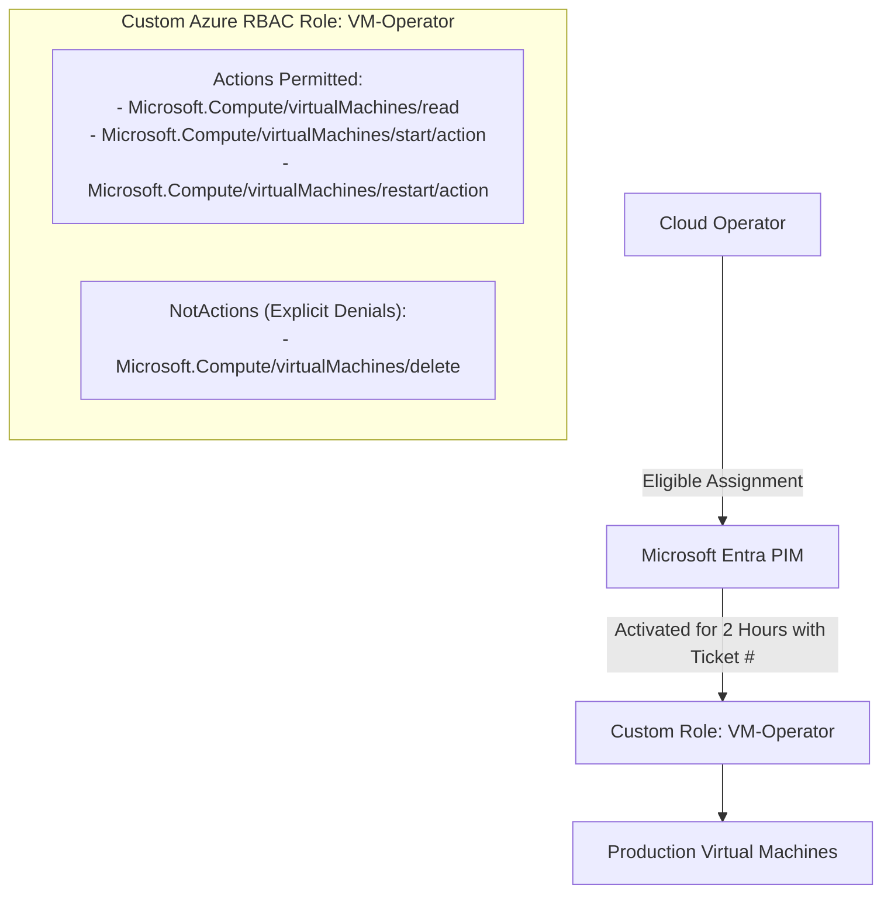

# Lab 04: Designing Custom RBAC Roles & Entra PIM Activation

[⬅️ Prev: SAML SSO Lab](./03_Lab_Configuring_SAML_SSO_with_Mock_App.md) | [Back to Labs](./README.md) | [Next: Advanced Topics Track ➡️](../08_Advanced_Topics/README.md)

---

### Objective
Implement the Principle of Least Privilege by creating a custom Azure RBAC role definition that permits virtual machine restarts without granting broad subscription-level access, and configure Microsoft Entra Privileged Identity Management (PIM) for time-bound activation.

---

### Architecture: Least Privilege Custom RBAC



---

### Step-by-Step Lab Instructions

#### Step 1: Author the Custom Role JSON Definition
Create a file named `vm-operator-role.json`:

```json
{
  "Name": "Custom-VM-Restart-Operator",
  "IsDataAction": false,
  "Description": "Allows operators to view and restart virtual machines without modification rights.",
  "Actions": [
    "Microsoft.Compute/virtualMachines/read",
    "Microsoft.Compute/virtualMachines/restart/action",
    "Microsoft.Compute/virtualMachines/start/action",
    "Microsoft.Network/networkInterfaces/read"
  ],
  "NotActions": [
    "Microsoft.Compute/virtualMachines/write",
    "Microsoft.Compute/virtualMachines/delete"
  ],
  "AssignableScopes": [
    "/subscriptions/YOUR_SUBSCRIPTION_ID_HERE"
  ]
}
```

#### Step 2: Deploy Role via Azure CLI
```bash
# Log in to Azure account
az login

# Create custom role definition
az role definition create --role-definition vm-operator-role.json
```

#### Step 3: Configure PIM Eligible Assignment
1. In Entra ID admin center, navigate to **Identity Governance** ➔ **Privileged Identity Management** ➔ **Azure resources**.
2. Select your subscription and click **Roles**.
3. Search for `Custom-VM-Restart-Operator`. Click **Add assignments**.
4. Assignment type: Select **Eligible** (NOT Active). Duration: 1 year.

#### Step 4: Test Just-In-Time (JIT) Activation
1. Sign in as the test operator.
2. Navigate to **My roles** in PIM.
3. Click **Activate** next to `Custom-VM-Restart-Operator`.
4. Enter reason: `Emergency maintenance - Ticket INC-98124` and duration: `2 hours`.
5. Complete step-up MFA challenge.
6. Verify access: Operator can now restart the VM from the console, but the **Delete** button is grayed out and blocked!
