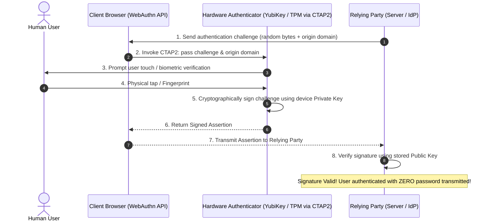

# 01. Passwordless Authentication: FIDO2 and Passkeys Deep Dive

[⬅️ Back to Advanced Topics](./README.md) | [Next: ITDR ➡️](./02_Identity_Threat_Detection_and_Response_ITDR.md)

---

### 1. The Death of Passwords

Passwords have failed as a secure authentication mechanism for three fundamental reasons:
1. **Human Cognitive Limit**: Humans cannot remember 50 unique 20-character random passwords, leading to password reuse and sticky notes.
2. **Server-Side Compromise**: Passwords stored on servers (even hashed with bcrypt or Argon2) are vulnerable to database leaks and offline cracking.
3. **Phishing Susceptibility**: Any credential a human can read or copy can be intercepted by an adversary using tools like Evilginx.

**FIDO2 / WebAuthn** completely eliminates shared secrets. The server stores **only a public key**. The private key never leaves the hardware security boundary.

---

### 2. Architecture: WebAuthn and CTAP2

---

### 3. Passkeys: Synced vs Device-Bound

| Dimension | Device-Bound Passkeys | Synced Passkeys (Consumer) |
| :--- | :--- | :--- |
| **Storage Hardware** | Dedicated physical hardware key (YubiKey 5) or non-exportable hardware TPM. | Cloud keychain (iCloud Keychain, Google Password Manager). |
| **Exportability** | **Impossible to export**: Private key is locked in hardware silicon. | Synchronized across consumer mobile devices via cloud backup. |
| **Enterprise Fit** | **Enterprise Standard**: Mandated for high-risk, privileged, and financial roles. | Suited for customer/consumer web applications (CIAM). |
