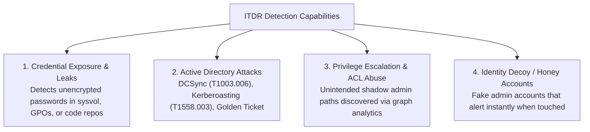

# 02. Identity Threat Detection and Response (ITDR)

[⬅️ Prev: Passwordless FIDO2](./01_Passwordless_Authentication_FIDO2_and_Passkeys.md) | [Back to Advanced Topics](./README.md) | [Next: CIAM ➡️](./03_Customer_Identity_and_Access_Management_CIAM.md)

---

### 1. The Need for ITDR

Traditional Endpoint Detection & Response (EDR) monitors processes and files on local machines. Network Detection & Response (NDR) monitors packet streams.
However, attackers increasingly avoid malware entirely, relying on **Living-off-the-Land (LotL)** techniques using stolen credentials and legitimate directory tools (`ldapsearch`, `PowerView`, Graph API).

**Identity Threat Detection and Response (ITDR)** focuses exclusively on detecting threats against the identity infrastructure itself (Active Directory, Entra ID, Okta).

---

### 2. Key Attack Techniques ITDR Detects

---

### 3. Defensive Strategy: Identity Honeytokens

An enterprise ITDR strategy deploys **Decoy Accounts (Honeytokens)** in Active Directory:
- Create an account: `sql_backup_superadmin`.
- Set an intentionally weak description: *"Production Database Master Account"*.
- **The Account is never used for legitimate business.**
- Set an alert rule in Sentinel: Any authentication attempt against `sql_backup_superadmin` triggers an immediate Sev-1 Incident! The attacker has exposed their presence.
