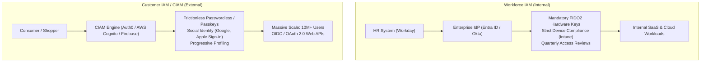
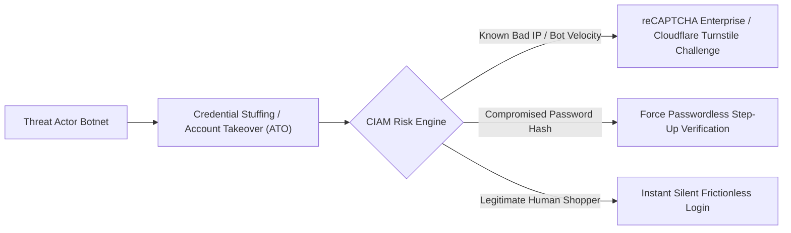

# 03. Customer Identity and Access Management (CIAM) Deep Dive

[⬅️ Prev: ITDR](./02_Identity_Threat_Detection_and_Response_ITDR.md) | [Back to Advanced Topics](./README.md) | [Next: Interview Prep ➡️](../09_Interview_Preparation/README.md)

---

### 1. Definition and Strategic Purpose

**Customer Identity and Access Management (CIAM)** is a specialized subset of IAM designed to manage, secure, and govern the digital identities, registrations, profiles, and access entitlements of external consumers, customers, and citizens engaging with an organization's public web and mobile digital services.

While Workforce IAM prioritizes strict administrative control, compliance enforcement, and internal governance (where security always trumps convenience), **CIAM sits at the intersection of security and customer experience (CX)**:
- Every additional friction point (a complex password requirement, an extra form field, a clunky SMS code) directly reduces conversion rates, shopping cart completion, and business revenue.
- Conversely, weak security leads to mass credential stuffing, account takeover (ATO), loyalty points theft, and catastrophic regulatory fines under GDPR and CCPA.

> 💡 **Analogy**: The Corporate Headquarters vs The Luxury Retail Store:
> - **Workforce IAM** is the employee security entrance at corporate headquarters: Security guards check your employee badge, make you step through a metal detector, inspect your bag, and log your visit. You must comply because it is your workplace.
> - **CIAM** is the front revolving door of a luxury boutique on 5th Avenue: The entrance must be welcoming, elegant, and effortless. If you demand customers produce three forms of ID and wait 15 minutes before browsing, they walk next door to your competitor. Yet, store security must still silently identify shoplifters and credit card fraudsters without disturbing legitimate shoppers.

---

### 2. Comprehensive Architectural Comparison: Workforce IAM vs CIAM

| Dimension | Workforce IAM (Employees) | Customer IAM (CIAM - Consumers) |
| :--- | :--- | :--- |
| **Scale & Concurrency** | 5,000 to 100,000 users. Highly predictable 9-to-5 logon patterns. | 100,000 to 50,000,000+ users. Massive unpredictable spikes (Black Friday, product launches). |
| **Authoritative Source**| Corporate HR system of record (Workday, SAP SuccessFactors). | Self-registration, social identity providers (Google, Apple, GitHub). |
| **User Experience (UX)**| Strict security controls enforced; user friction is tolerated. | Frictionless onboarding is mandatory; friction directly reduces conversion. |
| **MFA Methods** | Hardware security keys (FIDO2 YubiKey), corporate authenticator apps. | Passkeys, biometric FaceID/TouchID, WhatsApp/SMS OTP, magic links. |
| **Data Privacy & Legal**| Corporate employment contracts and acceptable use policies. | Strict privacy mandates: GDPR (Right to be Forgotten), CCPA, COPPA, consent tracking. |
| **Dominant Platforms** | Microsoft Entra ID P2, Okta Workforce Identity, PingFederate, SailPoint. | Okta/Auth0, AWS Cognito, Microsoft Entra External ID, Firebase Auth. |

---

### 3. Core Technical Pillars of Modern CIAM

#### A. Social Identity Federation (Bring Your Own Identity - BYOI)
Consumers avoid creating new passwords for every online store. CIAM platforms federate with public identity providers using OAuth 2.0 and OpenID Connect (OIDC):
- **Sign in with Apple**: Enforces privacy by allowing users to mask their real email with a private relay address (`user@privaterelay.appleid.com`).
- **Sign in with Google**: Single-click authorization returning verified profile claims (`sub`, `email`, `name`).

#### B. Progressive Profiling
Instead of demanding 15 profile fields during registration (which causes 70% of users to abandon the site), modern CIAM captures data progressively:
1. **Initial Visit**: Ask only for an email or single-click social login.
2. **First Purchase**: Prompt for shipping address and phone number during checkout.
3. **Third Visit**: Offer personalized recommendations in exchange for birthdate or product preferences.

#### C. Frictionless Passwordless & WebAuthn Passkeys
Passkeys represent the pinnacle of modern CIAM. Users register their device's native biometric sensor (Touch ID, Face ID, Windows Hello). Authentication occurs in under 2 seconds with public-key cryptography, rendering phishing mathematically impossible while providing the smoothest user experience.

---

### 4. CIAM Threat Landscape & Automated Defenses

1. **Credential Stuffing**: Attackers use botnets to test millions of username/password pairs leaked from other websites. Modern CIAM connects to leaked credential databases (HaveIBeenPwned API) to block reused passwords at the moment of registration.
2. **Account Takeover (ATO) Fraud**: Attackers hijack accounts to steal loyalty points or execute fraudulent orders with stored credit cards. CIAM uses behavioral biometrics (typing cadence, mouse movement velocity) to distinguish humans from automated scripts.
3. **Consent & Preference Management**: Enforcing automated GDPR compliance, allowing consumers to export all stored profile data (`Data Portability`) or permanently erase their account (`Right to Erasure`).
