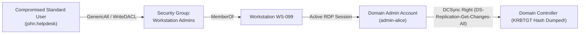
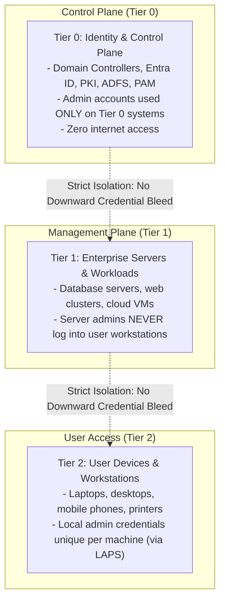

# 04. Active Directory Attack Paths and BloodHound Defense

[⬅️ Prev: CIAM](./03_Customer_Identity_and_Access_Management_CIAM.md) | [Back to Advanced Topics](./README.md) | [Next: Interview Prep ➡️](../09_Interview_Preparation/README.md)

---

### 1. Definition and Purpose

For decades, security teams audited Active Directory by looking at individual group memberships (e.g., checking who is in the `Domain Admins` group). 

Adversaries do not think in lists; **adversaries think in graphs**. 

**BloodHound** is an open-source graph analysis tool that visualizes hidden, non-obvious relationships, permissions, and access rights within Active Directory and Azure/Entra ID environments to uncover critical **Attack Paths** that lead to total administrative takeover.

> 💡 **Analogy**: The Domino Effect:
> - You believe your vault is safe because only the CEO has the master key.
> - But BloodHound reveals: The Janitor has write access to the HVAC maintenance panel ➔ The HVAC panel can reboot the Security Room Server ➔ The Security Room Server caches the Helpdesk Tech's session ➔ The Helpdesk Tech can reset the CEO's password.
> By tipping over the first unprivileged domino, the attacker knocks down the final king.

---

### 2. The Concept of "Shadow Admins"

A **Shadow Admin** is an account that is **not** a member of any high-privilege group (like Domain Admins or Enterprise Admins), but possesses granular Active Directory Access Control List (ACL) permissions that can be chained to achieve full Domain Admin rights.

---

### 3. Dangerous Active Directory Object ACL Permissions

| ACE / Right | What It Allows an Attacker to Do |
| :--- | :--- |
| **GenericAll** | Full control over the target object (e.g., can reset user's password, modify group members, add SPNs). |
| **WriteDacl** | Modify the security permissions (DACL) of the object, granting themselves `GenericAll`. |
| **WriteOwner** | Take ownership of the target object, then assign themselves `WriteDacl`. |
| **ForceChangePassword** | Instantly reset the target user's password without knowing their current password. |
| **AddMember** | Add any user or group to the target security group. |
| **DCSync (`DS-Replication-Get-Changes-All`)** | Impersonate a Domain Controller to pull password hashes (including `krbtgt`) directly over RPC. |

---

### 4. The Microsoft Enterprise Access Model (Tiering)

To break BloodHound attack paths, enterprises enforce the **Enterprise Access Model** (formerly known as AD Tiering):

#### The Golden Rule of Tiering:
**Credentials from a higher tier must NEVER be typed or cached on a system belonging to a lower tier.**
If a Domain Admin logs into an infected Tier 2 laptop to troubleshoot an email issue, their credentials are saved in memory (`lsass.exe`), instantly gifting the attacker Tier 0 control.
