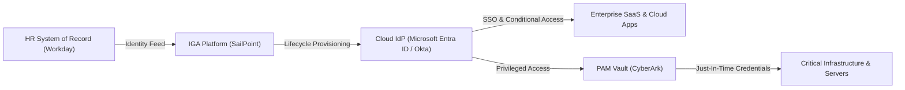

# Identity and Access Management (IAM) Career Path & Knowledge Base

Welcome to the **Enterprise Identity and Access Management (IAM)** learning path. This curriculum transforms beginners into enterprise-ready IAM Engineers, Directory Architects, and Identity Governance Specialists.

---

## 📌 Track Overview

Identity is the new security perimeter. In a world of remote work, multi-cloud architectures, and SaaS applications, network firewalls are no longer sufficient to stop modern attackers. Access must be governed, verified, and dynamically evaluated at every transaction.

---

## 🗺️ Chronological Learning Sequence

Navigate through the folders in numbered order to build your mastery progressively:

| Folder | Focus Area | Description |
| :--- | :--- | :--- |
| **[01_Fundamentals](./01_Fundamentals/README.md)** | Conceptual Foundations | Definition of IAM, Identity vs Account, AuthN vs AuthZ, Zero Trust model. |
| **[02_Core_Concepts](./02_Core_Concepts/README.md)** | Core Building Blocks | Identity Lifecycle (JML), RBAC vs ABAC, SSO, MFA, PAM, IGA, Machine Identities. |
| **[03_Technologies_and_Protocols](./03_Technologies_and_Protocols/README.md)** | Deep Protocol Mechanics | Active Directory, Kerberos, LDAP, SAML 2.0, OAuth 2.0 & OIDC, SCIM, Conditional Access. |
| **[04_Tools_and_Platforms](./04_Tools_and_Platforms/README.md)** | Industry Tools | Microsoft Entra ID, Okta, SailPoint, CyberArk, HashiCorp Vault. |
| **[05_Workflows_and_Processes](./05_Workflows_and_Processes/README.md)** | Enterprise SOPs | 8-point operational workflows for JML, Access Requests, Reviews, JIT PAM, and Incident Triage. |
| **[06_Real_World_Scenarios](./06_Real_World_Scenarios/README.md)** | Incident Case Studies | Orphaned accounts, MFA fatigue, rogue admin offboarding, B2B federation. |
| **[07_Hands_On_Labs](./07_Hands_On_Labs/README.md)** | Practical Exercises | Entra ID tenant setup, Conditional Access policies, SAML SSO mock, PIM activation. |
| **[08_Advanced_Topics](./08_Advanced_Topics/README.md)** | Next-Gen Identity | FIDO2 Passwordless, Identity Threat Detection & Response (ITDR), CIAM. |
| **[09_Interview_Preparation](./09_Interview_Preparation/README.md)** | Career Readiness | 50+ technical questions, scenario walkthroughs, and portfolio project guidance. |

---

## 🎯 Target Competencies

By completing this track, you will be able to:
1. Explain, design, and troubleshoot SAML 2.0, OIDC, and Kerberos authentication exchanges.
2. Formulate least-privilege RBAC/ABAC role hierarchies that satisfy SOX, HIPAA, and ISO 27001 audits.
3. Configure enterprise Conditional Access policies balancing strict security with user friction.
4. Execute Joiner-Mover-Leaver (JML) workflows with zero manual orphaned accounts.
5. Secure privileged administrative access with CyberArk and Microsoft Entra Privileged Identity Management (PIM).
