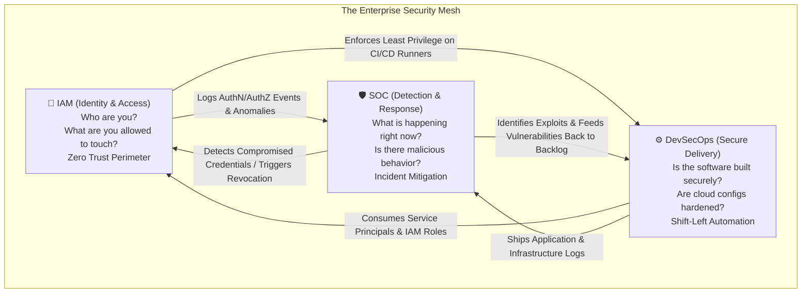
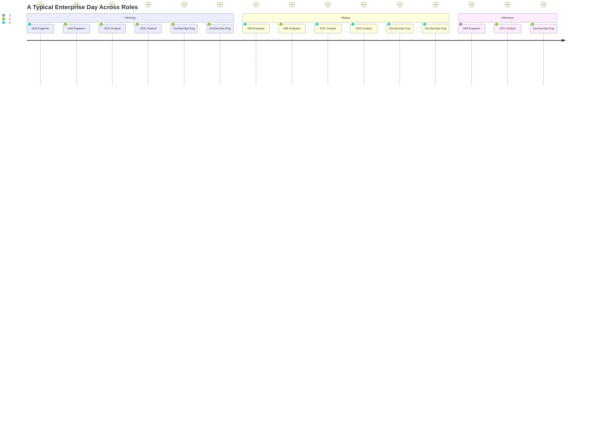
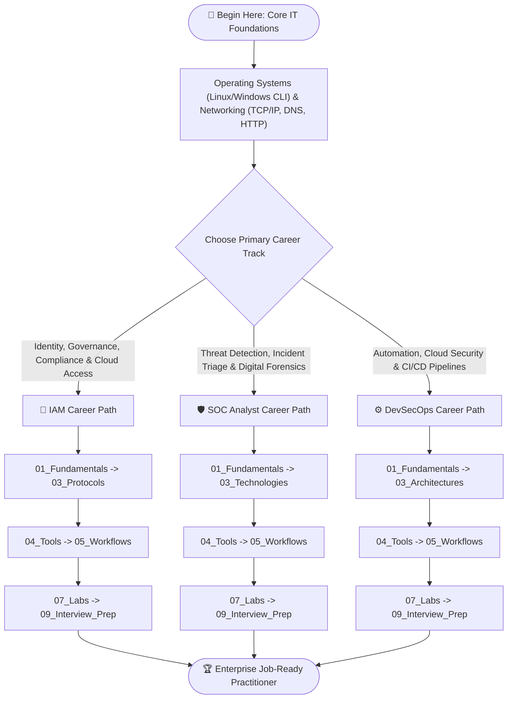

# Enterprise Cybersecurity Learning Repository
### The Complete Practitioner's Guide to Identity and Access Management (IAM), Security Operations Center (SOC), and DevSecOps

[](#)
[](#)
[](#)
[](#)

---

## 🎯 Repository Purpose

Traditional cybersecurity courses often isolate theory from real-world enterprise operations. Students learn abstract cryptography or simple port scanning without ever seeing how corporate identity governance works, how security analysts triage high-volume SIEM alerts during an ongoing ransomware attack, or how security gates halt vulnerable code deployments in a modern CI/CD pipeline.

This repository bridges that gap. Built from the perspective of a Senior Cybersecurity Professional, Technical Mentor, and Enterprise Architect, this repository serves as a **single, exhaustive, battle-tested learning path** designed to take you from foundational understanding to enterprise-ready proficiency across the three most critical defense pillars of modern IT security:

1. **[IAM (Identity and Access Management)](./IAM/README.md)**: Controlling *who* has access to *what*, enforcing least privilege, securing privileged accounts, and governing modern multi-cloud identity perimeters. *(New to IAM? Check out the [Beginner's Glossary & Acronym Decoder](./IAM/01_Fundamentals/00_IAM_Beginners_Glossary_and_Acronym_Decoder.md)!)*
2. **[SOC (Security Operations Center)](./SOC/README.md)**: Monitoring corporate environments 24/7/365, triaging security telemetry, hunting threats, analyzing malware and phishing, and executing rapid incident response.
3. **[DevSecOps (Development, Security, and Operations)](./DevSecOps/README.md)**: Embedding automated security checks into the software development lifecycle (SSDLC), securing container orchestration, managing secrets, and automating Infrastructure as Code (IaC) compliance.

---

## 👥 Who Should Use This Repository?

- **Aspiring Cybersecurity Beginners**: Individuals transitioning into security from computer science, IT support, networking, or non-technical backgrounds who need an unshakeable, practical foundation.
- **Helpdesk & System Administrators**: Technical professionals looking to elevate their careers into specialized, high-demand cybersecurity engineering or analyst roles.
- **Junior IAM Analysts, SOC L1 Analysts & Junior DevOps Engineers**: Practitioners seeking to deepen their technical architecture knowledge, master industry workflows, and prepare for promotion to L2/Senior roles.
- **Hiring Managers & Technical Mentors**: Team leads who need a structured, standardized onboarding curriculum for junior team members.

---

## 🏛️ The Triad of Modern Cyber Defense

In modern zero-trust enterprise environments, these three domains do not operate in silos. They form an interlocking defensive mesh:



---

## ⚖️ How the Three Roles Differ: Comprehensive Comparison

| Dimension | Identity and Access Management (IAM) | Security Operations Center (SOC) | DevSecOps |
| :--- | :--- | :--- | :--- |
| **Primary Mission** | Ensure the right people and machines get the right access to the right resources at the right time for the right reasons. | Detect, investigate, contain, and remediate unauthorized access, attacks, and anomalies in real time. | Integrate security tooling, compliance policies, and automated safeguards seamlessly into developer workflows and cloud delivery pipelines. |
| **Core Mentality** | *"Default Deny; verify identity continuously; enforce least privilege."* | *"Assume Breach; hunt for anomalies; isolate and eradicate threats."* | *"Shift Left; automate security gates; fail fast without slowing developer velocity."* |
| **Key Daily Tasks** | - Managing Joiner-Mover-Leaver (JML) workflows<br>- Auditing privileged access (PIM/PAM)<br>- Configuring SSO and MFA policies<br>- Conducting access certification campaigns | - Triaging high-priority SIEM alerts<br>- Performing endpoint isolation and memory triage<br>- Analyzing suspicious emails and payloads<br>- Executing incident response runbooks | - Configuring SAST/DAST/SCA pipeline scanners<br>- Reviewing Terraform/IaC security misconfigurations<br>- Managing secret rotation and Vault policies<br>- Hardening Dockerfiles and Kubernetes manifests |
| **Core Technologies** | SAML 2.0, OIDC, OAuth 2.0, Kerberos, LDAP, SCIM, FIDO2/WebAuthn | SIEM, EDR/XDR, IDS/IPS, SOAR, Sysmon, Zeek, Suricata, PCAP, Threat Intel (STIX/TAXII) | CI/CD (GitHub Actions, GitLab), Docker, Kubernetes, Terraform, Semgrep, Trivy, SonarQube |
| **Flagship Tools** | Microsoft Entra ID, Okta, SailPoint, CyberArk, HashiCorp Vault | Microsoft Sentinel, Splunk, CrowdStrike Falcon, Defender for Endpoint, Wireshark, VirusTotal | GitHub Actions, Jenkins, Snyk, Checkov, OWASP ZAP, HashiCorp Vault, Falco, OPA |
| **Key Performance Metrics (KPIs)** | - Time to deprovision terminated users (< 1 hr)<br>- Orphaned account percentage (0%)<br>- MFA adoption rate (100%)<br>- PAM session recording coverage | - Mean Time to Detect (MTTD)<br>- Mean Time to Acknowledge (MTTA)<br>- Mean Time to Respond/Contain (MTTR)<br>- False Positive Rate | - Pipeline security build failure rate<br>- Mean Time to Remediate (MTTR) CVEs<br>- Critical vulnerabilities escaping to Production<br>- Secret leak incidents in Git |
| **Typical Career Ladder** | IAM Support Analyst → IAM Engineer → IAM Architect → Director of Identity Governance | SOC Analyst L1 → SOC Analyst L2 → Incident Responder / Threat Hunter → SOC Manager / CISO | Junior DevOps Engineer → DevSecOps Engineer → Cloud Security Architect → Head of Platform Security |

---

## 📅 A Day in the Life: Role Comparison



---

## 🧭 Repository Structure & Chronological Learning Flow

Each primary track (`IAM/`, `SOC/`, `DevSecOps/`) is organized strictly into nine numbered progressive directories. This eliminates guesswork and ensures you build deep conceptual foundations before tackling advanced architectures and labs:

```
├── IAM/                               # Identity & Access Management Track
│   ├── 01_Fundamentals/              # Foundational identity concepts & Zero Trust
│   ├── 02_Core_Concepts/              # JML, RBAC, ABAC, SSO, MFA, PAM, IGA, Machine ID
│   ├── 03_Technologies_and_Protocols/ # AD, LDAP, Kerberos, SAML 2.0, OAuth 2.0/OIDC, SCIM
│   ├── 04_Tools_and_Platforms/        # Entra ID, Okta, SailPoint, CyberArk, Vault
│   ├── 05_Workflows_and_Processes/    # Standard 8-point operational enterprise workflows
│   ├── 06_Real_World_Scenarios/       # Realistic enterprise breach/incident case studies
│   ├── 07_Hands_On_Labs/              # Step-by-step practical implementation labs
│   ├── 08_Advanced_Topics/            # Passwordless, ITDR, CIAM
│   └── 09_Interview_Preparation/      # Technical & scenario interview question banks
│
├── SOC/                               # Security Operations Center Track
│   ├── 01_Fundamentals/              # SOC structure (L1/L2/L3), OS & Networking foundations
│   ├── 02_Core_Concepts/              # Telemetry, Log analysis, MITRE ATT&CK, Kill Chain, Threat Intel
│   ├── 03_Technologies_and_Architectures/ # SIEM, EDR/XDR, IDS/IPS, Email Security, Malware basics
│   ├── 04_Tools_and_Platforms/        # Microsoft Sentinel, Splunk, CrowdStrike, Wireshark, OSINT
│   ├── 05_Workflows_and_Processes/    # Standard 8-point alert triage, containment & IR workflows
│   ├── 06_Real_World_Scenarios/       # Phishing, Impossible Travel, Ransomware, Pass-the-Hash
│   ├── 07_Hands_On_Labs/              # KQL hunting, Splunk detection, Wireshark PCAP triage
│   ├── 08_Advanced_Topics/            # Proactive Threat Hunting, Detection Engineering (Sigma), SOAR
│   └── 09_Interview_Preparation/      # L1/L2 Technical & practical triage scenarios
│
└── DevSecOps/                         # Development, Security & Operations Track
    ├── 01_Fundamentals/              # Philosophy, Shift-Left, SSDLC, Linux CLI & Git workflows
    ├── 02_Core_Concepts/              # CI/CD gates, SAST/DAST/SCA/IAST, Secrets, SBOM, IaC
    ├── 03_Technologies_and_Architectures/ # Container runtime, Kubernetes security, Cloud CSPM, OIDC
    ├── 04_Tools_and_Platforms/        # GitHub Actions, SonarQube, Semgrep, Trivy, Checkov, OWASP ZAP
    ├── 05_Workflows_and_Processes/    # Standard 8-point CI/CD gate, PR review, and remediation flows
    ├── 06_Real_World_Scenarios/       # Leaked AWS keys in Git, Log4j crisis, Malicious Docker image
    ├── 07_Hands_On_Labs/              # Hardening GitHub Actions, Custom Semgrep rules, Docker scans
    ├── 08_Advanced_Topics/            # SLSA Framework, Policy-as-Code (OPA/Kyverno), Chaos Security
    └── 09_Interview_Preparation/      # Pipeline architecture & DevSecOps interview scenarios
```

---

## 🛠️ The 8-Point Operational Process Standard

A core principle of this repository is that **cybersecurity is an operational discipline**. Knowing the definition of an alert or a role assignment is meaningless if you cannot execute the workflow under pressure.

Every operational process documented in `05_Workflows_and_Processes/` across all three paths strictly follows this enterprise 8-point framework:

1. **Trigger**: What event, webhook, ticket, or threshold initiates this workflow?
2. **Responsible Parties**: Who executes, approves, and oversees the process (RACI model)?
3. **Required Tools & Inputs**: What credentials, consoles, log sources, or telemetry are mandatory?
4. **Step-by-Step Execution**: The exact sequential procedure performed by the engineer.
5. **Decision Points & Logic Gates**: Explicit IF/THEN decision logic during execution.
6. **Escalation Matrix**: Clear conditions for when to escalate to L2, L3, Legal, HR, or Leadership.
7. **Expected Outcome**: What does clean, successful completion look like?
8. **Evidence & Compliance Artifacts**: Exactly what logs, audit tickets, and timestamps must be retained.

---

## 🚦 Recommended Learning Pathways



### ⏱️ Recommended Study Timelines

#### Option A: The Fast-Track Specialist (30 Days - 1 Track)
- **Target**: Job-seekers who already have basic IT knowledge and want to specialize in one track immediately.
- **Commitment**: 2-3 hours/day.
- **Week 1**: 01_Fundamentals & 02_Core_Concepts.
- **Week 2**: 03_Technologies/Protocols & 04_Tools.
- **Week 3**: 05_Workflows & 06_Real_World_Scenarios.
- **Week 4**: 07_Hands_On_Labs & 09_Interview_Preparation.

#### Option B: The Holistic Cybersecurity Professional (90 Days - All 3 Tracks)
- **Target**: Individuals seeking a complete enterprise security foundation.
- **Month 1 (Days 1–30)**: Complete the **SOC** track to understand how attacks happen and how defenses detect them.
- **Month 2 (Days 31–60)**: Complete the **IAM** track to master the core identity fabric and access control perimeter.
- **Month 3 (Days 61–90)**: Complete the **DevSecOps** track to learn how to automate security into software and cloud infrastructure.

---

## 📚 Master Track Navigation

Jump straight into the track that matches your career goals:

| Track | Primary Focus | Direct Link |
| :--- | :--- | :--- |
| **Identity and Access Management** | Authentication, Authorization, Entra ID, Okta, SAML/OIDC, JML, PAM | [Explore IAM Track ➔](./IAM/README.md) |
| **Security Operations Center** | SIEM, Sentinel, Splunk, EDR, Phishing Triage, Malware, Incident Response | [Explore SOC Track ➔](./SOC/README.md) |
| **DevSecOps** | CI/CD Pipelines, SAST/DAST/SCA, Trivy, Semgrep, Kubernetes, Terraform | [Explore DevSecOps Track ➔](./DevSecOps/README.md) |

---

## 📝 Document Conventions

- 💡 **Analogies**: Where complex technical concepts arise, intuitive real-world analogies are provided to anchor understanding before technical mechanics are dissected.
- ⚙️ **Production Code & Queries**: Includes real Kusto Query Language (KQL), Splunk Search Processing Language (SPL), GitHub Actions YAML, Bash, Python, and Terraform code snippets.
- 📊 **Mermaid Visuals**: Architecture and sequence flows are diagrammed directly in Markdown.

*Maintained with rigorous technical standards for the global cybersecurity learning community.*
