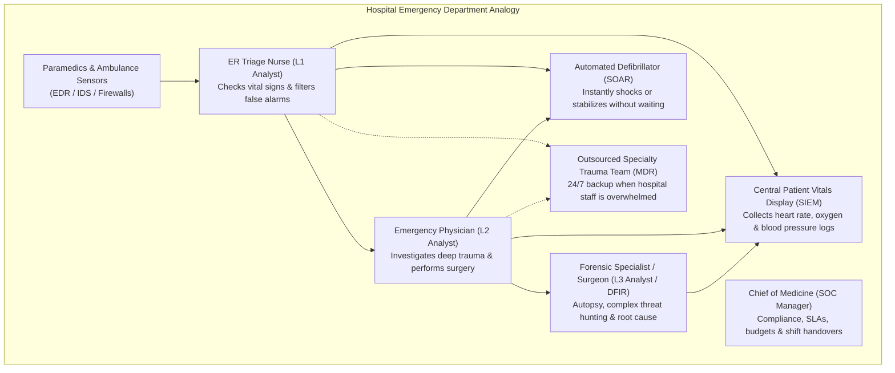
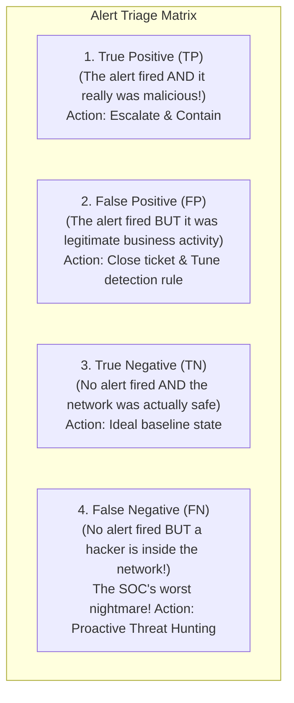

# 00. SOC Beginner's Glossary and Acronym Decoder

Welcome to the **Security Operations Center (SOC)**. If you are new to security operations, the sea of acronyms (SIEM, SOAR, EDR, XDR, MDR, IOC, TTP, PCAP, CVE, DFIR) can feel overwhelming.

This guide is your master decoder. Every term is explained in plain English with everyday real-world analogies.

---

### 🏛️ The SOC Ecosystem: The Hospital Emergency Room Analogy

A modern corporate SOC operates exactly like a major metropolitan hospital:

---

### 📖 Master Acronym Decoder: Alphabetical Rosetta Stone

| Acronym | Full Name | Plain-English Definition | What Problem Does It Solve? |
| :--- | :--- | :--- | :--- |
| **SOC** | **Security Operations Center** | The command center of security analysts monitoring corporate networks 24/7 to catch and stop hackers. | Without a SOC, hackers sit undetected inside enterprise networks for an average of 200+ days before stealing data. |
| **SIEM** | **Security Information & Event Management** | The central database that collects, normalizes, and analyzes log files from thousands of computers, firewalls, and cloud servers. | Instead of checking 5,000 servers individually, all logs stream into one searchable screen (e.g., Splunk, Microsoft Sentinel). |
| **SOAR** | **Security Orchestration, Automation & Response** | The automated robot assistant that executes repetitive playbooks in seconds (e.g., blocking an IP, disabling a compromised account). | Prevents analysts from burning out by automating 80% of repetitive copy-paste triage tasks. |
| **EDR** | **Endpoint Detection & Response** | Next-generation software installed on laptops and servers (e.g., CrowdStrike Falcon, Microsoft Defender) that watches running processes and isolates infected machines. | Old antivirus only caught known files; EDR catches behavioral hacker activity in real time even with zero malware. |
| **XDR** | **Extended Detection & Response** | EDR expanded to correlate data across endpoints, cloud servers, corporate emails, and network firewalls into one timeline. | Eliminates tool silos so you see the entire attack from the initial phishing email to the server breach. |
| **MDR** | **Managed Detection & Response** | An outsourced 24/7 team of elite security analysts who watch your SIEM/EDR alerts and neutralize threats when your internal team is offline. | Provides enterprise-grade 24/7 coverage for companies that cannot afford to hire 15 full-time night-shift analysts. |
| **NDR** | **Network Detection & Response** | Network sensors inspecting raw packet traffic for suspicious communication patterns and data exfiltration. | Catches rogue unmanaged devices (like smart TVs or hacked IoT devices) that don't have EDR agents installed. |
| **IDS** | **Intrusion Detection System** | A network security sensor that detects known attack patterns and sounds an alarm (passive listener). | Like a security guard watching CCTV cameras who shouts: *"Someone just climbed the fence!"* |
| **IPS** | **Intrusion Prevention System** | An active network device that detects attack patterns and **immediately drops the malicious traffic** (active blocker). | Like an automatic security gate that slams shut the instant someone attempts to force entry. |
| **IOC** | **Indicator of Compromise** | Digital evidence that an attack has already occurred (e.g., a known malicious file hash, an attacker IP address, or a phishing domain). | Forensic clues left at a crime scene (like fingerprints, bullet casings, or broken glass). |
| **IOA** | **Indicator of Attack** | Evidence of an attacker's *intent and behavior* occurring right now, regardless of what tools they use. | Like spotting someone wearing a ski mask trying every doorknob in an office hallway at 3:00 AM. |
| **TTP** | **Tactics, Techniques & Procedures** | The habits, behavioral methods, and playbook patterns of a threat actor. | A bank robber's signature style (e.g., always tunneling through the floor on holiday weekends). |
| **MITRE ATT&CK** | **Adversarial Tactics, Techniques & Common Knowledge** | The globally standardized encyclopedia of all known cyberattack techniques used by real-world threat actors. | Provides a common language: instead of saying *"they stole credentials"*, we specify technique `T1003 (OS Credential Dumping)`. |
| **PCAP** | **Packet Capture** | A recorded file of raw network traffic (packets) captured by tools like Wireshark or tcpdump. | Like a complete, unedited audio recording of every phone call that occurred over the network wire. |
| **CVE** | **Common Vulnerabilities & Exposures** | A unique public catalog number assigned to a specific security software flaw (e.g., `CVE-2021-44228` for Log4Shell). | The global serial number for software bugs so security tools around the world reference the exact same issue. |
| **CVSS** | **Common Vulnerability Scoring System** | A standard numerical score from `0.0` to `10.0` measuring the severity and ease of exploit of a software flaw. | `9.0 - 10.0` = Critical (drop everything and patch); `0.1 - 3.9` = Low severity. |
| **DFIR** | **Digital Forensics & Incident Response** | The specialized branch of cybersecurity focused on forensic evidence recovery, malware reverse-engineering, and deep breach investigation. | The crime lab forensic detectives who analyze hard drive memory and rebuild the timeline of a crime for court evidence. |
| **MTTD** | **Mean Time to Detect** | The average time (in minutes or hours) it takes for the SOC to discover a security breach after it starts. | A key metric measuring how fast the alarm bells ring. |
| **MTTR** | **Mean Time to Respond / Remediate** | The average time it takes for the SOC to contain and neutralize a security threat once detected. | Measures how fast the fire department puts out the blaze. |
| **OSINT** | **Open Source Intelligence** | Gathering threat intelligence from publicly accessible sources (VirusTotal, AbuseIPDB, Shodan, public git repos). | Using public records, satellite imagery, and community forums to gather intel on an adversary. |
| **C2 / C&C** | **Command and Control** | The remote server controlled by a hacker that sends instructions to malware infected computers inside your network. | The villain's radio transmitter directing rogue sleeper agents behind enemy lines. |

---

### 🎯 The Four Triage Verdicts (Memorize These for Interviews!)

Every time an alert fires on a SOC analyst's monitor, the analyst must categorize it into one of four buckets:

* **True Positive (TP)**: The smoke alarm went off, and there is a real fire in the kitchen. (Great job! Extinguish it).
* **False Positive (FP)**: The smoke alarm went off because someone burnt toast. (Annoying, but harmless. Tune the toaster or move the sensor).
* **True Negative (TN)**: The alarm is silent because there is no smoke and no fire. (System working normally).
* **False Negative (FN)**: A burglar cut through the back window, stole the jewelry, and the alarm never made a sound! (Catastrophe! You need better sensors and proactive threat hunters).

---

### 🚀 Recommended Next Steps
Now that you speak the language of the SOC, step into the operational roles and daily life of a SOC analyst:
- [01. SOC Overview and Roles: L1, L2, L3 Deep Dive ➡️](./01_SOC_Overview_and_Roles_L1_L2_L3.md)
