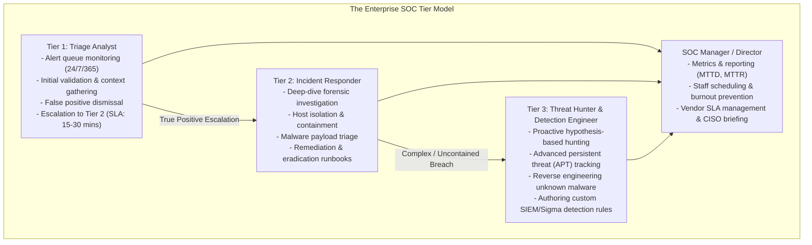

# 01. SOC Overview and Tiered Hierarchy (L1, L2, L3)

[⬅️ Back to Fundamentals](./README.md) | [Next: Threat Landscape Basics ➡️](./02_Cybersecurity_and_Threat_Landscape_Basics.md)

---

### 1. Definition and Purpose

A **Security Operations Center (SOC)** is a centralized organizational unit responsible for continuously monitoring an enterprise's security posture, detecting anomalies, analyzing cyber threats, and orchestrating rapid incident containment and remediation.

> 💡 **Analogy**: The Hospital Emergency Room (ER):
> - **Tier 1 (Triage Nurse)**: Monitors the waiting room. Evaluates incoming patients, checks vital signs (heart rate, temperature), filters out non-emergencies (a mild scratch), and immediately escalates critical trauma patients to doctors.
> - **Tier 2 (Attending ER Physician)**: Takes the trauma patient into surgery. Diagnoses internal bleeding, performs emergency procedures, and stabilizes the patient.
> - **Tier 3 (Specialist Surgeon & Epidemiologist)**: Performs complex neurosurgery, investigates how a new virus entered the population, and redesigns hospital protocols to prevent an outbreak.
> - **SOC Manager (Chief of Medicine)**: Oversees hospital operations, staffing, budgets, compliance, and executive communication.

---

### 2. The Tiered SOC Operational Structure

---

### 3. Detailed Responsibilities by Tier

| Metric / Dimension | Tier 1 (L1) Triage Analyst | Tier 2 (L2) Incident Responder | Tier 3 (L3) Senior Hunter / Engineer |
| :--- | :--- | :--- | :--- |
| **Typical Experience** | 0 – 2 Years | 2 – 5 Years | 5+ Years |
| **Primary Workplace** | Live SIEM Queue (Splunk, Sentinel) | EDR Console, Sandbox, Forensics VM | Jupyter Notebooks, Sigma Repo, Threat Intel Feeds |
| **Key Questions Answered** | *"Is this alert a real attack or benign business activity?"* | *"How did the attacker get in, what did they touch, and how do we kick them out?"* | *"What attacks are occurring in our environment that generated NO alerts?"* |
| **Typical Target SLA** | Review & triage within 15–30 minutes | Contain incident within 1–2 hours | Root-cause analysis within 24–48 hours |
| **Everyday Tasks** | - Inspecting IP reputations on VirusTotal - Calling users to verify multi-factor logins - Closing known false positives with notes | - Isolating endpoints via CrowdStrike - Extracting memory dumps with Volatility - Killing malicious processes and tasks | - Developing detection logic in KQL/SPL - Emulating adversary TTPs (Atomic Red Team) - Tracking APT campaigns in MISP |

---

### 4. Key Performance Indicators (KPIs) of a High-Performing SOC

1. **MTTD (Mean Time to Detect)**: Average time elapsed between an attacker's initial malicious action and the generation of a security alert.
2. **MTTA (Mean Time to Acknowledge)**: Average time for an L1 analyst to claim an alert from the queue.
3. **MTTR (Mean Time to Respond / Contain)**: Average time from alert generation to complete isolation of the threat.
4. **False Positive Rate**: Percentage of generated alerts that represent benign operational activity. (A high FP rate leads to dangerous **Alert Fatigue**).
