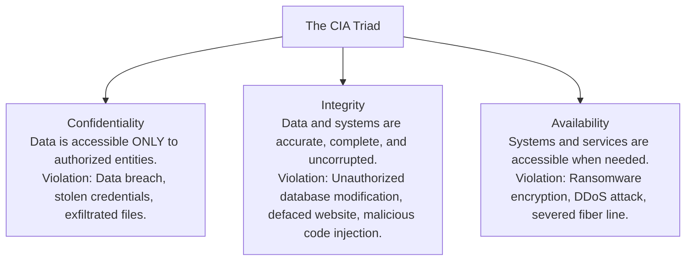

# 02. Cybersecurity Fundamentals and Threat Landscape

[⬅️ Prev: SOC Overview](./01_SOC_Overview_and_Roles_L1_L2_L3.md) | [Back to Fundamentals](./README.md) | [Next: Networking for SOC ➡️](./03_Networking_Fundamentals_for_SOC_Analysts.md)

---

### 1. The CIA Triad: The North Star of Security

Every security event, incident, and architecture is measured against the **CIA Triad**:

---

### 2. Threat Actor Archetypes

Understanding *who* is attacking helps analysts determine the motivation, sophistication, and likely next steps:

| Threat Actor Category | Motivation | Sophistication | Examples / Capabilities |
| :--- | :--- | :--- | :--- |
| **Script Kiddies / Opportunists** | Bragging rights, chaotic curiosity | Low | Running automated public exploit scripts, GitHub tools, automated port scanners without understanding underlying code. |
| **Cybercrime Syndicates (e.g., LockBit, BlackCat)** | Pure financial extortion | High | Ransomware-as-a-Service (RaaS), sophisticated social engineering, initial access broker (IAB) monetization. |
| **Nation-State / APT (Advanced Persistent Threats)** | Geopolitical espionage, intellectual property theft, critical infrastructure sabotage | Elite | Custom zero-day exploits, living-off-the-land techniques (LotL), dormant persistence lasting years (e.g., Cozy Bear/APT29, Lazarus Group). |
| **Malicious Insiders** | Revenge, financial payout, corporate espionage | High (due to existing legitimate access) | Disgruntled employees downloading proprietary code, rogue administrators deleting backups. |

---

### 3. Vulnerability vs Threat vs Risk

These three terms are frequently confused in security reports:

$$\text{Risk} = \text{Threat} \times \text{Vulnerability} \times \text{Impact}$$

- **Vulnerability**: A flaw or weakness in software code, hardware design, or system configuration (e.g., an unpatched Apache server running Log4j).
- **Threat**: Any circumstance or entity with the capability and intent to exploit a vulnerability (e.g., a ransomware gang scanning the internet for Log4j).
- **Risk**: The potential loss or damage resulting from a threat successfully exploiting a vulnerability.
