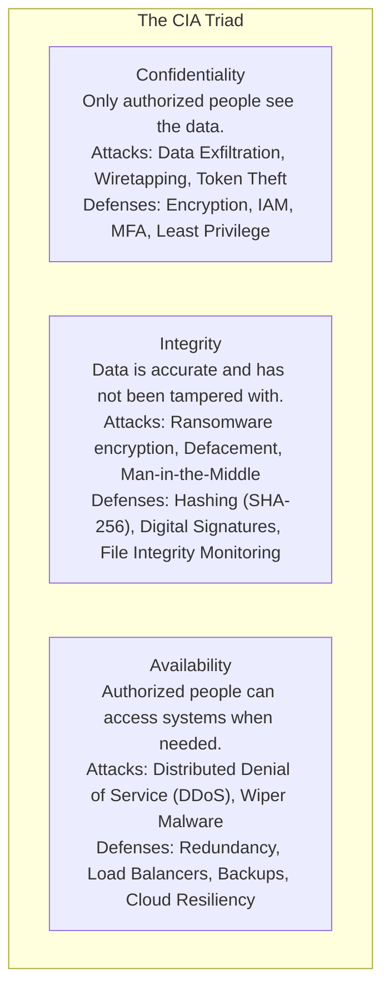
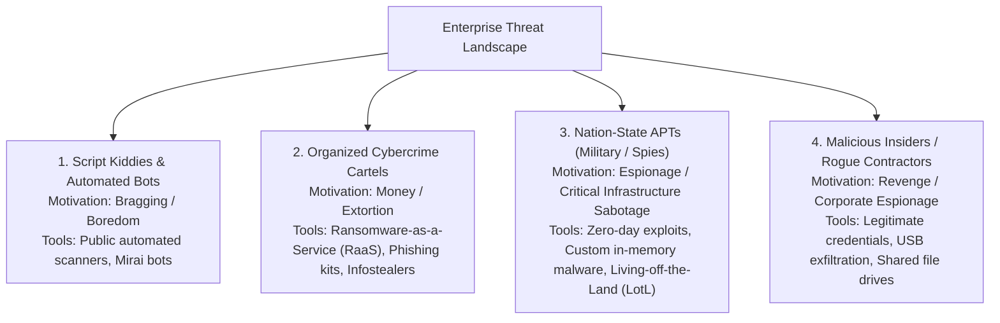
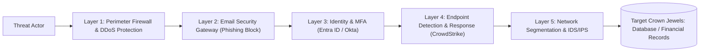

# 02. Cybersecurity and Threat Landscape Basics

[⬅️ Prev: SOC Overview and Roles](./01_SOC_Overview_and_Roles_L1_L2_L3.md) | [Back to Fundamentals](./README.md) | [Next: Networking Fundamentals ➡️](./03_Networking_Fundamentals_for_SOC_Analysts.md)

---

### 🎓 Beginner's Compass: Decoded Acronyms & Terms
- **CIA Triad**: The bedrock cybersecurity model standing for **Confidentiality** (keeping secrets hidden), **Integrity** (preventing data tampering), and **Availability** (ensuring systems stay running).
- **Threat Actor**: Any individual or group executing malicious cyber operations (hackers).
- **APT (Advanced Persistent Threat)**: Elite, nation-state intelligence agencies (e.g., Russia's Fancy Bear, China's APT41, North Korea's Lazarus Group) who spend months stealthily infiltrating critical infrastructure.
- **Ransomware Cartel / Cybercrime Group**: Profit-driven criminal organizations (e.g., LockBit, BlackCat, Akira) who extort multi-million dollar ransoms by encrypting enterprise networks.
- **Attack Surface**: The total sum of all points where an unauthorized user can try to enter or extract data from an environment (every open port, web app, employee inbox, and VPN endpoint).
- **Defense-in-Depth**: Layering multiple defensive controls so that if one security barrier fails, the next one stops the attacker.

---

### 1. The Core Security Model: The CIA Triad

Every security control in a SOC exists to defend one or more pillars of the CIA Triad:

---

### 2. Who is Attacking Organizations? (Threat Actor Taxonomy)

As an analyst, understanding **who** is attacking helps you anticipate their next moves:

| Threat Actor Category | Capability Level | Primary Target | Real-World Example |
| :--- | :--- | :--- | :--- |
| **Commodity Cybercrime** | Moderate | Credit card databases, crypto wallets, consumer data | RedLine Stealer, Agent Tesla keylogger |
| **Ransomware Syndicates** | High | Hospitals, schools, manufacturing, law firms | LockBit 3.0, BlackCat (ALPHV), Cl0p |
| **Nation-State (APTs)** | Maximum (Military grade) | Defense contractors, government ministries, telecom switches | APT29 (Cozy Bear - Russia), Lazarus (North Korea) |
| **Hacktivists** | Low to Moderate | High-profile corporate websites (DDoS, defacement) | Anonymous, Killnet |

---

### 3. The Defense-in-Depth Strategy

Never rely on a single defensive tool. If an attacker bypasses the email firewall, endpoint detection must catch them. If endpoint fails, network monitoring must spot their data exfiltration:

---

### 4. Common Beginner Mistakes vs. Best Practices

| Common Beginner Mistake | Real-World Risk | Industry Best Practice |
| :--- | :--- | :--- |
| **Assuming antivirus blocks everything** | Modern threat actors use "Living-off-the-Land" (LotL) binaries (e.g., PowerShell, `certutil.exe`) that traditional antivirus considers completely harmless. | Deploy **behavioral EDR** that analyzes process trees and execution intent rather than static file signatures. |
| **Ignoring internal network traffic** | Focusing 100% of monitoring on the internet perimeter allows attackers who gain a foothold to move laterally between internal servers unseen. | Monitor internal East-West traffic using **Network Detection and Response (NDR)** and Kerberos/AD security event logs. |
| **Treating all alerts with equal priority** | Spending 45 minutes investigating an automated port-scan alert while a critical ransomware staging alert sits unnoticed in the queue. | Strictly adhere to SOC triage playbooks and queue prioritization matrices (P1 Critical vs P4 Informational). |

---

### 5. Recommended Next Steps
Learn how network communication works and how analysts inspect raw packets:
- [03. Networking Fundamentals for SOC Analysts ➡️](./03_Networking_Fundamentals_for_SOC_Analysts.md)
