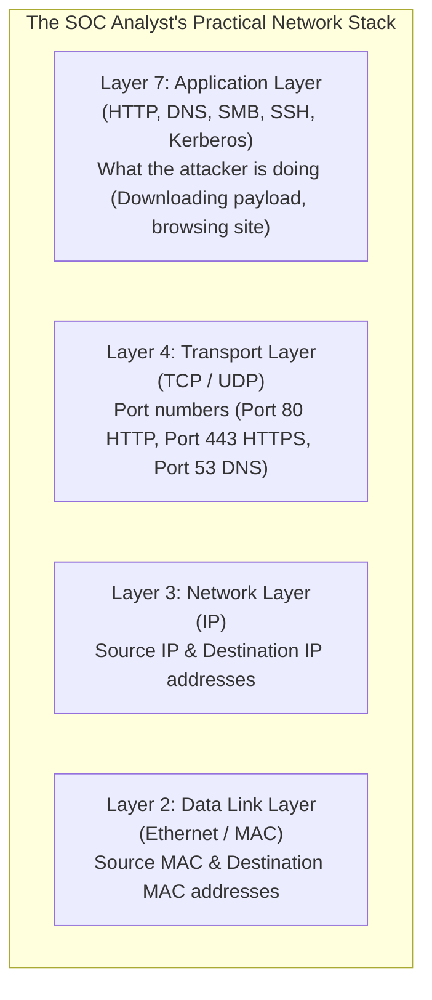
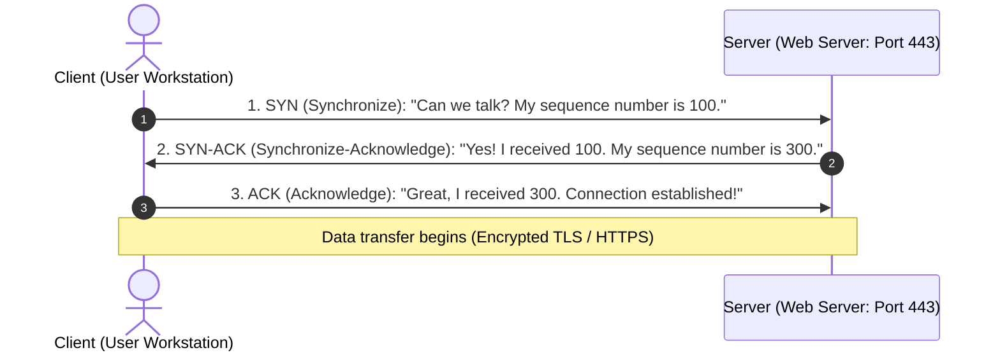

# 03. Networking Fundamentals for SOC Analysts

[⬅️ Prev: Threat Landscape Basics](./02_Cybersecurity_and_Threat_Landscape_Basics.md) | [Back to Fundamentals](./README.md) | [Next: Operating System Fundamentals ➡️](./04_Operating_System_Fundamentals_Windows_and_Linux.md)

---

### 🎓 Beginner's Compass: Decoded Acronyms & Terms
- **Packet**: The fundamental container of digital data sent across a computer network, containing headers (addresses) and payload (data).
- **IP Address (IPv4 / IPv6)**: The logical digital address of a computer (e.g., `192.168.1.50`).
- **MAC Address**: The physical hardware serial number burned into a network card (e.g., `00:1A:2B:3C:4D:5E`).
- **TCP (Transmission Control Protocol)**: A connection-oriented protocol that guarantees reliable, ordered packet delivery using handshakes.
- **UDP (User Datagram Protocol)**: A lightweight, connectionless protocol that sends data without handshakes (used for DNS and live video streaming).
- **DNS (Domain Name System)**: The phonebook of the internet that translates human domain names (`google.com`) into computer IP addresses (`142.250.190.46`). Port 53.
- **Port**: A logical doorway (0 to 65,535) on a computer that directs traffic to a specific software program (e.g., Port 80 for web, Port 22 for SSH).

---

### 1. Plain-English Walkthrough: The Postal Letter Analogy

When a computer sends data over the internet, think of mailing a physical letter:
- **Layer 2 (Data Link - MAC Address)**: The local postal carrier's truck number moving the letter between local sorting hubs.
- **Layer 3 (Network - IP Address)**: The street address and postal zip code written on the envelope (`Destination IP: 203.0.113.10`).
- **Layer 4 (Transport - Port Number)**: The apartment number or office suite (`Port 443`). Without an apartment number, the mailroom doesn't know which tenant receives the letter!
- **Layer 7 (Application - HTTP/DNS Payload)**: The actual letter inside the envelope containing the message.

---

### 2. The TCP 3-Way Handshake (And How Port Scans Work)

Before any TCP communication (web browsing, SSH, file downloads) can occur, client and server must establish a connection via the **3-Way Handshake**:

#### How SOC Analysts Detect Port Scans:
Attackers use tools like **Nmap** to find open doors:
* **TCP SYN Stealth Scan (`nmap -sS`)**: The attacker sends step 1 (`SYN`). If the server responds with step 2 (`SYN-ACK`), the attacker knows the port is open! But instead of completing the handshake with step 3, the attacker sends a `RST` (Reset) packet to tear down the connection before full logging occurs.
* **SOC Detection Rule**: If a single external IP address generates 200+ `SYN` packets to different destination ports within 5 seconds without completing connections, your SIEM fires: *"Port Scan Detected from IP 198.51.100.25"*.

---

### 3. Essential Ports Every SOC Analyst Must Memorize

In technical interviews and daily alert triage, you must instantly recognize these ports:

| Port Number | Protocol | Transport | Typical Security Concern |
| :--- | :--- | :--- | :--- |
| **22** | **SSH** | TCP | Exposed to internet -> Targeted by continuous brute-force attacks. |
| **53** | **DNS** | UDP / TCP | **DNS Tunneling**: Attackers exfiltrate confidential data inside DNS queries. |
| **80** | **HTTP** | TCP | Unencrypted plaintext web traffic; vulnerable to sniffing. |
| **443** | **HTTPS (TLS)** | TCP | 90%+ of malware C2 beacons hide inside encrypted HTTPS traffic! |
| **88** | **Kerberos** | TCP / UDP | Active Directory domain authentication; targeted by Kerberoasting. |
| **389 / 636** | **LDAP / LDAPS** | TCP | Directory queries; cleartext passwords exposed if using 389 instead of 636. |
| **445** | **SMB** | TCP | File sharing; used by ransomware (WannaCry, EternalBlue) for lateral movement! |
| **3389** | **RDP** | TCP | Remote Desktop; should NEVER be exposed directly to the public internet. |

---

### 4. Common Beginner Mistakes vs. Best Practices

| Common Beginner Mistake | Real-World Risk | Industry Best Practice |
| :--- | :--- | :--- |
| **Assuming internal IPs are safe** | Seeing private RFC 1918 IPs (`10.0.0.0/8`, `192.168.0.0/16`) and assuming the traffic is harmless ignores active internal lateral movement. | Investigate internal-to-internal anomalies (e.g., an accountant laptop making SMB connections to 50 other laptops). |
| **Ignoring DNS query logs** | Focusing only on HTTP URLs allows stealthy malware that communicates via dynamic DNS or IP-less beaconing to go undetected. | Ingest all internal DNS query logs into your SIEM; monitor for anomalous domain length and high-entropy TXT records. |
| **Confusing Public vs Private IPs** | Misidentifying private loopback (`127.0.0.1`) or link-local (`169.254.x.x`) traffic as external attacks wastes hours of triage time. | Memorize RFC 1918 private subnets: `10.0.0.0/8`, `172.16.0.0/12`, and `192.168.0.0/16`. |

---

### 5. Recommended Next Steps
Learn how operating systems execute processes, record event logs, and leave forensic artifacts:
- [04. Operating System Fundamentals for Windows and Linux ➡️](./04_Operating_System_Fundamentals_Windows_and_Linux.md)
