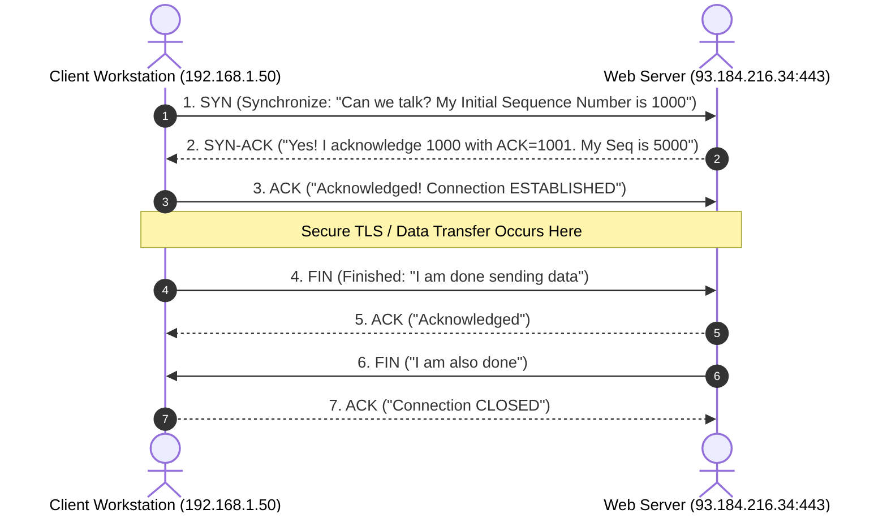

# 03. Networking Fundamentals for SOC Analysts

[⬅️ Prev: Threat Landscape Basics](./02_Cybersecurity_and_Threat_Landscape_Basics.md) | [Back to Fundamentals](./README.md) | [Next: Operating Systems for SOC ➡️](./04_Operating_System_Fundamentals_Windows_and_Linux.md)

---

### 1. Why SOC Analysts Must Master Networking

Attacks almost never occur in isolation on an air-gapped machine. Threat actors communicate over networks to deliver payloads, execute lateral movement, establish Command and Control (C2) beacons, and exfiltrate confidential databases. If you cannot read network packets, you are blind to 80% of adversary activity.

---

### 2. The TCP/IP Model and Key Protocols

```
┌─────────────────────────────────┐
│ Layer 4: Application Layer      │ HTTP (80), HTTPS (443), DNS (53), SSH (22), SMB (445), RDP (3389)
├─────────────────────────────────┤
│ Layer 3: Transport Layer        │ TCP (Reliable, Connection-Oriented) vs UDP (Fast, Connectionless)
├─────────────────────────────────┤
│ Layer 2: Internet / IP Layer    │ IPv4 / IPv6, ICMP (Ping), Routing, IP Headers
├─────────────────────────────────┤
│ Layer 1: Network Access / Link  │ Ethernet, MAC Addresses, ARP, Switches
└─────────────────────────────────┘
```

---

### 3. The TCP Three-Way Handshake & Teardown

Every standard TCP connection (web browsing, database queries, SSH) begins with a 3-way handshake:



#### What the SOC Analyst Looks For in Packet Logs:
- **SYN Floods (DDoS)**: Thousands of incoming SYN packets without completing the third ACK step, exhausting server connection tables.
- **Port Scanning (SYN Scan / Half-Open)**: Tools like Nmap send a SYN packet; if the server replies SYN-ACK, Nmap records the port as open and immediately sends an `RST` (Reset) packet to close the connection before application logging triggers.

---

### 4. Critical Protocols Every Analyst Must Inspect

#### A. DNS (Domain Name System - Port 53)
- **Role**: Translates human-readable names (`google.com`) into IP addresses (`142.250.190.46`).
- **SOC Threat Vectors**:
  - **DGA (Domain Generation Algorithms)**: Malware generating 1,000 random domains a day (`asdf9482ks.biz`) to contact C2.
  - **DNS Tunneling / Exfiltration**: Attackers encoding confidential data inside DNS queries (`TXT base64encodeddata.attacker.com`).

#### B. SMB (Server Message Block - Port 445)
- **Role**: Windows file sharing and named pipes.
- **SOC Threat Vectors**: The primary highway for internal **lateral movement** (PsExec, EternalBlue exploit, ransomware spreading between corporate PCs).

#### C. RDP (Remote Desktop Protocol - Port 3389)
- **Role**: Windows graphical remote administration.
- **SOC Threat Vectors**: External internet-facing RDP servers targeted with brute-force password spraying.
