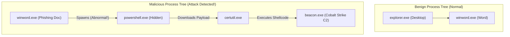

# 04. Operating System Fundamentals: Windows and Linux

[⬅️ Prev: Networking Fundamentals](./03_Networking_Fundamentals_for_SOC_Analysts.md) | [Back to Fundamentals](./README.md) | [Next: Core Concepts Track ➡️](../02_Core_Concepts/README.md)

---

### 🎓 Beginner's Compass: Decoded Acronyms & Terms
- **Event Log**: A structured record generated by the operating system detailing system health, user logins, and software execution.
- **Sysmon (System Monitor)**: A free Windows system service from Microsoft Sysinternals that provides advanced monitoring of process creation, network connections, and file changes.
- **PID (Process Identifier)**: A unique numerical ID assigned by the OS to every running program (e.g., `PID 4092`).
- **PPID (Parent Process Identifier)**: The PID of the program that launched another program (e.g., if Microsoft Word launches PowerShell, Word's PID is the PPID).
- **Windows Registry**: A massive hierarchical database in Windows storing low-level operating system and application configuration settings.
- **`/var/log/`**: The standard directory in Linux where system and authentication logs are stored.

---

### 1. Plain-English Walkthrough: The Process Tree & Malicious Spawning

In modern cybersecurity, **who launched whom** is the #1 indicator of compromise.

#### The Concept of Parent-Child Processes:
* When you open Windows Explorer and double-click `calc.exe`, `explorer.exe` (Parent) spawns `calc.exe` (Child). That is completely **normal**.
* But when an employee opens a Microsoft Word document (`winword.exe`), and Word suddenly spawns PowerShell (`powershell.exe`), which immediately launches a hidden command prompt (`cmd.exe`):
  * **That is 99.9% malicious!** Office programs should never run command-line scripting engines.



---

### 2. Windows Event Logs Every Analyst Must Memorize

Windows logs thousands of events into the **Security Log**. Memorize these 6 Event IDs for interviews and daily triage:

| Event ID | Event Name | Significance for SOC Analysts |
| :--- | :--- | :--- |
| **`4624`** | **Successful Logon** | Contains **Logon Type**: Type 2 = Interactive (keyboard), Type 3 = Network (file share/SMB), Type 10 = Remote Desktop (RDP). |
| **`4625`** | **Failed Logon** | Indicates wrong password or brute-force attempt. Look for hundreds of 4625 events from a single IP. |
| **`4688`** | **A New Process Has Been Created** | Crucial for threat hunting! When command-line auditing is enabled, it records the exact command typed by the user or malware. |
| **`7045`** | **A New Service Was Installed** | Hackers frequently install malicious Windows services to maintain persistence across reboots. |
| **`4720`** | **A User Account Was Created** | Unauthorized backdoor user created by an attacker who gained admin access. |
| **`1102`** | **The Audit Log Was Cleared** | High-severity red alert! Attackers clear event logs to hide their tracks before disconnecting. |

---

### 3. Microsoft Sysmon: The SOC Analyst's Best Friend

While default Windows logging is basic, **Sysmon** provides rich forensic telemetry:

* **Event ID 1: Process Creation**: Logs the process name, full command-line arguments, hashes (MD5/SHA256), and parent process name.
* **Event ID 3: Network Connection Detected**: Logs which specific `.exe` initiated an outbound connection, along with source/destination IP and port.
* **Event ID 10: ProcessAccess**: Detects when a program tries to read the memory of `lsass.exe` (the Windows authentication subsystem). **This catches Mimikatz password dumping!**
* **Event ID 11: FileCreate**: Detects when a file is written to disk (e.g., executable dropped into `C:\Users\Public\`).

---

### 4. Linux Forensics Fundamentals

In Linux environments (cloud servers, web servers, containers):

#### Key Log Files:
* `/var/log/auth.log` (Debian/Ubuntu) or `/var/log/secure` (RHEL/CentOS): Records all SSH logins, failed authentications, and `sudo` privilege elevations.
* `/var/log/syslog` or `/var/log/messages`: General operating system and daemon events.
* `~/.bash_history`: Records commands typed by users in interactive bash terminals (unless the attacker ran `unset HISTFILE`).

#### Essential Linux Commands for Incident Responders:
```bash
# 1. View all listening network ports and which process owns them
sudo netstat -tulpn   # or: sudo ss -tulpn

# 2. Inspect running processes sorted by resource usage
ps aux --sort=-%mem | head -n 20

# 3. Check scheduled cron jobs (common persistence location for Linux backdoors)
crontab -l
ls -la /etc/cron.* /etc/crontab

# 4. View who is currently logged into the server
who
w
last -n 20
```

---

### 5. Common Beginner Mistakes vs. Best Practices

| Common Beginner Mistake | Real-World Risk | Industry Best Practice |
| :--- | :--- | :--- |
| **Relying solely on process names** | Hackers name their malware `svchost.exe` or `explorer.exe` to blend in. | Always verify the **File Path** (legitimate `svchost.exe` lives strictly in `C:\Windows\System32\`, never in `AppData` or `Temp`) and verify the digital signature. |
| **Ignoring Command-Line Auditing** | Seeing that `powershell.exe` ran without knowing what arguments it passed leaves investigators blind. | Enable Windows Policy: *"Include command line in process creation events"* (Event 4688) or deploy Sysmon Event 1. |
| **Not checking persistence mechanisms** | Killing a malicious running process without checking the Windows Registry `Run` keys or Linux crontab means the malware re-infects on reboot. | Check common persistence hooks: Registry `HKLM\Software\Microsoft\Windows\CurrentVersion\Run` and Scheduled Tasks. |

---

### 6. Recommended Next Steps
Now that you understand the operating system and network foundations, dive into how telemetry is gathered and analyzed across the enterprise:
- [02. Core Concepts: Security Monitoring and Telemetry ➡️](../02_Core_Concepts/01_Security_Monitoring_and_Telemetry.md)
