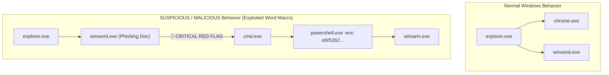

# 04. Operating System Fundamentals: Windows and Linux Internals

[⬅️ Prev: Networking for SOC](./03_Networking_Fundamentals_for_SOC_Analysts.md) | [Back to Fundamentals](./README.md) | [Next: Core Concepts Track ➡️](../02_Core_Concepts/README.md)

---

### 1. Windows Internals for Security Analysts

Windows dominates corporate desktop and server infrastructure. Understanding processes, the registry, and event logs is mandatory.

#### A. The Process Tree & Parent-Child Relationships
Every running program is a process spawned by a parent process. Malicious behavior is frequently spotted simply by identifying abnormal parent-child relationships:



> 🚨 **SOC Rule of Thumb**: Microsoft Word or Excel should **NEVER** spawn `cmd.exe`, `powershell.exe`, `certutil.exe`, or `cscript.exe`. When you see Word spawning a shell, an exploit or malicious macro has executed.

#### B. Critical Windows Security Event IDs

| Event ID | Event Description | SOC Analyst Significance |
| :--- | :--- | :--- |
| **4624** | Successful Account Logon | Check Logon Type (Type 2 = Interactive local, Type 3 = Network/SMB, Type 10 = RDP). |
| **4625** | Failed Account Logon | Spike indicates brute-force or credential spraying. |
| **4688** | A New Process Has Been Created | Inspect process name, parent process, and full command line! |
| **4720** | A User Account Was Created | Rogue account persistence check. |
| **4728 / 4732** | Member Added to Privileged Group | User added to Domain Admins or Local Administrators! |
| **7045** | A Service Was Installed on the System | Common persistence and privilege escalation mechanism. |

---

### 2. Linux Internals for Security Analysts

Linux powers the majority of cloud servers, web applications, and database engines.

#### Key Log Directories (`/var/log`):
- `/var/log/auth.log` (Ubuntu/Debian) or `/var/log/secure` (RHEL/CentOS): Records all SSH logins, sudo commands, and PAM authentication attempts.
- `/var/log/syslog` or `/var/log/messages`: General system OS events and daemon activities.
- `/var/log/audit/audit.log`: Granular Linux Audit Daemon (auditd) events recording system calls, file modifications, and process executions.

#### Essential Linux Investigation Commands:
```bash
# Check running processes and their parent PIDs
ps auxf

# Identify active listening network sockets and corresponding process names
netstat -tulpn  # or 'ss -tulpn'

# View last 50 failed SSH authentication attempts
grep "Failed password" /var/log/auth.log | tail -n 50

# Inspect scheduled cron jobs for persistence
cat /etc/crontab
crontab -l
ls -la /etc/cron.*
```
