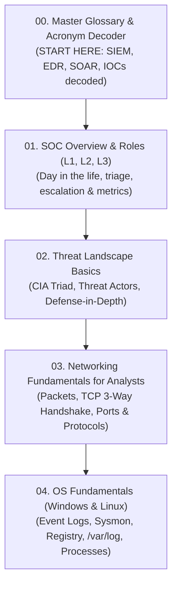

# 01. SOC Fundamentals Track

Welcome to the **Security Operations Center (SOC) Fundamentals** module. This track builds the bedrock knowledge required to analyze security telemetry, understand computer networks, inspect operating systems, and understand the roles within a modern defensive security team.

---

### 🗺️ Module Learning Pathway

---

### 📚 Topics in This Module

| Document | Primary Focus | Practical Takeaway |
| :--- | :--- | :--- |
| **[00. Master Glossary & Decoder](./00_SOC_Beginners_Glossary_and_Acronym_Decoder.md)** | Industry vocabulary & acronyms | Never feel confused by SIEM, EDR, SOAR, or IOCs again. |
| **[01. SOC Overview and Roles](./01_SOC_Overview_and_Roles_L1_L2_L3.md)** | Responsibilities of Tier 1, 2, and 3 analysts | Understand where you fit in the organization and how shifts operate. |
| **[02. Threat Landscape Basics](./02_Cybersecurity_and_Threat_Landscape_Basics.md)** | APTs, ransomware gangs, and attack surfaces | Understand who is attacking enterprises and what they want. |
| **[03. Networking Fundamentals](./03_Networking_Fundamentals_for_SOC_Analysts.md)** | Wireshark, OSI, DNS, HTTP, and ports | Inspect real network packets and spot malicious traffic. |
| **[04. OS Fundamentals](./04_Operating_System_Fundamentals_Windows_and_Linux.md)** | Windows Event Logs, Sysmon, and Linux artifacts | Read forensic evidence on compromised workstations and servers. |
